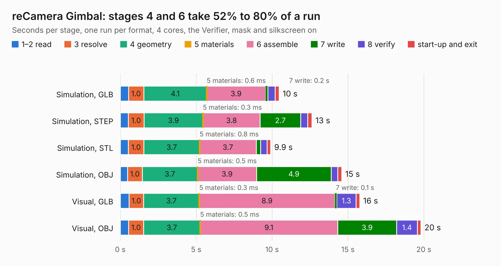

# 2527. reCamera Gimbal

Board 2,527 of the 3,120 of [Corpus Testing](../Corpus-Testing.md), on [Corpus Page 24](../CorpusTestingPages/Corpus-Testing-24.md#2527-recamera-gimbal).

| Mode and format | 1–2 read | 3 resolve | 4 geometry | 5 materials | 6 assemble | 7 write | 8 verify | start-up and exit | Total |
|---|---:|---:|---:|---:|---:|---:|---:|---:|---:|
| Simulation, GLB | 0.5 | 1.0 | 4.1 | 0.6&nbsp;ms | 3.9 | 0.2 | 0.5 | 0.3 | 10.5 |
| Simulation, STEP | 0.5 | 1.0 | 3.9 | 0.3&nbsp;ms | 3.8 | 2.7 | 0.5 | 0.3 | 12.6 |
| Simulation, STL | 0.5 | 1.0 | 3.7 | 0.8&nbsp;ms | 3.7 | 0.3 | 0.4 | 0.2 | 9.9 |
| Simulation, OBJ | 0.5 | 1.0 | 3.7 | 0.5&nbsp;ms | 3.9 | 4.9 | 0.4 | 0.3 | 14.6 |
| Visual, GLB | 0.6 | 1.0 | 3.7 | 0.3&nbsp;ms | 8.9 | 0.1 | 1.3 | 0.2 | 15.8 |
| Visual, OBJ | 0.5 | 1.0 | 3.7 | 0.5&nbsp;ms | 9.1 | 3.9 | 1.4 | 0.2 | 19.8 |

<table align="center"><tr><td valign="top">

| Board | Repo: [Seeed-Studio/OSHW-reCamera-Series](https://github.com/Seeed-Studio/OSHW-reCamera-Series) Board: `reCamera Gimbal.kicad_pcb` |
|---|---|
| Folder | hardware / recamera-2002 / base / b401-can / PCB / B4_v0.2 |
| Complexity | 289&nbsp;/&nbsp;1000 (size&nbsp;184, features&nbsp;105) |
| KESE&nbsp;features | through vias, slotted holes, custom pads, rounded, trapezoid or chamfered pads, arc tracks, filled zones, copper drawings, curved board outline |
| Tested | 9th November 2026 |
| Copper&nbsp;layers | 2 |
| File&nbsp;format | KiCad 8 (20240108) |
| Parts,&nbsp;tracks,&nbsp;vias | 108, 515, 237 |
| Triangles,&nbsp;simulation | 970,442 in 115 parts |
| Verifier | PASS in all six runs |

</td><td valign="top">

<table>
<tr><th>File type</th><th>File size</th><th>Peak memory used</th></tr>
<tr><th colspan="3" align="left">Simulation</th></tr>
<tr><td>GLB</td><td align="right">34&nbsp;MB</td><td align="right">506&nbsp;MB</td></tr>
<tr><td>STEP</td><td align="right">176&nbsp;MB</td><td align="right">539&nbsp;MB</td></tr>
<tr><td>STL</td><td align="right">49&nbsp;MB</td><td align="right">502&nbsp;MB</td></tr>
<tr><td>OBJ</td><td align="right">100&nbsp;MB</td><td align="right">686&nbsp;MB</td></tr>
<tr><th colspan="3" align="left">Visual</th></tr>
<tr><td>GLB</td><td align="right">26&nbsp;MB</td><td align="right">606&nbsp;MB</td></tr>
<tr><td>OBJ</td><td align="right">79&nbsp;MB</td><td align="right">642&nbsp;MB</td></tr>
</table>

</td></tr></table>

| Previous | Next |
|:---|---:|
| [2526. reCamera B101_B4_Gyro v0.1](b2526b_OSHW-reCamera-Series_reCamera-B101-B4-Gyro-v0-1.md) | [2528. reCamera Basically Board](b2528b_OSHW-reCamera-Series_reCamera-Basically-Board.md) |
