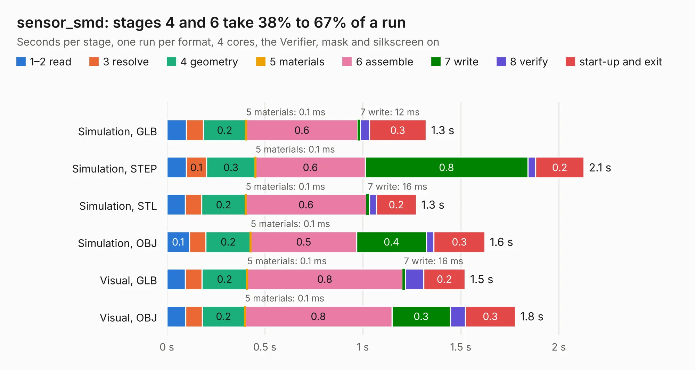

# 2528. sensor_smd

Board 2,528 of the 3,131 of [Corpus Testing](../Corpus-Testing.md), on [Corpus Page 24](../CorpusTestingPages/Corpus-Testing-24.md#2528-sensor_smd).

| Mode and format | 1–2 read | 3 resolve | 4 geometry | 5 materials | 6 assemble | 7 write | 8 verify | start-up and exit | Total |
|---|---:|---:|---:|---:|---:|---:|---:|---:|---:|
| Simulation, GLB | 99&nbsp;ms | 87&nbsp;ms | 0.2 | 0.1&nbsp;ms | 0.6 | 12&nbsp;ms | 47&nbsp;ms | 0.3 | 1.3 |
| Simulation, STEP | 99&nbsp;ms | 0.1 | 0.3 | 0.1&nbsp;ms | 0.6 | 0.8 | 40&nbsp;ms | 0.2 | 2.1 |
| Simulation, STL | 94&nbsp;ms | 83&nbsp;ms | 0.2 | 0.1&nbsp;ms | 0.6 | 16&nbsp;ms | 35&nbsp;ms | 0.2 | 1.3 |
| Simulation, OBJ | 0.1 | 83&nbsp;ms | 0.2 | 0.1&nbsp;ms | 0.5 | 0.4 | 39&nbsp;ms | 0.3 | 1.6 |
| Visual, GLB | 95&nbsp;ms | 85&nbsp;ms | 0.2 | 0.1&nbsp;ms | 0.8 | 16&nbsp;ms | 93&nbsp;ms | 0.2 | 1.5 |
| Visual, OBJ | 96&nbsp;ms | 85&nbsp;ms | 0.2 | 0.1&nbsp;ms | 0.8 | 0.3 | 76&nbsp;ms | 0.3 | 1.8 |

<table align="center"><tr><td valign="top">

| Board | Repo: [scottbez1/splitflap](https://github.com/scottbez1/splitflap) Board: `sensor_smd.kicad_pcb` |
|---|---|
| Folder | electronics / sensor_smd |
| Complexity | 177&nbsp;/&nbsp;1000 (size&nbsp;92, features&nbsp;85) |
| KESE&nbsp;features | through vias, rounded, trapezoid or chamfered pads, filled zones, curved board outline, stack-up, dielectric εr and tanδ |
| Tested | 10th November 2026 |
| Copper&nbsp;layers | 2 |
| File&nbsp;format | KiCad 6 (20211014) |
| Parts,&nbsp;tracks,&nbsp;vias | 5, 24, 2 |
| Triangles,&nbsp;simulation | 60,768 in 17 parts |
| Verifier | PASS in all six runs |

</td><td valign="top">

<table>
<tr><th>File type</th><th>File size</th><th>Peak memory used</th></tr>
<tr><th colspan="3" align="left">Simulation</th></tr>
<tr><td>GLB</td><td align="right">2.1&nbsp;MB</td><td align="right">73&nbsp;MB</td></tr>
<tr><td>STEP</td><td align="right">11&nbsp;MB</td><td align="right">186&nbsp;MB</td></tr>
<tr><td>STL</td><td align="right">3.0&nbsp;MB</td><td align="right">73&nbsp;MB</td></tr>
<tr><td>OBJ</td><td align="right">5.8&nbsp;MB</td><td align="right">87&nbsp;MB</td></tr>
<tr><th colspan="3" align="left">Visual</th></tr>
<tr><td>GLB</td><td align="right">1.8&nbsp;MB</td><td align="right">108&nbsp;MB</td></tr>
<tr><td>OBJ</td><td align="right">5.0&nbsp;MB</td><td align="right">107&nbsp;MB</td></tr>
</table>

</td></tr></table>

| Previous | Next |
|:---|---:|
| [2527. sensor](b2527b_splitflap_sensor.md) | [2529. mppt](b2529b_mppt_mppt.md) |
