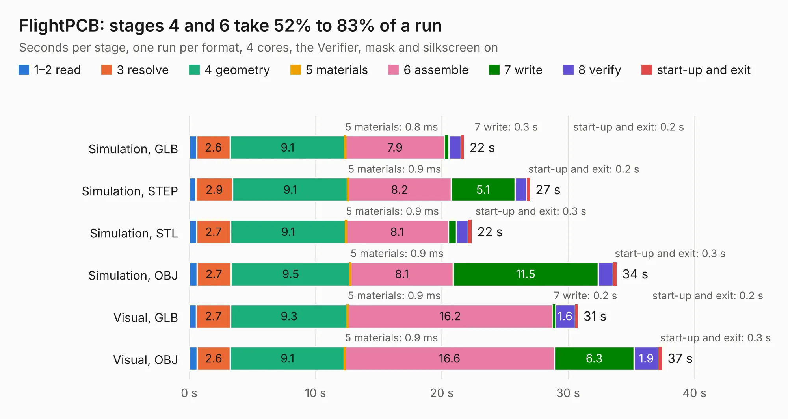

# 2528. FlightPCB

Board 2,528 of the 3,110 of [Corpus Testing](../Corpus-Testing.md), on [Corpus Page 24](../CorpusTestingPages/Corpus-Testing-24.md#2528-flightpcb).

| Mode and format | 1–2 read | 3 resolve | 4 geometry | 5 materials | 6 assemble | 7 write | 8 verify | start-up and exit | Total |
|---|---:|---:|---:|---:|---:|---:|---:|---:|---:|
| Simulation, GLB | 0.6 | 2.6 | 9.1 | 0.8&nbsp;ms | 7.9 | 0.3 | 1.0 | 0.2 | 21.7 |
| Simulation, STEP | 0.5 | 2.9 | 9.1 | 0.9&nbsp;ms | 8.2 | 5.1 | 1.0 | 0.2 | 27.0 |
| Simulation, STL | 0.6 | 2.7 | 9.1 | 0.9&nbsp;ms | 8.1 | 0.6 | 0.9 | 0.3 | 22.4 |
| Simulation, OBJ | 0.6 | 2.7 | 9.5 | 0.9&nbsp;ms | 8.1 | 11.5 | 1.2 | 0.3 | 33.8 |
| Visual, GLB | 0.5 | 2.7 | 9.3 | 0.9&nbsp;ms | 16.2 | 0.2 | 1.6 | 0.2 | 30.8 |
| Visual, OBJ | 0.6 | 2.6 | 9.1 | 0.9&nbsp;ms | 16.6 | 6.3 | 1.9 | 0.3 | 37.4 |

<table align="center"><tr><td valign="top">

| Board | Repo: [shubhamai/tsar](https://github.com/shubhamai/tsar) Board: `FlightPCB.kicad_pcb` |
|---|---|
| Folder | v2 |
| Complexity | 368&nbsp;/&nbsp;1000 (size&nbsp;253, features&nbsp;115) |
| KESE&nbsp;features | through vias, slotted holes, rounded, trapezoid or chamfered pads, arc tracks, filled zones, TrueType text, stack-up, dielectric εr and tanδ |
| Tested | 9th November 2026 |
| Copper&nbsp;layers | 4 |
| File&nbsp;format | KiCad 8 (20240108) |
| Parts,&nbsp;tracks,&nbsp;vias | 132, 1,661, 205 |
| Triangles,&nbsp;simulation | 2,181,068 in 169 parts |
| Verifier | PASS in all six runs |

</td><td valign="top">

<table>
<tr><th>File type</th><th>File size</th><th>Peak memory used</th></tr>
<tr><th colspan="3" align="left">Simulation</th></tr>
<tr><td>GLB</td><td align="right">76&nbsp;MB</td><td align="right">732&nbsp;MB</td></tr>
<tr><td>STEP</td><td align="right">333&nbsp;MB</td><td align="right">889&nbsp;MB</td></tr>
<tr><td>STL</td><td align="right">109&nbsp;MB</td><td align="right">737&nbsp;MB</td></tr>
<tr><td>OBJ</td><td align="right">232&nbsp;MB</td><td align="right">1.5&nbsp;GB</td></tr>
<tr><th colspan="3" align="left">Visual</th></tr>
<tr><td>GLB</td><td align="right">40&nbsp;MB</td><td align="right">872&nbsp;MB</td></tr>
<tr><td>OBJ</td><td align="right">123&nbsp;MB</td><td align="right">908&nbsp;MB</td></tr>
</table>

</td></tr></table>

| Previous | Next |
|:---|---:|
| [2527. FlightPCB](b2527b_tsar_v1_FlightPCB.md) | [2529. FlightPCB](b2529b_tsar_v3_FlightPCB.md) |
