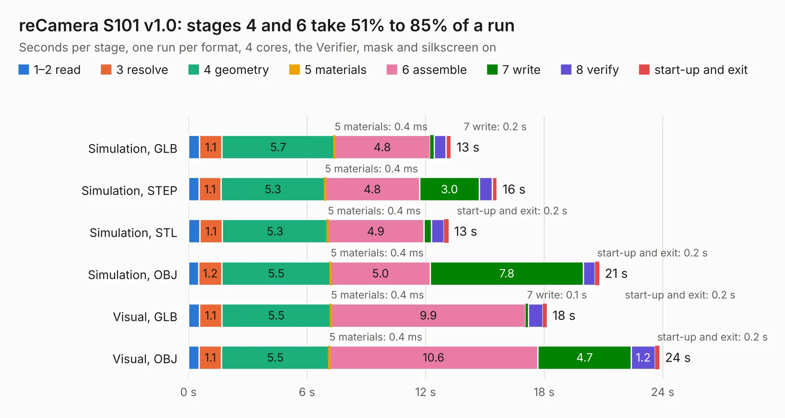

# 2531. reCamera S101 v1.0

Board 2,531 of the 3,122 of [Corpus Testing](../Corpus-Testing.md), on [Corpus Page 24](../CorpusTestingPages/Corpus-Testing-24.md#2531-recamera-s101-v10).

| Mode and format | 1–2 read | 3 resolve | 4 geometry | 5 materials | 6 assemble | 7 write | 8 verify | start-up and exit | Total |
|---|---:|---:|---:|---:|---:|---:|---:|---:|---:|
| Simulation, GLB | 0.6 | 1.1 | 5.7 | 0.4&nbsp;ms | 4.8 | 0.2 | 0.6 | 0.2 | 13.3 |
| Simulation, STEP | 0.5 | 1.1 | 5.3 | 0.4&nbsp;ms | 4.8 | 3.0 | 0.7 | 0.2 | 15.6 |
| Simulation, STL | 0.6 | 1.1 | 5.3 | 0.4&nbsp;ms | 4.9 | 0.4 | 0.6 | 0.2 | 13.2 |
| Simulation, OBJ | 0.5 | 1.2 | 5.5 | 0.4&nbsp;ms | 5.0 | 7.8 | 0.6 | 0.2 | 20.8 |
| Visual, GLB | 0.6 | 1.1 | 5.5 | 0.4&nbsp;ms | 9.9 | 0.1 | 0.8 | 0.2 | 18.1 |
| Visual, OBJ | 0.5 | 1.1 | 5.5 | 0.4&nbsp;ms | 10.6 | 4.7 | 1.2 | 0.2 | 23.8 |

<table align="center"><tr><td valign="top">

| Board | Repo: [Seeed-Studio/OSHW-reCamera-Series](https://github.com/Seeed-Studio/OSHW-reCamera-Series) Board: `reCamera S101 v1.0.kicad_pcb` |
|---|---|
| Folder | hardware / recamera-2002 / sensors / s101-ov5647 / PCB / V1.0 |
| Complexity | 325&nbsp;/&nbsp;1000 (size&nbsp;200, features&nbsp;125) |
| KESE&nbsp;features | through vias, custom pads, rounded, trapezoid or chamfered pads, filled zones, copper drawings, curved board outline, stack-up, dielectric εr and tanδ, copper finish |
| Tested | 9th November 2026 |
| Copper&nbsp;layers | 4 |
| File&nbsp;format | KiCad 8 (20240108) |
| Parts,&nbsp;tracks,&nbsp;vias | 82, 532, 301 |
| Triangles,&nbsp;simulation | 1,511,908 in 97 parts |
| Verifier | PASS in all six runs |

</td><td valign="top">

<table>
<tr><th>File type</th><th>File size</th><th>Peak memory used</th></tr>
<tr><th colspan="3" align="left">Simulation</th></tr>
<tr><td>GLB</td><td align="right">51&nbsp;MB</td><td align="right">636&nbsp;MB</td></tr>
<tr><td>STEP</td><td align="right">202&nbsp;MB</td><td align="right">696&nbsp;MB</td></tr>
<tr><td>STL</td><td align="right">76&nbsp;MB</td><td align="right">580&nbsp;MB</td></tr>
<tr><td>OBJ</td><td align="right">154&nbsp;MB</td><td align="right">994&nbsp;MB</td></tr>
<tr><th colspan="3" align="left">Visual</th></tr>
<tr><td>GLB</td><td align="right">30&nbsp;MB</td><td align="right">746&nbsp;MB</td></tr>
<tr><td>OBJ</td><td align="right">92&nbsp;MB</td><td align="right">715&nbsp;MB</td></tr>
</table>

</td></tr></table>

| Previous | Next |
|:---|---:|
| [2530. reCamera Basically Board](b2530b_OSHW-reCamera-Series_reCamera-Basically-Board.md) | [2532. reCamera S101 v1.1](b2532b_OSHW-reCamera-Series_reCamera-S101-v1-1.md) |
