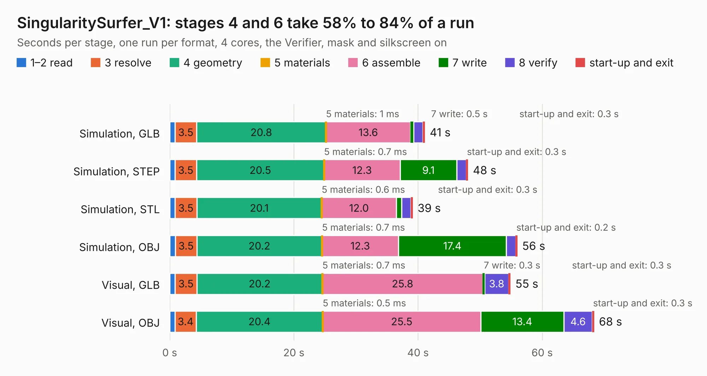

# 2531. SingularitySurfer_V1

Board 2,531 of the 3,105 of [Corpus Testing](../Corpus-Testing.md), on [Corpus Page 24](../CorpusTestingPages/Corpus-Testing-24.md#2531-singularitysurfer_v1).

| Mode and format | 1–2 read | 3 resolve | 4 geometry | 5 materials | 6 assemble | 7 write | 8 verify | start-up and exit | Total |
|---|---:|---:|---:|---:|---:|---:|---:|---:|---:|
| Simulation, GLB | 0.9 | 3.5 | 20.8 | 1&nbsp;ms | 13.6 | 0.5 | 1.5 | 0.3 | 41.1 |
| Simulation, STEP | 0.9 | 3.5 | 20.5 | 0.7&nbsp;ms | 12.3 | 9.1 | 1.5 | 0.3 | 48.0 |
| Simulation, STL | 0.8 | 3.5 | 20.1 | 0.6&nbsp;ms | 12.0 | 0.9 | 1.5 | 0.3 | 39.1 |
| Simulation, OBJ | 0.9 | 3.5 | 20.2 | 0.7&nbsp;ms | 12.3 | 17.4 | 1.5 | 0.2 | 56.0 |
| Visual, GLB | 0.9 | 3.5 | 20.2 | 0.7&nbsp;ms | 25.8 | 0.3 | 3.8 | 0.3 | 54.9 |
| Visual, OBJ | 0.8 | 3.4 | 20.4 | 0.5&nbsp;ms | 25.5 | 13.4 | 4.6 | 0.3 | 68.3 |

<table align="center"><tr><td valign="top">

| Board | Repo: [SingularitySurfer/SingularitySurfer-FPGA-Lock-In-Amplifier](https://github.com/SingularitySurfer/SingularitySurfer-FPGA-Lock-In-Amplifier) Board: `SingularitySurfer_V1.kicad_pcb` |
|---|---|
| Folder | BOARD / SingularitySurfer_V1 |
| Complexity | 305&nbsp;/&nbsp;1000 (size&nbsp;240, features&nbsp;65) |
| KESE&nbsp;features | through vias, slotted holes, rounded, trapezoid or chamfered pads, filled zones, curved board outline |
| Tested | 9th November 2026 |
| Copper&nbsp;layers | 2 |
| File&nbsp;format | KiCad 5 (20171130) |
| Parts,&nbsp;tracks,&nbsp;vias | 158, 1,227, 415 |
| Triangles,&nbsp;simulation | 2,823,450 in 130 parts |
| Verifier | PASS in all six runs |

</td><td valign="top">

<table>
<tr><th>File type</th><th>File size</th><th>Peak memory used</th></tr>
<tr><th colspan="3" align="left">Simulation</th></tr>
<tr><td>GLB</td><td align="right">99&nbsp;MB</td><td align="right">1.1&nbsp;GB</td></tr>
<tr><td>STEP</td><td align="right">503&nbsp;MB</td><td align="right">1.3&nbsp;GB</td></tr>
<tr><td>STL</td><td align="right">141&nbsp;MB</td><td align="right">1.1&nbsp;GB</td></tr>
<tr><td>OBJ</td><td align="right">302&nbsp;MB</td><td align="right">1.9&nbsp;GB</td></tr>
<tr><th colspan="3" align="left">Visual</th></tr>
<tr><td>GLB</td><td align="right">74&nbsp;MB</td><td align="right">1.3&nbsp;GB</td></tr>
<tr><td>OBJ</td><td align="right">229&nbsp;MB</td><td align="right">1.6&nbsp;GB</td></tr>
</table>

</td></tr></table>

| Previous | Next |
|:---|---:|
| [2530. Frontend_test](b2530b_SingularitySurfer-FPGA-Lock-In-Amplifier_Frontend-test.md) | [2532. AT386SX](b2532b_mb386sx-rc2016_AT386SX.md) |
