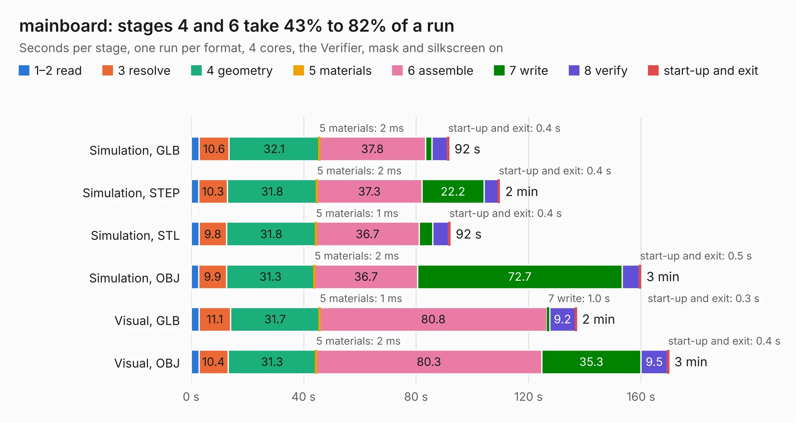

# 2531. mainboard

Board 2,531 of the 3,107 of [Corpus Testing](../Corpus-Testing.md), on [Corpus Page 24](../CorpusTestingPages/Corpus-Testing-24.md#2531-mainboard).

| Mode and format | 1–2 read | 3 resolve | 4 geometry | 5 materials | 6 assemble | 7 write | 8 verify | start-up and exit | Total |
|---|---:|---:|---:|---:|---:|---:|---:|---:|---:|
| Simulation, GLB | 2.9 | 10.6 | 32.1 | 2&nbsp;ms | 37.8 | 2.2 | 5.6 | 0.4 | 91.6 |
| Simulation, STEP | 2.7 | 10.3 | 31.8 | 2&nbsp;ms | 37.3 | 22.2 | 5.0 | 0.4 | 109.7 |
| Simulation, STL | 2.8 | 9.8 | 31.8 | 1&nbsp;ms | 36.7 | 4.8 | 5.7 | 0.4 | 92.1 |
| Simulation, OBJ | 2.7 | 9.9 | 31.3 | 2&nbsp;ms | 36.7 | 72.7 | 6.2 | 0.5 | 159.9 |
| Visual, GLB | 2.9 | 11.1 | 31.7 | 1&nbsp;ms | 80.8 | 1.0 | 9.2 | 0.3 | 137.0 |
| Visual, OBJ | 2.8 | 10.4 | 31.3 | 2&nbsp;ms | 80.3 | 35.3 | 9.5 | 0.4 | 169.9 |

<table align="center"><tr><td valign="top">

| Board | Repo: [sierra-lobo/mainboard-hardware](https://github.com/sierra-lobo/mainboard-hardware) Board: `mainboard.kicad_pcb` |
|---|---|
| Folder | revC-fm |
| Complexity | 447&nbsp;/&nbsp;1000 (size&nbsp;307, features&nbsp;140) |
| KESE&nbsp;features | through vias, custom pads, rounded, trapezoid or chamfered pads, drill offsets, filled zones, copper drawings, curved board outline, TrueType text, stack-up, dielectric εr and tanδ, mask and silkscreen colours |
| Tested | 9th November 2026 |
| Copper&nbsp;layers | 8 |
| File&nbsp;format | KiCad 7 (20221018) |
| Parts,&nbsp;tracks,&nbsp;vias | 639, 4,774, 1,106 |
| Triangles,&nbsp;simulation | 10,865,118 in 616 parts |
| Verifier | PASS in all six runs |

</td><td valign="top">

<table>
<tr><th>File type</th><th>File size</th><th>Peak memory used</th></tr>
<tr><th colspan="3" align="left">Simulation</th></tr>
<tr><td>GLB</td><td align="right">366&nbsp;MB</td><td align="right">2.5&nbsp;GB</td></tr>
<tr><td>STEP</td><td align="right">1.4&nbsp;GB</td><td align="right">3.5&nbsp;GB</td></tr>
<tr><td>STL</td><td align="right">543&nbsp;MB</td><td align="right">2.4&nbsp;GB</td></tr>
<tr><td>OBJ</td><td align="right">1.2&nbsp;GB</td><td align="right">6.9&nbsp;GB</td></tr>
<tr><th colspan="3" align="left">Visual</th></tr>
<tr><td>GLB</td><td align="right">201&nbsp;MB</td><td align="right">3.2&nbsp;GB</td></tr>
<tr><td>OBJ</td><td align="right">675&nbsp;MB</td><td align="right">4.1&nbsp;GB</td></tr>
</table>

</td></tr></table>

| Previous | Next |
|:---|---:|
| [2530. mainboard_before_drastic](b2530b_mainboard-hardware_mainboard-before-drastic.md) | [2532. Frontend_test](b2532b_SingularitySurfer-FPGA-Lock-In-Amplifier_Frontend-test.md) |
