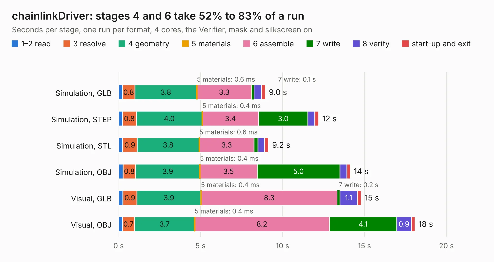

# 2532. chainlinkDriver

Board 2,532 of the 3,138 of [Corpus Testing](../Corpus-Testing.md), on [Corpus Page 24](../CorpusTestingPages/Corpus-Testing-24.md#2532-chainlinkdriver).

| Mode and format | 1–2 read | 3 resolve | 4 geometry | 5 materials | 6 assemble | 7 write | 8 verify | start-up and exit | Total |
|---|---:|---:|---:|---:|---:|---:|---:|---:|---:|
| Simulation, GLB | 0.2 | 0.8 | 3.8 | 0.6&nbsp;ms | 3.3 | 0.1 | 0.5 | 0.2 | 9.0 |
| Simulation, STEP | 0.2 | 0.8 | 4.0 | 0.4&nbsp;ms | 3.4 | 3.0 | 0.4 | 0.2 | 12.2 |
| Simulation, STL | 0.2 | 0.9 | 3.8 | 0.6&nbsp;ms | 3.3 | 0.2 | 0.4 | 0.3 | 9.2 |
| Simulation, OBJ | 0.3 | 0.8 | 3.9 | 0.4&nbsp;ms | 3.5 | 5.0 | 0.4 | 0.2 | 14.1 |
| Visual, GLB | 0.3 | 0.9 | 3.9 | 0.4&nbsp;ms | 8.3 | 0.2 | 1.1 | 0.2 | 14.8 |
| Visual, OBJ | 0.2 | 0.7 | 3.7 | 0.4&nbsp;ms | 8.2 | 4.1 | 0.9 | 0.2 | 18.1 |

<table align="center"><tr><td valign="top">

| Board | Repo: [scottbez1/splitflap](https://github.com/scottbez1/splitflap) Board: `chainlinkDriver.kicad_pcb` |
|---|---|
| Folder | electronics / chainlinkDriver |
| Complexity | 219&nbsp;/&nbsp;1000 (size&nbsp;174, features&nbsp;45) |
| KESE&nbsp;features | through vias, rounded, trapezoid or chamfered pads, filled zones |
| Tested | 9th November 2026 |
| Copper&nbsp;layers | 2 |
| File&nbsp;format | KiCad 5 (20171130) |
| Parts,&nbsp;tracks,&nbsp;vias | 58, 687, 111 |
| Triangles,&nbsp;simulation | 979,006 in 95 parts |
| Verifier | PASS in all six runs |

</td><td valign="top">

<table>
<tr><th>File type</th><th>File size</th><th>Peak memory used</th></tr>
<tr><th colspan="3" align="left">Simulation</th></tr>
<tr><td>GLB</td><td align="right">33&nbsp;MB</td><td align="right">423&nbsp;MB</td></tr>
<tr><td>STEP</td><td align="right">154&nbsp;MB</td><td align="right">512&nbsp;MB</td></tr>
<tr><td>STL</td><td align="right">49&nbsp;MB</td><td align="right">428&nbsp;MB</td></tr>
<tr><td>OBJ</td><td align="right">98&nbsp;MB</td><td align="right">663&nbsp;MB</td></tr>
<tr><th colspan="3" align="left">Visual</th></tr>
<tr><td>GLB</td><td align="right">26&nbsp;MB</td><td align="right">633&nbsp;MB</td></tr>
<tr><td>OBJ</td><td align="right">79&nbsp;MB</td><td align="right">633&nbsp;MB</td></tr>
</table>

</td></tr></table>

| Previous | Next |
|:---|---:|
| [2531. chainlinkBuddyTDisplay](b2531b_splitflap_chainlinkBuddyTDisplay.md) | [2533. chainlinkDriverTester](b2533b_splitflap_chainlinkDriverTester.md) |
