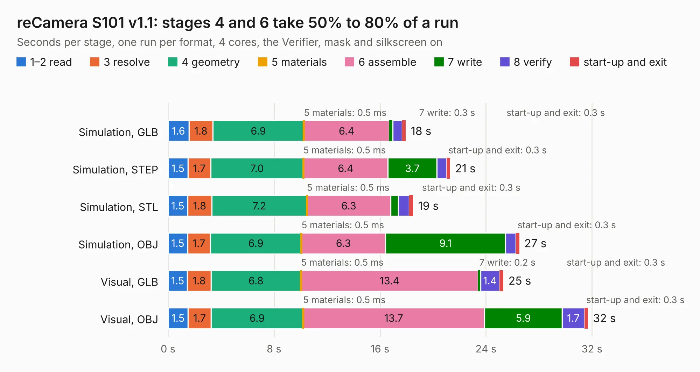

# 2533. reCamera S101 v1.1

Board 2,533 of the 3,123 of [Corpus Testing](../Corpus-Testing.md), on [Corpus Page 24](../CorpusTestingPages/Corpus-Testing-24.md#2533-recamera-s101-v11).

| Mode and format | 1–2 read | 3 resolve | 4 geometry | 5 materials | 6 assemble | 7 write | 8 verify | start-up and exit | Total |
|---|---:|---:|---:|---:|---:|---:|---:|---:|---:|
| Simulation, GLB | 1.6 | 1.8 | 6.9 | 0.5&nbsp;ms | 6.4 | 0.3 | 0.7 | 0.3 | 18.0 |
| Simulation, STEP | 1.5 | 1.7 | 7.0 | 0.5&nbsp;ms | 6.4 | 3.7 | 0.7 | 0.3 | 21.3 |
| Simulation, STL | 1.5 | 1.8 | 7.2 | 0.5&nbsp;ms | 6.3 | 0.6 | 0.8 | 0.3 | 18.5 |
| Simulation, OBJ | 1.5 | 1.7 | 6.9 | 0.5&nbsp;ms | 6.3 | 9.1 | 0.8 | 0.3 | 26.5 |
| Visual, GLB | 1.5 | 1.8 | 6.8 | 0.5&nbsp;ms | 13.4 | 0.2 | 1.4 | 0.3 | 25.3 |
| Visual, OBJ | 1.5 | 1.7 | 6.9 | 0.5&nbsp;ms | 13.7 | 5.9 | 1.7 | 0.3 | 31.7 |

<table align="center"><tr><td valign="top">

| Board | Repo: [Seeed-Studio/OSHW-reCamera-Series](https://github.com/Seeed-Studio/OSHW-reCamera-Series) Board: `reCamera S101 v1.1.kicad_pcb` |
|---|---|
| Folder | hardware / recamera-2002 / sensors / s101-ov5647 / PCB / V1.1 |
| Complexity | 343&nbsp;/&nbsp;1000 (size&nbsp;203, features&nbsp;140) |
| KESE&nbsp;features | through vias, custom pads, rounded, trapezoid or chamfered pads, arc tracks, filled zones, copper drawings, curved board outline, stack-up, dielectric εr and tanδ, copper finish |
| Tested | 9th November 2026 |
| Copper&nbsp;layers | 4 |
| File&nbsp;format | KiCad 8 (20240108) |
| Parts,&nbsp;tracks,&nbsp;vias | 82, 711, 334 |
| Triangles,&nbsp;simulation | 1,668,166 in 102 parts |
| Verifier | PASS in all six runs |

</td><td valign="top">

<table>
<tr><th>File type</th><th>File size</th><th>Peak memory used</th></tr>
<tr><th colspan="3" align="left">Simulation</th></tr>
<tr><td>GLB</td><td align="right">56&nbsp;MB</td><td align="right">624&nbsp;MB</td></tr>
<tr><td>STEP</td><td align="right">231&nbsp;MB</td><td align="right">748&nbsp;MB</td></tr>
<tr><td>STL</td><td align="right">83&nbsp;MB</td><td align="right">658&nbsp;MB</td></tr>
<tr><td>OBJ</td><td align="right">170&nbsp;MB</td><td align="right">1.1&nbsp;GB</td></tr>
<tr><th colspan="3" align="left">Visual</th></tr>
<tr><td>GLB</td><td align="right">34&nbsp;MB</td><td align="right">738&nbsp;MB</td></tr>
<tr><td>OBJ</td><td align="right">101&nbsp;MB</td><td align="right">812&nbsp;MB</td></tr>
</table>

</td></tr></table>

| Previous | Next |
|:---|---:|
| [2532. reCamera S101 v1.0](b2532b_OSHW-reCamera-Series_reCamera-S101-v1-0.md) | [2534. reCamera 2002 S4 GC2053 Sensor Board_V1.0_SCH&PCB_250905](b2534b_OSHW-reCamera-Series_reCamera-2002-S4-GC2053-Sensor-Board-V1-0-SCH-PCB-250905.md) |
