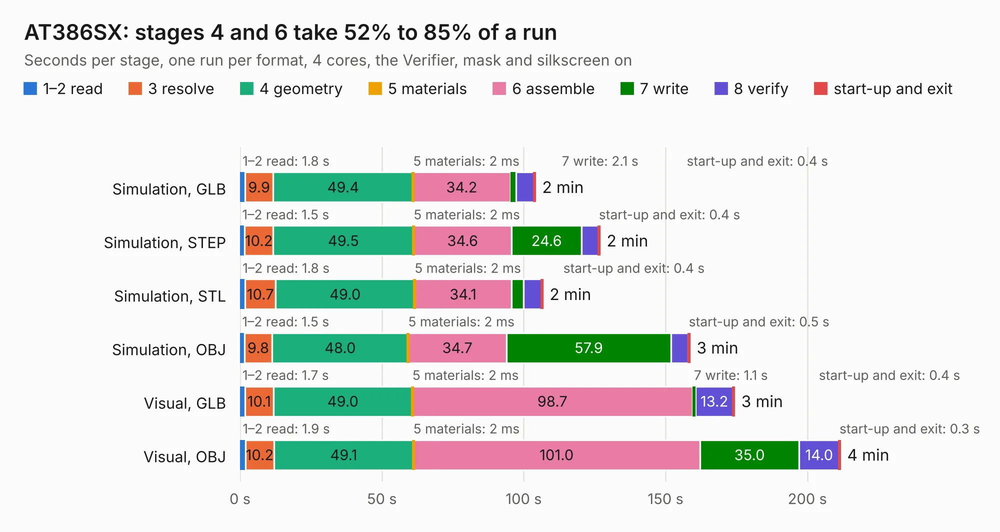

# 2533. AT386SX

Board 2,533 of the 3,106 of [Corpus Testing](../Corpus-Testing.md), on [Corpus Page 24](../CorpusTestingPages/Corpus-Testing-24.md#2533-at386sx).

| Mode and format | 1–2 read | 3 resolve | 4 geometry | 5 materials | 6 assemble | 7 write | 8 verify | start-up and exit | Total |
|---|---:|---:|---:|---:|---:|---:|---:|---:|---:|
| Simulation, GLB | 1.8 | 9.9 | 49.4 | 2&nbsp;ms | 34.2 | 2.1 | 6.2 | 0.4 | 104.0 |
| Simulation, STEP | 1.5 | 10.2 | 49.5 | 2&nbsp;ms | 34.6 | 24.6 | 5.9 | 0.4 | 126.7 |
| Simulation, STL | 1.8 | 10.7 | 49.0 | 2&nbsp;ms | 34.1 | 4.3 | 6.2 | 0.4 | 106.6 |
| Simulation, OBJ | 1.5 | 9.8 | 48.0 | 2&nbsp;ms | 34.7 | 57.9 | 6.1 | 0.5 | 158.4 |
| Visual, GLB | 1.7 | 10.1 | 49.0 | 2&nbsp;ms | 98.7 | 1.1 | 13.2 | 0.4 | 174.2 |
| Visual, OBJ | 1.9 | 10.2 | 49.1 | 2&nbsp;ms | 101.0 | 35.0 | 14.0 | 0.3 | 211.5 |

<table align="center"><tr><td valign="top">

| Board | Repo: [skiselev/mb386sx-rc2016](https://github.com/skiselev/mb386sx-rc2016) Board: `AT386SX.kicad_pcb` |
|---|---|
| Folder | KiCad |
| Complexity | 359&nbsp;/&nbsp;1000 (size&nbsp;274, features&nbsp;85) |
| KESE&nbsp;features | through vias, rounded, trapezoid or chamfered pads, filled zones, curved board outline, stack-up, dielectric εr and tanδ |
| Tested | 9th November 2026 |
| Copper&nbsp;layers | 2 |
| File&nbsp;format | KiCad 6 (20211014) |
| Parts,&nbsp;tracks,&nbsp;vias | 148, 8,868, 700 |
| Triangles,&nbsp;simulation | 9,788,128 in 320 parts |
| Verifier | PASS in all six runs |

</td><td valign="top">

<table>
<tr><th>File type</th><th>File size</th><th>Peak memory used</th></tr>
<tr><th colspan="3" align="left">Simulation</th></tr>
<tr><td>GLB</td><td align="right">333&nbsp;MB</td><td align="right">2.7&nbsp;GB</td></tr>
<tr><td>STEP</td><td align="right">1.6&nbsp;GB</td><td align="right">3.5&nbsp;GB</td></tr>
<tr><td>STL</td><td align="right">489&nbsp;MB</td><td align="right">2.7&nbsp;GB</td></tr>
<tr><td>OBJ</td><td align="right">1.0&nbsp;GB</td><td align="right">6.1&nbsp;GB</td></tr>
<tr><th colspan="3" align="left">Visual</th></tr>
<tr><td>GLB</td><td align="right">231&nbsp;MB</td><td align="right">3.5&nbsp;GB</td></tr>
<tr><td>OBJ</td><td align="right">739&nbsp;MB</td><td align="right">4.6&nbsp;GB</td></tr>
</table>

</td></tr></table>

| Previous | Next |
|:---|---:|
| [2532. SingularitySurfer_V1](b2532b_SingularitySurfer-FPGA-Lock-In-Amplifier_SingularitySurfer-V1.md) | [2534. Omega-Keyboard](b2534b_omega_Omega-Keyboard.md) |
