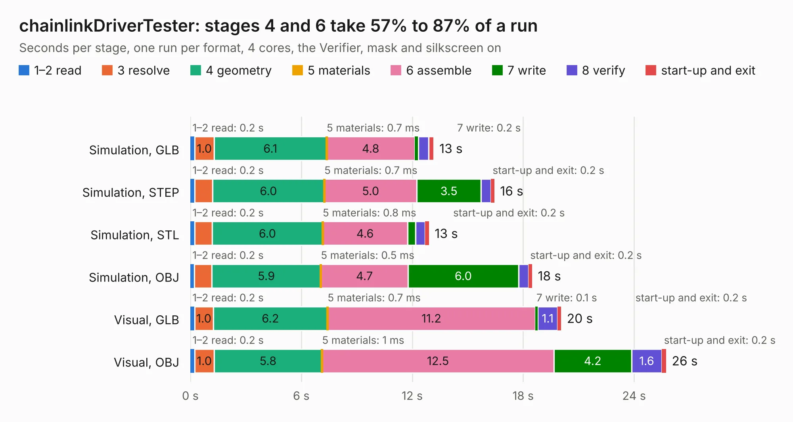

# 2533. chainlinkDriverTester

Board 2,533 of the 3,138 of [Corpus Testing](../Corpus-Testing.md), on [Corpus Page 24](../CorpusTestingPages/Corpus-Testing-24.md#2533-chainlinkdrivertester).

| Mode and format | 1–2 read | 3 resolve | 4 geometry | 5 materials | 6 assemble | 7 write | 8 verify | start-up and exit | Total |
|---|---:|---:|---:|---:|---:|---:|---:|---:|---:|
| Simulation, GLB | 0.2 | 1.0 | 6.1 | 0.7&nbsp;ms | 4.8 | 0.2 | 0.6 | 0.3 | 13.2 |
| Simulation, STEP | 0.2 | 1.0 | 6.0 | 0.7&nbsp;ms | 5.0 | 3.5 | 0.5 | 0.2 | 16.4 |
| Simulation, STL | 0.2 | 0.9 | 6.0 | 0.8&nbsp;ms | 4.6 | 0.4 | 0.5 | 0.2 | 12.9 |
| Simulation, OBJ | 0.2 | 0.9 | 5.9 | 0.5&nbsp;ms | 4.7 | 6.0 | 0.5 | 0.2 | 18.5 |
| Visual, GLB | 0.2 | 1.0 | 6.2 | 0.7&nbsp;ms | 11.2 | 0.1 | 1.1 | 0.2 | 20.1 |
| Visual, OBJ | 0.2 | 1.0 | 5.8 | 1&nbsp;ms | 12.5 | 4.2 | 1.6 | 0.2 | 25.7 |

<table align="center"><tr><td valign="top">

| Board | Repo: [scottbez1/splitflap](https://github.com/scottbez1/splitflap) Board: `chainlinkDriverTester.kicad_pcb` |
|---|---|
| Folder | electronics / chainlinkDriverTester |
| Complexity | 236&nbsp;/&nbsp;1000 (size&nbsp;171, features&nbsp;65) |
| KESE&nbsp;features | through vias, slotted holes, rounded, trapezoid or chamfered pads, filled zones, curved board outline |
| Tested | 9th November 2026 |
| Copper&nbsp;layers | 2 |
| File&nbsp;format | KiCad 5 (20171130) |
| Parts,&nbsp;tracks,&nbsp;vias | 59, 536, 97 |
| Triangles,&nbsp;simulation | 1,553,564 in 107 parts |
| Verifier | PASS in all six runs |

</td><td valign="top">

<table>
<tr><th>File type</th><th>File size</th><th>Peak memory used</th></tr>
<tr><th colspan="3" align="left">Simulation</th></tr>
<tr><td>GLB</td><td align="right">52&nbsp;MB</td><td align="right">651&nbsp;MB</td></tr>
<tr><td>STEP</td><td align="right">214&nbsp;MB</td><td align="right">719&nbsp;MB</td></tr>
<tr><td>STL</td><td align="right">78&nbsp;MB</td><td align="right">604&nbsp;MB</td></tr>
<tr><td>OBJ</td><td align="right">158&nbsp;MB</td><td align="right">1.0&nbsp;GB</td></tr>
<tr><th colspan="3" align="left">Visual</th></tr>
<tr><td>GLB</td><td align="right">33&nbsp;MB</td><td align="right">697&nbsp;MB</td></tr>
<tr><td>OBJ</td><td align="right">101&nbsp;MB</td><td align="right">790&nbsp;MB</td></tr>
</table>

</td></tr></table>

| Previous | Next |
|:---|---:|
| [2532. chainlinkDriver](b2532b_splitflap_chainlinkDriver.md) | [2534. sensor](b2534b_splitflap_sensor.md) |
