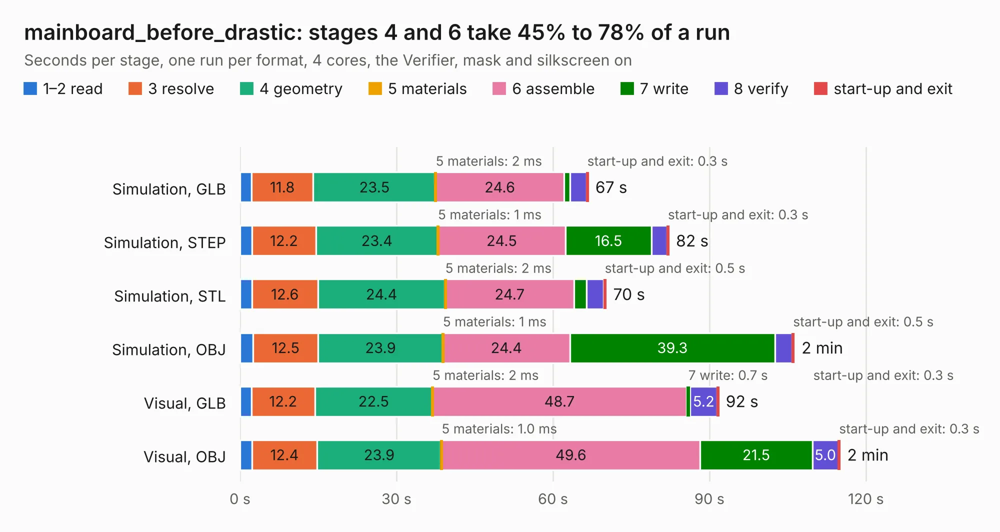

# 2534. mainboard_before_drastic

Board 2,534 of the 3,111 of [Corpus Testing](../Corpus-Testing.md), on [Corpus Page 24](../CorpusTestingPages/Corpus-Testing-24.md#2534-mainboard_before_drastic).

| Mode and format | 1–2 read | 3 resolve | 4 geometry | 5 materials | 6 assemble | 7 write | 8 verify | start-up and exit | Total |
|---|---:|---:|---:|---:|---:|---:|---:|---:|---:|
| Simulation, GLB | 2.2 | 11.8 | 23.5 | 2&nbsp;ms | 24.6 | 1.2 | 3.2 | 0.3 | 66.7 |
| Simulation, STEP | 2.3 | 12.2 | 23.4 | 1&nbsp;ms | 24.5 | 16.5 | 3.0 | 0.3 | 82.2 |
| Simulation, STL | 2.3 | 12.6 | 24.4 | 2&nbsp;ms | 24.7 | 2.4 | 3.3 | 0.5 | 70.2 |
| Simulation, OBJ | 2.5 | 12.5 | 23.9 | 1&nbsp;ms | 24.4 | 39.3 | 3.2 | 0.5 | 106.3 |
| Visual, GLB | 2.2 | 12.2 | 22.5 | 2&nbsp;ms | 48.7 | 0.7 | 5.2 | 0.3 | 91.8 |
| Visual, OBJ | 2.3 | 12.4 | 23.9 | 1.0&nbsp;ms | 49.6 | 21.5 | 5.0 | 0.3 | 115.0 |

<table align="center"><tr><td valign="top">

| Board | Repo: [sierra-lobo/mainboard-hardware](https://github.com/sierra-lobo/mainboard-hardware) Board: `mainboard_before_drastic.kicad_pcb` |
|---|---|
| Folder | revB-em |
| Complexity | 373&nbsp;/&nbsp;1000 (size&nbsp;293, features&nbsp;80) |
| KESE&nbsp;features | through vias, custom pads, rounded, trapezoid or chamfered pads, filled zones, copper drawings, curved board outline |
| Tested | 9th November 2026 |
| Copper&nbsp;layers | 6 |
| File&nbsp;format | KiCad 6 (20211014) |
| Parts,&nbsp;tracks,&nbsp;vias | 350, 3,043, 664 |
| Triangles,&nbsp;simulation | 6,173,362 in 345 parts |
| Verifier | PASS in all six runs |

</td><td valign="top">

<table>
<tr><th>File type</th><th>File size</th><th>Peak memory used</th></tr>
<tr><th colspan="3" align="left">Simulation</th></tr>
<tr><td>GLB</td><td align="right">215&nbsp;MB</td><td align="right">1.6&nbsp;GB</td></tr>
<tr><td>STEP</td><td align="right">962&nbsp;MB</td><td align="right">2.1&nbsp;GB</td></tr>
<tr><td>STL</td><td align="right">309&nbsp;MB</td><td align="right">1.6&nbsp;GB</td></tr>
<tr><td>OBJ</td><td align="right">681&nbsp;MB</td><td align="right">4.1&nbsp;GB</td></tr>
<tr><th colspan="3" align="left">Visual</th></tr>
<tr><td>GLB</td><td align="right">118&nbsp;MB</td><td align="right">2.0&nbsp;GB</td></tr>
<tr><td>OBJ</td><td align="right">381&nbsp;MB</td><td align="right">2.5&nbsp;GB</td></tr>
</table>

</td></tr></table>

| Previous | Next |
|:---|---:|
| [2533. mainboard](b2533b_mainboard-hardware_revB-em_mainboard.md) | [2535. mainboard](b2535b_mainboard-hardware_revC-fm_mainboard.md) |
