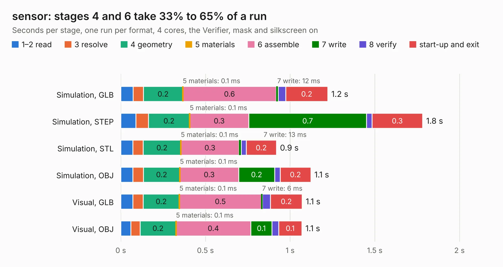

# 2535. sensor

Board 2,535 of the 3,139 of [Corpus Testing](../Corpus-Testing.md), on [Corpus Page 24](../CorpusTestingPages/Corpus-Testing-24.md#2535-sensor).

| Mode and format | 1–2 read | 3 resolve | 4 geometry | 5 materials | 6 assemble | 7 write | 8 verify | start-up and exit | Total |
|---|---:|---:|---:|---:|---:|---:|---:|---:|---:|
| Simulation, GLB | 73&nbsp;ms | 61&nbsp;ms | 0.2 | 0.1&nbsp;ms | 0.6 | 12&nbsp;ms | 44&nbsp;ms | 0.2 | 1.2 |
| Simulation, STEP | 89&nbsp;ms | 74&nbsp;ms | 0.2 | 0.1&nbsp;ms | 0.3 | 0.7 | 33&nbsp;ms | 0.3 | 1.8 |
| Simulation, STL | 71&nbsp;ms | 61&nbsp;ms | 0.2 | 0.1&nbsp;ms | 0.3 | 13&nbsp;ms | 29&nbsp;ms | 0.2 | 0.9 |
| Simulation, OBJ | 71&nbsp;ms | 63&nbsp;ms | 0.2 | 0.1&nbsp;ms | 0.3 | 0.2 | 32&nbsp;ms | 0.2 | 1.1 |
| Visual, GLB | 71&nbsp;ms | 61&nbsp;ms | 0.2 | 0.1&nbsp;ms | 0.5 | 6&nbsp;ms | 48&nbsp;ms | 0.2 | 1.1 |
| Visual, OBJ | 59&nbsp;ms | 55&nbsp;ms | 0.2 | 0.1&nbsp;ms | 0.4 | 0.1 | 39&nbsp;ms | 0.1 | 1.1 |

<table align="center"><tr><td valign="top">

| Board | Repo: [scottbez1/splitflap](https://github.com/scottbez1/splitflap) Board: `sensor.kicad_pcb` |
|---|---|
| Folder | electronics / sensor |
| Complexity | 60&nbsp;/&nbsp;1000 (size&nbsp;60, features&nbsp;0) |
| Tested | 9th November 2026 |
| Copper&nbsp;layers | 2 |
| File&nbsp;format | KiCad 5 (20171130) |
| Parts,&nbsp;tracks,&nbsp;vias | 2, 6, 0 |
| Triangles,&nbsp;simulation | 51,798 in 15 parts |
| Verifier | PASS in all six runs |

</td><td valign="top">

<table>
<tr><th>File type</th><th>File size</th><th>Peak memory used</th></tr>
<tr><th colspan="3" align="left">Simulation</th></tr>
<tr><td>GLB</td><td align="right">1.8&nbsp;MB</td><td align="right">69&nbsp;MB</td></tr>
<tr><td>STEP</td><td align="right">8.2&nbsp;MB</td><td align="right">170&nbsp;MB</td></tr>
<tr><td>STL</td><td align="right">2.6&nbsp;MB</td><td align="right">69&nbsp;MB</td></tr>
<tr><td>OBJ</td><td align="right">5.0&nbsp;MB</td><td align="right">80&nbsp;MB</td></tr>
<tr><th colspan="3" align="left">Visual</th></tr>
<tr><td>GLB</td><td align="right">1.2&nbsp;MB</td><td align="right">92&nbsp;MB</td></tr>
<tr><td>OBJ</td><td align="right">3.2&nbsp;MB</td><td align="right">105&nbsp;MB</td></tr>
</table>

</td></tr></table>

| Previous | Next |
|:---|---:|
| [2534. chainlinkDriverTester](b2534b_splitflap_chainlinkDriverTester.md) | [2536. sensor_smd](b2536b_splitflap_sensor-smd.md) |
