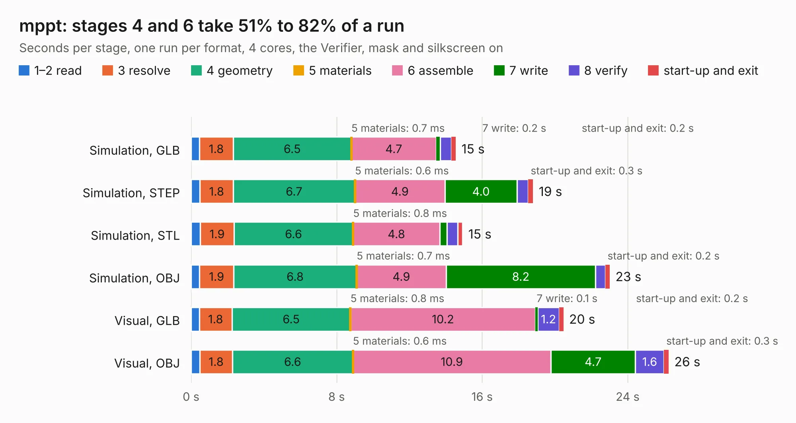

# 2536. mppt

Board 2,536 of the 3,138 of [Corpus Testing](../Corpus-Testing.md), on [Corpus Page 24](../CorpusTestingPages/Corpus-Testing-24.md#2536-mppt).

| Mode and format | 1–2 read | 3 resolve | 4 geometry | 5 materials | 6 assemble | 7 write | 8 verify | start-up and exit | Total |
|---|---:|---:|---:|---:|---:|---:|---:|---:|---:|
| Simulation, GLB | 0.5 | 1.8 | 6.5 | 0.7&nbsp;ms | 4.7 | 0.2 | 0.6 | 0.2 | 14.6 |
| Simulation, STEP | 0.5 | 1.8 | 6.7 | 0.6&nbsp;ms | 4.9 | 4.0 | 0.6 | 0.3 | 18.8 |
| Simulation, STL | 0.5 | 1.9 | 6.6 | 0.8&nbsp;ms | 4.8 | 0.4 | 0.6 | 0.3 | 14.9 |
| Simulation, OBJ | 0.5 | 1.9 | 6.8 | 0.7&nbsp;ms | 4.9 | 8.2 | 0.5 | 0.2 | 23.0 |
| Visual, GLB | 0.5 | 1.8 | 6.5 | 0.8&nbsp;ms | 10.2 | 0.1 | 1.2 | 0.2 | 20.5 |
| Visual, OBJ | 0.5 | 1.8 | 6.6 | 0.6&nbsp;ms | 10.9 | 4.7 | 1.6 | 0.3 | 26.3 |

<table align="center"><tr><td valign="top">

| Board | Repo: [seandepagnier/mppt](https://github.com/seandepagnier/mppt) Board: `mppt.kicad_pcb` |
|---|---|
| Folder | schematics |
| Complexity | 275&nbsp;/&nbsp;1000 (size&nbsp;205, features&nbsp;70) |
| KESE&nbsp;features | through vias, custom pads, rounded, trapezoid or chamfered pads, filled zones, copper drawings |
| Tested | 9th November 2026 |
| Copper&nbsp;layers | 4 |
| File&nbsp;format | KiCad 5 (20171130) |
| Parts,&nbsp;tracks,&nbsp;vias | 152, 949, 117 |
| Triangles,&nbsp;simulation | 1,286,936 in 115 parts |
| Verifier | PASS in all six runs |

</td><td valign="top">

<table>
<tr><th>File type</th><th>File size</th><th>Peak memory used</th></tr>
<tr><th colspan="3" align="left">Simulation</th></tr>
<tr><td>GLB</td><td align="right">46&nbsp;MB</td><td align="right">580&nbsp;MB</td></tr>
<tr><td>STEP</td><td align="right">208&nbsp;MB</td><td align="right">641&nbsp;MB</td></tr>
<tr><td>STL</td><td align="right">64&nbsp;MB</td><td align="right">565&nbsp;MB</td></tr>
<tr><td>OBJ</td><td align="right">135&nbsp;MB</td><td align="right">891&nbsp;MB</td></tr>
<tr><th colspan="3" align="left">Visual</th></tr>
<tr><td>GLB</td><td align="right">27&nbsp;MB</td><td align="right">656&nbsp;MB</td></tr>
<tr><td>OBJ</td><td align="right">82&nbsp;MB</td><td align="right">675&nbsp;MB</td></tr>
</table>

</td></tr></table>

| Previous | Next |
|:---|---:|
| [2535. sensor_smd](b2535b_splitflap_sensor-smd.md) | [2537. reCamera B101 v1.0](b2537b_OSHW-reCamera-Series_reCamera-B101-v1-0.md) |
