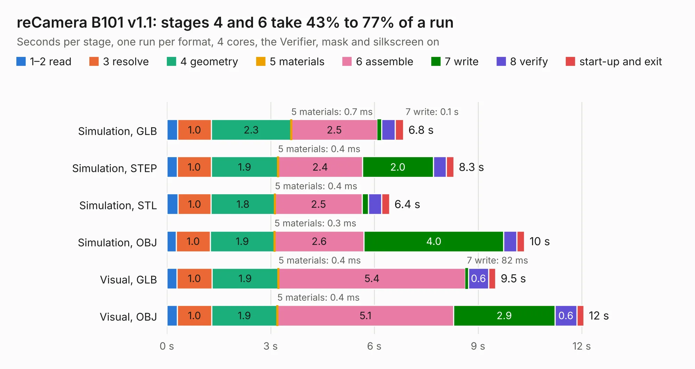

# 2538 reCamera B101 v1.1

Board 2,538 of the 3,138 of [Corpus Testing](../Corpus-Testing.md), on [Corpus Page 24](../CorpusTestingPages/Corpus-Testing-24.md#2538-recamera-b101-v11).

| Mode and format | 1–2 read | 3 resolve | 4 geometry | 5 materials | 6 assemble | 7 write | 8 verify | start-up and exit | Total |
|---|---:|---:|---:|---:|---:|---:|---:|---:|---:|
| Simulation, GLB | 0.3 | 1.0 | 2.3 | 0.7&nbsp;ms | 2.5 | 0.1 | 0.4 | 0.2 | 6.8 |
| Simulation, STEP | 0.3 | 1.0 | 1.9 | 0.4&nbsp;ms | 2.4 | 2.0 | 0.4 | 0.2 | 8.3 |
| Simulation, STL | 0.3 | 1.0 | 1.8 | 0.4&nbsp;ms | 2.5 | 0.2 | 0.4 | 0.2 | 6.4 |
| Simulation, OBJ | 0.3 | 1.0 | 1.9 | 0.3&nbsp;ms | 2.6 | 4.0 | 0.4 | 0.2 | 10.3 |
| Visual, GLB | 0.3 | 1.0 | 1.9 | 0.4&nbsp;ms | 5.4 | 82&nbsp;ms | 0.6 | 0.2 | 9.5 |
| Visual, OBJ | 0.3 | 1.0 | 1.9 | 0.4&nbsp;ms | 5.1 | 2.9 | 0.6 | 0.2 | 12.1 |

<table align="center"><tr><td valign="top">

| Board | Repo: [Seeed-Studio/OSHW-reCamera-Series](https://github.com/Seeed-Studio/OSHW-reCamera-Series) Board: `reCamera B101 v1.1.kicad_pcb` |
|---|---|
| Folder | hardware / recamera-2002 / base / b101-default / PCB / V1.1 |
| Complexity | 304&nbsp;/&nbsp;1000 (size&nbsp;189, features&nbsp;115) |
| KESE&nbsp;features | through vias, rounded, trapezoid or chamfered pads, arc tracks, filled zones, curved board outline, stack-up, dielectric εr and tanδ, copper finish |
| Tested | 9th November 2026 |
| Copper&nbsp;layers | 4 |
| File&nbsp;format | KiCad 8 (20240108) |
| Parts,&nbsp;tracks,&nbsp;vias | 45, 566, 157 |
| Triangles,&nbsp;simulation | 778,752 in 84 parts |
| Verifier | PASS in all six runs |

</td><td valign="top">

<table>
<tr><th>File type</th><th>File size</th><th>Peak memory used</th></tr>
<tr><th colspan="3" align="left">Simulation</th></tr>
<tr><td>GLB</td><td align="right">26&nbsp;MB</td><td align="right">366&nbsp;MB</td></tr>
<tr><td>STEP</td><td align="right">112&nbsp;MB</td><td align="right">456&nbsp;MB</td></tr>
<tr><td>STL</td><td align="right">39&nbsp;MB</td><td align="right">376&nbsp;MB</td></tr>
<tr><td>OBJ</td><td align="right">78&nbsp;MB</td><td align="right">588&nbsp;MB</td></tr>
<tr><th colspan="3" align="left">Visual</th></tr>
<tr><td>GLB</td><td align="right">19&nbsp;MB</td><td align="right">483&nbsp;MB</td></tr>
<tr><td>OBJ</td><td align="right">57&nbsp;MB</td><td align="right">492&nbsp;MB</td></tr>
</table>

</td></tr></table>

| Previous | Next |
|:---|---:|
| [2537 reCamera B101 v1.0](b2537b_OSHW-reCamera-Series_reCamera-B101-v1-0.md) | [2539 reCamera B101 v1.2](b2539b_OSHW-reCamera-Series_reCamera-B101-v1-2.md) |
