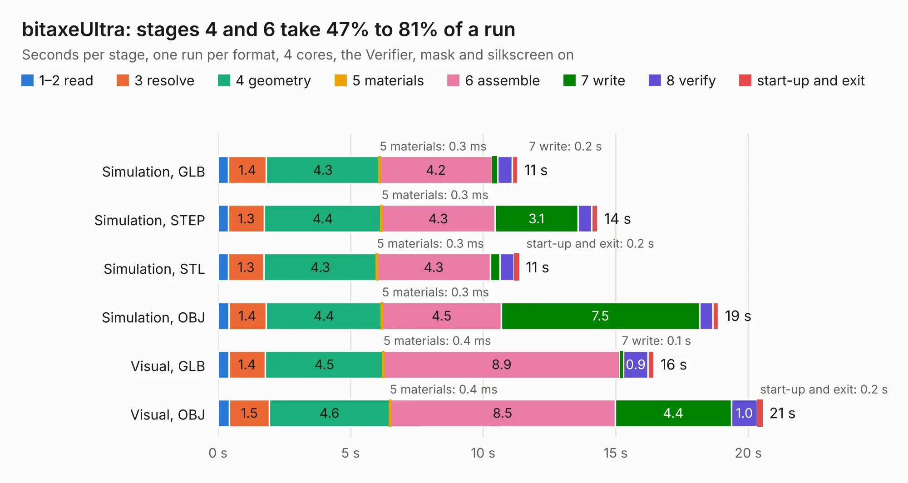

# 2538. bitaxeUltra

Board 2,538 of the 3,106 of [Corpus Testing](../Corpus-Testing.md), on [Corpus Page 24](../CorpusTestingPages/Corpus-Testing-24.md#2538-bitaxeultra).

| Mode and format | 1–2 read | 3 resolve | 4 geometry | 5 materials | 6 assemble | 7 write | 8 verify | start-up and exit | Total |
|---|---:|---:|---:|---:|---:|---:|---:|---:|---:|
| Simulation, GLB | 0.4 | 1.4 | 4.3 | 0.3&nbsp;ms | 4.2 | 0.2 | 0.6 | 0.2 | 11.3 |
| Simulation, STEP | 0.4 | 1.3 | 4.4 | 0.3&nbsp;ms | 4.3 | 3.1 | 0.5 | 0.2 | 14.3 |
| Simulation, STL | 0.4 | 1.3 | 4.3 | 0.3&nbsp;ms | 4.3 | 0.4 | 0.5 | 0.2 | 11.4 |
| Simulation, OBJ | 0.4 | 1.4 | 4.4 | 0.3&nbsp;ms | 4.5 | 7.5 | 0.5 | 0.2 | 18.9 |
| Visual, GLB | 0.4 | 1.4 | 4.5 | 0.4&nbsp;ms | 8.9 | 0.1 | 0.9 | 0.2 | 16.4 |
| Visual, OBJ | 0.4 | 1.5 | 4.6 | 0.4&nbsp;ms | 8.5 | 4.4 | 1.0 | 0.2 | 20.5 |

<table align="center"><tr><td valign="top">

| Board | Repo: [skot/bitaxe](https://github.com/skot/bitaxe) Board: `bitaxeUltra.kicad_pcb` |
|---|---|
| Complexity | 333&nbsp;/&nbsp;1000 (size&nbsp;203, features&nbsp;130) |
| KESE&nbsp;features | through vias, slotted holes, custom pads, rounded, trapezoid or chamfered pads, filled zones, copper drawings, copper text, curved board outline, stack-up, dielectric εr and tanδ |
| Tested | 9th November 2026 |
| Copper&nbsp;layers | 4 |
| File&nbsp;format | KiCad 7 (20221018) |
| Parts,&nbsp;tracks,&nbsp;vias | 94, 933, 201 |
| Triangles,&nbsp;simulation | 1,436,406 in 109 parts |
| Verifier | PASS in all six runs |

</td><td valign="top">

<table>
<tr><th>File type</th><th>File size</th><th>Peak memory used</th></tr>
<tr><th colspan="3" align="left">Simulation</th></tr>
<tr><td>GLB</td><td align="right">48&nbsp;MB</td><td align="right">532&nbsp;MB</td></tr>
<tr><td>STEP</td><td align="right">183&nbsp;MB</td><td align="right">655&nbsp;MB</td></tr>
<tr><td>STL</td><td align="right">72&nbsp;MB</td><td align="right">553&nbsp;MB</td></tr>
<tr><td>OBJ</td><td align="right">147&nbsp;MB</td><td align="right">984&nbsp;MB</td></tr>
<tr><th colspan="3" align="left">Visual</th></tr>
<tr><td>GLB</td><td align="right">28&nbsp;MB</td><td align="right">624&nbsp;MB</td></tr>
<tr><td>OBJ</td><td align="right">85&nbsp;MB</td><td align="right">680&nbsp;MB</td></tr>
</table>

</td></tr></table>

| Previous | Next |
|:---|---:|
| [2537. Z80-SBC](b2537b_zeta-sbc_Z80-SBC.md) | [2539. a13board](b2539b_a13board_a13board.md) |
