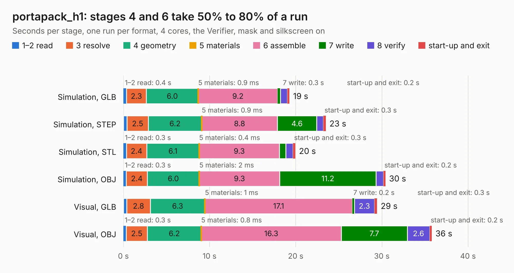

# 2540. portapack_h1

Board 2,540 of the 3,127 of [Corpus Testing](../Corpus-Testing.md), on [Corpus Page 24](../CorpusTestingPages/Corpus-Testing-24.md#2540-portapack_h1).

| Mode and format | 1–2 read | 3 resolve | 4 geometry | 5 materials | 6 assemble | 7 write | 8 verify | start-up and exit | Total |
|---|---:|---:|---:|---:|---:|---:|---:|---:|---:|
| Simulation, GLB | 0.4 | 2.3 | 6.0 | 0.9&nbsp;ms | 9.2 | 0.3 | 0.8 | 0.2 | 19.3 |
| Simulation, STEP | 0.4 | 2.5 | 6.2 | 0.9&nbsp;ms | 8.8 | 4.6 | 0.8 | 0.3 | 23.5 |
| Simulation, STL | 0.3 | 2.4 | 6.1 | 0.4&nbsp;ms | 9.3 | 0.8 | 0.8 | 0.3 | 20.0 |
| Simulation, OBJ | 0.3 | 2.4 | 6.0 | 2&nbsp;ms | 9.3 | 11.2 | 0.9 | 0.2 | 30.4 |
| Visual, GLB | 0.4 | 2.8 | 6.3 | 1&nbsp;ms | 17.1 | 0.2 | 2.3 | 0.3 | 29.4 |
| Visual, OBJ | 0.3 | 2.5 | 6.2 | 0.8&nbsp;ms | 16.3 | 7.7 | 2.6 | 0.2 | 35.8 |

<table align="center"><tr><td valign="top">

| Board | Repo: [sharebrained/portapack-hackrf](https://github.com/sharebrained/portapack-hackrf) Board: `portapack_h1.kicad_pcb` |
|---|---|
| Folder | hardware / portapack_h1 |
| Complexity | 286&nbsp;/&nbsp;1000 (size&nbsp;261, features&nbsp;25) |
| KESE&nbsp;features | through vias, curved board outline |
| Tested | 9th November 2026 |
| Copper&nbsp;layers | 4 |
| File&nbsp;format | KiCad 5 (20171130) |
| Parts,&nbsp;tracks,&nbsp;vias | 98, 1,508, 475 |
| Triangles,&nbsp;simulation | 2,142,988 in 153 parts |
| Verifier | PASS in all six runs |

</td><td valign="top">

<table>
<tr><th>File type</th><th>File size</th><th>Peak memory used</th></tr>
<tr><th colspan="3" align="left">Simulation</th></tr>
<tr><td>GLB</td><td align="right">73&nbsp;MB</td><td align="right">833&nbsp;MB</td></tr>
<tr><td>STEP</td><td align="right">225&nbsp;MB</td><td align="right">1.0&nbsp;GB</td></tr>
<tr><td>STL</td><td align="right">107&nbsp;MB</td><td align="right">848&nbsp;MB</td></tr>
<tr><td>OBJ</td><td align="right">222&nbsp;MB</td><td align="right">1.4&nbsp;GB</td></tr>
<tr><th colspan="3" align="left">Visual</th></tr>
<tr><td>GLB</td><td align="right">49&nbsp;MB</td><td align="right">1.1&nbsp;GB</td></tr>
<tr><td>OBJ</td><td align="right">152&nbsp;MB</td><td align="right">1.1&nbsp;GB</td></tr>
</table>

</td></tr></table>

| Previous | Next |
|:---|---:|
| [2539. Cheap FOCer 2 60mm](b2539b_cheap-focer-2_Cheap-FOCer-2-60mm.md) | [2541. rpi-cm4-carrier-template](b2541b_rpi-cm4-carrier-template_rpi-cm4-carrier-template.md) |
