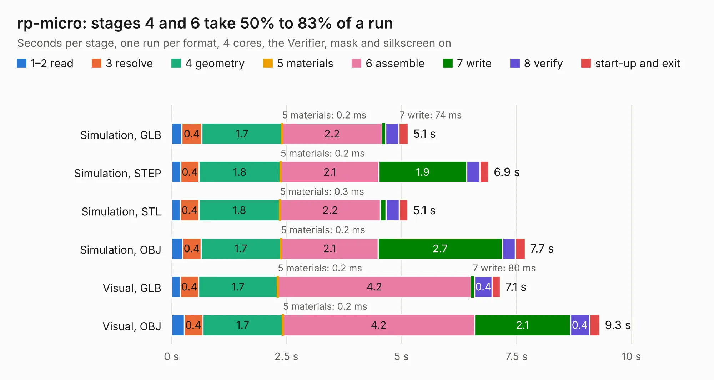

# 2541. rp-micro

Board 2,541 of the 3,121 of [Corpus Testing](../Corpus-Testing.md), on [Corpus Page 24](../CorpusTestingPages/Corpus-Testing-24.md#2541-rp-micro).

| Mode and format | 1–2 read | 3 resolve | 4 geometry | 5 materials | 6 assemble | 7 write | 8 verify | start-up and exit | Total |
|---|---:|---:|---:|---:|---:|---:|---:|---:|---:|
| Simulation, GLB | 0.2 | 0.4 | 1.7 | 0.2&nbsp;ms | 2.2 | 74&nbsp;ms | 0.3 | 0.2 | 5.1 |
| Simulation, STEP | 0.2 | 0.4 | 1.8 | 0.2&nbsp;ms | 2.1 | 1.9 | 0.3 | 0.2 | 6.9 |
| Simulation, STL | 0.2 | 0.4 | 1.8 | 0.3&nbsp;ms | 2.2 | 0.1 | 0.3 | 0.2 | 5.1 |
| Simulation, OBJ | 0.2 | 0.4 | 1.7 | 0.2&nbsp;ms | 2.1 | 2.7 | 0.3 | 0.2 | 7.7 |
| Visual, GLB | 0.2 | 0.4 | 1.7 | 0.2&nbsp;ms | 4.2 | 80&nbsp;ms | 0.4 | 0.2 | 7.1 |
| Visual, OBJ | 0.3 | 0.4 | 1.7 | 0.2&nbsp;ms | 4.2 | 2.1 | 0.4 | 0.2 | 9.3 |

<table align="center"><tr><td valign="top">

| Board | Repo: [siderakb/rp-micro](https://github.com/siderakb/rp-micro) Board: `rp-micro.kicad_pcb` |
|---|---|
| Folder | hardware |
| Complexity | 307&nbsp;/&nbsp;1000 (size&nbsp;202, features&nbsp;105) |
| KESE&nbsp;features | through vias, slotted holes, rounded, trapezoid or chamfered pads, drill offsets, filled zones, curved board outline, stack-up, dielectric εr and tanδ |
| Tested | 9th November 2026 |
| Copper&nbsp;layers | 2 |
| File&nbsp;format | KiCad 6 (20211014) |
| Parts,&nbsp;tracks,&nbsp;vias | 40, 437, 64 |
| Triangles,&nbsp;simulation | 530,056 in 74 parts |
| Verifier | PASS in all six runs |

</td><td valign="top">

<table>
<tr><th>File type</th><th>File size</th><th>Peak memory used</th></tr>
<tr><th colspan="3" align="left">Simulation</th></tr>
<tr><td>GLB</td><td align="right">18&nbsp;MB</td><td align="right">317&nbsp;MB</td></tr>
<tr><td>STEP</td><td align="right">89&nbsp;MB</td><td align="right">373&nbsp;MB</td></tr>
<tr><td>STL</td><td align="right">27&nbsp;MB</td><td align="right">307&nbsp;MB</td></tr>
<tr><td>OBJ</td><td align="right">53&nbsp;MB</td><td align="right">398&nbsp;MB</td></tr>
<tr><th colspan="3" align="left">Visual</th></tr>
<tr><td>GLB</td><td align="right">14&nbsp;MB</td><td align="right">412&nbsp;MB</td></tr>
<tr><td>OBJ</td><td align="right">42&nbsp;MB</td><td align="right">379&nbsp;MB</td></tr>
</table>

</td></tr></table>

| Previous | Next |
|:---|---:|
| [2540. FlightPCB](b2540b_tsar_v3_FlightPCB.md) | [2542. mainboard](b2542b_mainboard-hardware_revA-proto_mainboard.md) |
