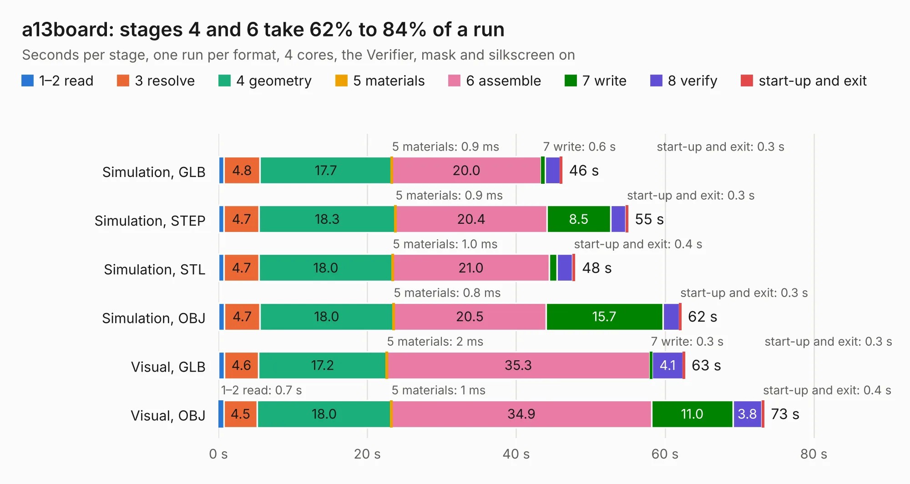

# 2545. a13board

Board 2,545 of the 3,112 of [Corpus Testing](../Corpus-Testing.md), on [Corpus Page 24](../CorpusTestingPages/Corpus-Testing-24.md#2545-a13board).

| Mode and format | 1–2 read | 3 resolve | 4 geometry | 5 materials | 6 assemble | 7 write | 8 verify | start-up and exit | Total |
|---|---:|---:|---:|---:|---:|---:|---:|---:|---:|
| Simulation, GLB | 0.7 | 4.8 | 17.7 | 0.9&nbsp;ms | 20.0 | 0.6 | 2.0 | 0.3 | 46.2 |
| Simulation, STEP | 0.8 | 4.7 | 18.3 | 0.9&nbsp;ms | 20.4 | 8.5 | 2.1 | 0.3 | 55.1 |
| Simulation, STL | 0.7 | 4.7 | 18.0 | 1.0&nbsp;ms | 21.0 | 1.0 | 2.1 | 0.4 | 48.0 |
| Simulation, OBJ | 0.8 | 4.7 | 18.0 | 0.8&nbsp;ms | 20.5 | 15.7 | 2.2 | 0.3 | 62.2 |
| Visual, GLB | 0.8 | 4.6 | 17.2 | 2&nbsp;ms | 35.3 | 0.3 | 4.1 | 0.3 | 62.7 |
| Visual, OBJ | 0.7 | 4.5 | 18.0 | 1&nbsp;ms | 34.9 | 11.0 | 3.8 | 0.4 | 73.4 |

<table align="center"><tr><td valign="top">

| Board | Repo: [slapin/a13board](https://github.com/slapin/a13board) Board: `a13board.kicad_pcb` |
|---|---|
| Complexity | 329&nbsp;/&nbsp;1000 (size&nbsp;294, features&nbsp;35) |
| KESE&nbsp;features | through vias, filled zones |
| Tested | 9th November 2026 |
| Copper&nbsp;layers | 4 |
| File&nbsp;format | KiCad 3 (3) |
| Parts,&nbsp;tracks,&nbsp;vias | 152, 5,791, 357 |
| Triangles,&nbsp;simulation | 3,205,058 in 287 parts |
| Verifier | PASS in all six runs |

</td><td valign="top">

<table>
<tr><th>File type</th><th>File size</th><th>Peak memory used</th></tr>
<tr><th colspan="3" align="left">Simulation</th></tr>
<tr><td>GLB</td><td align="right">113&nbsp;MB</td><td align="right">1.1&nbsp;GB</td></tr>
<tr><td>STEP</td><td align="right">518&nbsp;MB</td><td align="right">1.3&nbsp;GB</td></tr>
<tr><td>STL</td><td align="right">160&nbsp;MB</td><td align="right">1.1&nbsp;GB</td></tr>
<tr><td>OBJ</td><td align="right">346&nbsp;MB</td><td align="right">2.2&nbsp;GB</td></tr>
<tr><th colspan="3" align="left">Visual</th></tr>
<tr><td>GLB</td><td align="right">77&nbsp;MB</td><td align="right">1.3&nbsp;GB</td></tr>
<tr><td>OBJ</td><td align="right">242&nbsp;MB</td><td align="right">1.7&nbsp;GB</td></tr>
</table>

</td></tr></table>

| Previous | Next |
|:---|---:|
| [2544. bitaxeUltra](b2544b_bitaxe_bitaxeUltra.md) | [2546. StepperMotorBreakout](b2546b_smoothieboard2_StepperMotorBreakout.md) |
