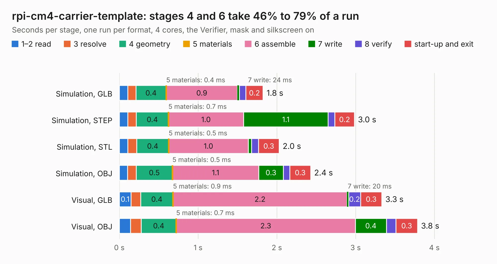

# 2545. rpi-cm4-carrier-template

Board 2,545 of the 3,132 of [Corpus Testing](../Corpus-Testing.md), on [Corpus Page 24](../CorpusTestingPages/Corpus-Testing-24.md#2545-rpi-cm4-carrier-template).

| Mode and format | 1–2 read | 3 resolve | 4 geometry | 5 materials | 6 assemble | 7 write | 8 verify | start-up and exit | Total |
|---|---:|---:|---:|---:|---:|---:|---:|---:|---:|
| Simulation, GLB | 0.1 | 0.1 | 0.4 | 0.4&nbsp;ms | 0.9 | 24&nbsp;ms | 85&nbsp;ms | 0.2 | 1.8 |
| Simulation, STEP | 0.1 | 0.1 | 0.4 | 0.7&nbsp;ms | 1.0 | 1.1 | 85&nbsp;ms | 0.2 | 3.0 |
| Simulation, STL | 0.1 | 0.1 | 0.4 | 0.5&nbsp;ms | 1.0 | 41&nbsp;ms | 89&nbsp;ms | 0.3 | 2.0 |
| Simulation, OBJ | 0.1 | 0.1 | 0.5 | 0.5&nbsp;ms | 1.1 | 0.3 | 84&nbsp;ms | 0.3 | 2.4 |
| Visual, GLB | 0.1 | 0.1 | 0.4 | 0.9&nbsp;ms | 2.2 | 20&nbsp;ms | 0.2 | 0.3 | 3.3 |
| Visual, OBJ | 0.1 | 0.1 | 0.4 | 0.7&nbsp;ms | 2.3 | 0.4 | 0.1 | 0.3 | 3.8 |

<table align="center"><tr><td valign="top">

| Board | Repo: [ShawnHymel/rpi-cm4-carrier-template](https://github.com/ShawnHymel/rpi-cm4-carrier-template) Board: `rpi-cm4-carrier-template.kicad_pcb` |
|---|---|
| Folder | hardware / rpi-cm4-carrier-template |
| Complexity | 69&nbsp;/&nbsp;1000 (size&nbsp;24, features&nbsp;45) |
| KESE&nbsp;features | curved board outline, stack-up, dielectric εr and tanδ, mask and silkscreen colours |
| Tested | 9th November 2026 |
| Copper&nbsp;layers | 2 |
| File&nbsp;format | KiCad 6 (20201002) |
| Parts,&nbsp;tracks,&nbsp;vias | 1, 0, 0 |
| Triangles,&nbsp;simulation | 40,544 in 207 parts |
| Verifier | PASS in all six runs |

</td><td valign="top">

<table>
<tr><th>File type</th><th>File size</th><th>Peak memory used</th></tr>
<tr><th colspan="3" align="left">Simulation</th></tr>
<tr><td>GLB</td><td align="right">1.6&nbsp;MB</td><td align="right">75&nbsp;MB</td></tr>
<tr><td>STEP</td><td align="right">8.1&nbsp;MB</td><td align="right">180&nbsp;MB</td></tr>
<tr><td>STL</td><td align="right">2.0&nbsp;MB</td><td align="right">75&nbsp;MB</td></tr>
<tr><td>OBJ</td><td align="right">4.5&nbsp;MB</td><td align="right">93&nbsp;MB</td></tr>
<tr><th colspan="3" align="left">Visual</th></tr>
<tr><td>GLB</td><td align="right">2.0&nbsp;MB</td><td align="right">138&nbsp;MB</td></tr>
<tr><td>OBJ</td><td align="right">5.6&nbsp;MB</td><td align="right">143&nbsp;MB</td></tr>
</table>

</td></tr></table>

| Previous | Next |
|:---|---:|
| [2544. portapack_h1](b2544b_portapack-hackrf_portapack-h1.md) | [2546. tulipcc](b2546b_tulipcc_tulipcc.md) |
