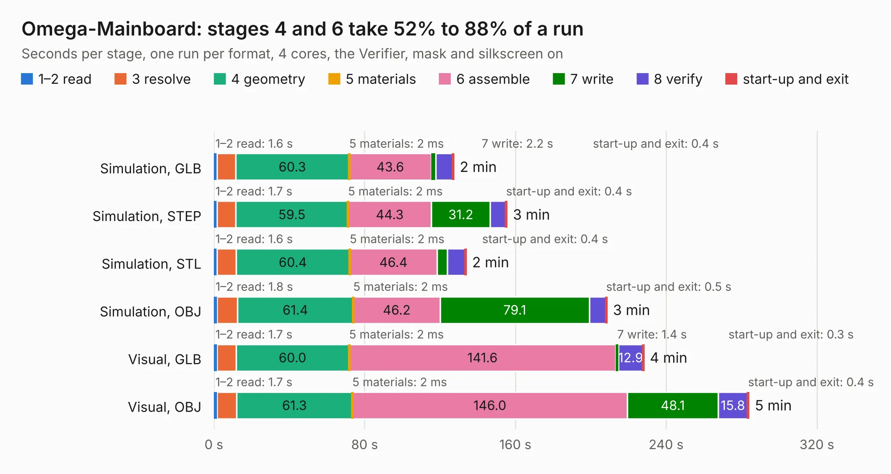

# 2546. Omega-Mainboard

Board 2,546 of the 3,117 of [Corpus Testing](../Corpus-Testing.md), on [Corpus Page 24](../CorpusTestingPages/Corpus-Testing-24.md#2546-omega-mainboard).

| Mode and format | 1–2 read | 3 resolve | 4 geometry | 5 materials | 6 assemble | 7 write | 8 verify | start-up and exit | Total |
|---|---:|---:|---:|---:|---:|---:|---:|---:|---:|
| Simulation, GLB | 1.6 | 9.8 | 60.3 | 2&nbsp;ms | 43.6 | 2.2 | 9.1 | 0.4 | 127.1 |
| Simulation, STEP | 1.7 | 10.0 | 59.5 | 2&nbsp;ms | 44.3 | 31.2 | 8.3 | 0.4 | 155.3 |
| Simulation, STL | 1.6 | 10.1 | 60.4 | 2&nbsp;ms | 46.4 | 5.5 | 9.3 | 0.4 | 133.7 |
| Simulation, OBJ | 1.8 | 10.8 | 61.4 | 2&nbsp;ms | 46.2 | 79.1 | 8.8 | 0.5 | 208.4 |
| Visual, GLB | 1.7 | 10.1 | 60.0 | 2&nbsp;ms | 141.6 | 1.4 | 12.9 | 0.3 | 228.0 |
| Visual, OBJ | 1.7 | 10.5 | 61.3 | 2&nbsp;ms | 146.0 | 48.1 | 15.8 | 0.4 | 283.7 |

<table align="center"><tr><td valign="top">

| Board | Repo: [skiselev/omega](https://github.com/skiselev/omega) Board: `Omega-Mainboard.kicad_pcb` |
|---|---|
| Folder | Mainboard / KiCad |
| Complexity | 266&nbsp;/&nbsp;1000 (size&nbsp;221, features&nbsp;45) |
| KESE&nbsp;features | through vias, filled zones, curved board outline |
| Tested | 9th November 2026 |
| Copper&nbsp;layers | 2 |
| File&nbsp;format | KiCad 5 (20171130) |
| Parts,&nbsp;tracks,&nbsp;vias | 237, 6,484, 208 |
| Triangles,&nbsp;simulation | 11,299,908 in 419 parts |
| Verifier | PASS in all six runs |

</td><td valign="top">

<table>
<tr><th>File type</th><th>File size</th><th>Peak memory used</th></tr>
<tr><th colspan="3" align="left">Simulation</th></tr>
<tr><td>GLB</td><td align="right">381&nbsp;MB</td><td align="right">4.0&nbsp;GB</td></tr>
<tr><td>STEP</td><td align="right">1.8&nbsp;GB</td><td align="right">4.2&nbsp;GB</td></tr>
<tr><td>STL</td><td align="right">565&nbsp;MB</td><td align="right">3.6&nbsp;GB</td></tr>
<tr><td>OBJ</td><td align="right">1.2&nbsp;GB</td><td align="right">6.9&nbsp;GB</td></tr>
<tr><th colspan="3" align="left">Visual</th></tr>
<tr><td>GLB</td><td align="right">256&nbsp;MB</td><td align="right">4.3&nbsp;GB</td></tr>
<tr><td>OBJ</td><td align="right">822&nbsp;MB</td><td align="right">4.8&nbsp;GB</td></tr>
</table>

</td></tr></table>

| Previous | Next |
|:---|---:|
| [2545. Omega-Keyboard](b2545b_omega_Omega-Keyboard.md) | [2547. Tiny_Z80](b2547b_tiny-z80_Tiny-Z80.md) |
