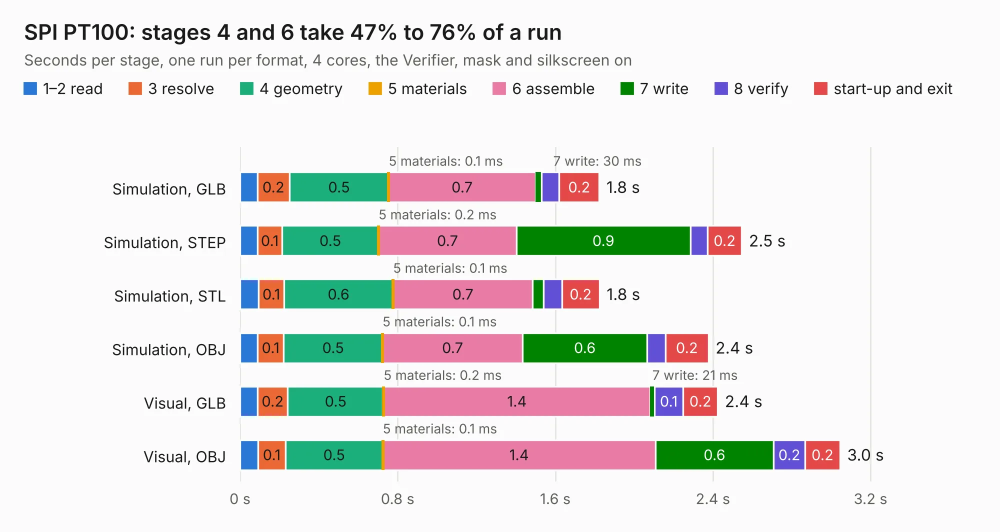

# 2547. SPI PT100

Board 2,547 of the 3,103 of [Corpus Testing](../Corpus-Testing.md), on [Corpus Page 24](../CorpusTestingPages/Corpus-Testing-24.md#2547-spi-pt100).

| Mode and format | 1–2 read | 3 resolve | 4 geometry | 5 materials | 6 assemble | 7 write | 8 verify | start-up and exit | Total |
|---|---:|---:|---:|---:|---:|---:|---:|---:|---:|
| Simulation, GLB | 88&nbsp;ms | 0.2 | 0.5 | 0.1&nbsp;ms | 0.7 | 30&nbsp;ms | 91&nbsp;ms | 0.2 | 1.8 |
| Simulation, STEP | 89&nbsp;ms | 0.1 | 0.5 | 0.2&nbsp;ms | 0.7 | 0.9 | 87&nbsp;ms | 0.2 | 2.5 |
| Simulation, STL | 94&nbsp;ms | 0.1 | 0.6 | 0.1&nbsp;ms | 0.7 | 54&nbsp;ms | 94&nbsp;ms | 0.2 | 1.8 |
| Simulation, OBJ | 89&nbsp;ms | 0.1 | 0.5 | 0.1&nbsp;ms | 0.7 | 0.6 | 93&nbsp;ms | 0.2 | 2.4 |
| Visual, GLB | 89&nbsp;ms | 0.2 | 0.5 | 0.2&nbsp;ms | 1.4 | 21&nbsp;ms | 0.1 | 0.2 | 2.4 |
| Visual, OBJ | 91&nbsp;ms | 0.1 | 0.5 | 0.1&nbsp;ms | 1.4 | 0.6 | 0.2 | 0.2 | 3.0 |

<table align="center"><tr><td valign="top">

| Board | Repo: [smoothieware/smoothieboard2](https://github.com/smoothieware/smoothieboard2) Board: `SPI PT100.kicad_pcb` |
|---|---|
| Folder | extension-boards / spi-pt100 |
| Complexity | 174&nbsp;/&nbsp;1000 (size&nbsp;139, features&nbsp;35) |
| KESE&nbsp;features | through vias, filled zones |
| Tested | 9th November 2026 |
| Copper&nbsp;layers | 2 |
| File&nbsp;format | KiCad 5 (20170123) |
| Parts,&nbsp;tracks,&nbsp;vias | 13, 221, 27 |
| Triangles,&nbsp;simulation | 161,198 in 30 parts |
| Verifier | PASS in all six runs |

</td><td valign="top">

<table>
<tr><th>File type</th><th>File size</th><th>Peak memory used</th></tr>
<tr><th colspan="3" align="left">Simulation</th></tr>
<tr><td>GLB</td><td align="right">5.5&nbsp;MB</td><td align="right">202&nbsp;MB</td></tr>
<tr><td>STEP</td><td align="right">28&nbsp;MB</td><td align="right">220&nbsp;MB</td></tr>
<tr><td>STL</td><td align="right">8.1&nbsp;MB</td><td align="right">203&nbsp;MB</td></tr>
<tr><td>OBJ</td><td align="right">16&nbsp;MB</td><td align="right">207&nbsp;MB</td></tr>
<tr><th colspan="3" align="left">Visual</th></tr>
<tr><td>GLB</td><td align="right">4.8&nbsp;MB</td><td align="right">198&nbsp;MB</td></tr>
<tr><td>OBJ</td><td align="right">14&nbsp;MB</td><td align="right">200&nbsp;MB</td></tr>
</table>

</td></tr></table>

| Previous | Next |
|:---|---:|
| [2546. SPIOpto](b2546b_smoothieboard2_SPIOpto.md) | [2548. Thermocouple](b2548b_smoothieboard2_Thermocouple.md) |
