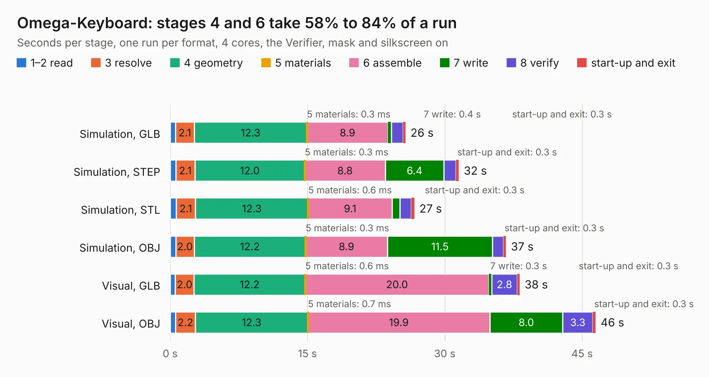

# 2548. Omega-Keyboard

Board 2,548 of the 3,120 of [Corpus Testing](../Corpus-Testing.md), on [Corpus Page 24](../CorpusTestingPages/Corpus-Testing-24.md#2548-omega-keyboard).

| Mode and format | 1–2 read | 3 resolve | 4 geometry | 5 materials | 6 assemble | 7 write | 8 verify | start-up and exit | Total |
|---|---:|---:|---:|---:|---:|---:|---:|---:|---:|
| Simulation, GLB | 0.6 | 2.1 | 12.3 | 0.3&nbsp;ms | 8.9 | 0.4 | 1.3 | 0.3 | 25.7 |
| Simulation, STEP | 0.6 | 2.1 | 12.0 | 0.3&nbsp;ms | 8.8 | 6.4 | 1.3 | 0.3 | 31.5 |
| Simulation, STL | 0.7 | 2.1 | 12.3 | 0.6&nbsp;ms | 9.1 | 0.9 | 1.2 | 0.3 | 26.7 |
| Simulation, OBJ | 0.6 | 2.0 | 12.2 | 0.3&nbsp;ms | 8.9 | 11.5 | 1.2 | 0.3 | 36.7 |
| Visual, GLB | 0.6 | 2.0 | 12.2 | 0.6&nbsp;ms | 20.0 | 0.3 | 2.8 | 0.3 | 38.2 |
| Visual, OBJ | 0.6 | 2.2 | 12.3 | 0.7&nbsp;ms | 19.9 | 8.0 | 3.3 | 0.3 | 46.5 |

<table align="center"><tr><td valign="top">

| Board | Repo: [skiselev/omega](https://github.com/skiselev/omega) Board: `Omega-Keyboard.kicad_pcb` |
|---|---|
| Folder | Keyboard / KiCad |
| Complexity | 225&nbsp;/&nbsp;1000 (size&nbsp;180, features&nbsp;45) |
| KESE&nbsp;features | through vias, filled zones, curved board outline |
| Tested | 9th November 2026 |
| Copper&nbsp;layers | 2 |
| File&nbsp;format | KiCad 5 (20171130) |
| Parts,&nbsp;tracks,&nbsp;vias | 89, 978, 38 |
| Triangles,&nbsp;simulation | 2,305,514 in 49 parts |
| Verifier | PASS in all six runs |

</td><td valign="top">

<table>
<tr><th>File type</th><th>File size</th><th>Peak memory used</th></tr>
<tr><th colspan="3" align="left">Simulation</th></tr>
<tr><td>GLB</td><td align="right">79&nbsp;MB</td><td align="right">838&nbsp;MB</td></tr>
<tr><td>STEP</td><td align="right">370&nbsp;MB</td><td align="right">1.0&nbsp;GB</td></tr>
<tr><td>STL</td><td align="right">115&nbsp;MB</td><td align="right">819&nbsp;MB</td></tr>
<tr><td>OBJ</td><td align="right">243&nbsp;MB</td><td align="right">1.6&nbsp;GB</td></tr>
<tr><th colspan="3" align="left">Visual</th></tr>
<tr><td>GLB</td><td align="right">52&nbsp;MB</td><td align="right">932&nbsp;MB</td></tr>
<tr><td>OBJ</td><td align="right">159&nbsp;MB</td><td align="right">1.1&nbsp;GB</td></tr>
</table>

</td></tr></table>

| Previous | Next |
|:---|---:|
| [2547. AT386SX](b2547b_mb386sx-rc2016_AT386SX.md) | [2549. Omega-Mainboard](b2549b_omega_Omega-Mainboard.md) |
