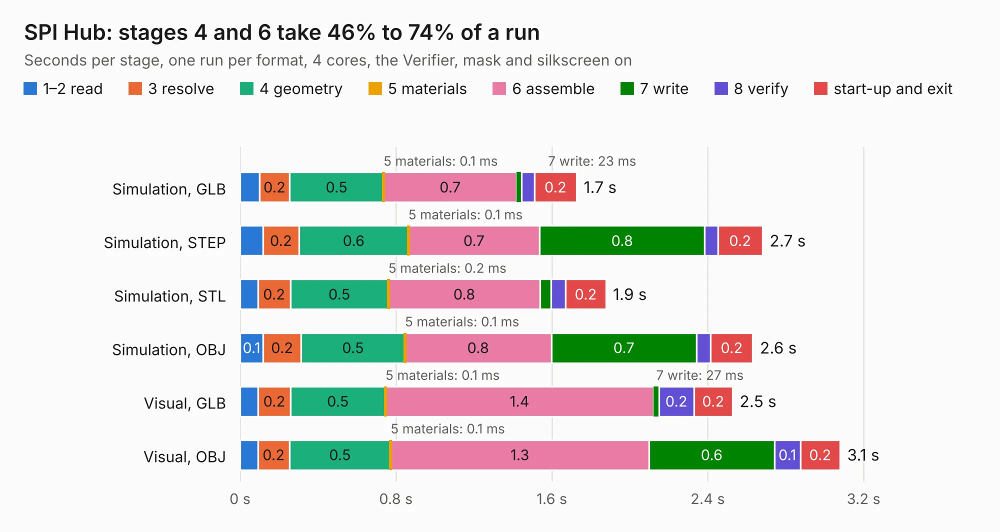

# 2548. SPI Hub

Board 2,548 of the 3,106 of [Corpus Testing](../Corpus-Testing.md), on [Corpus Page 24](../CorpusTestingPages/Corpus-Testing-24.md#2548-spi-hub).

| Mode and format | 1–2 read | 3 resolve | 4 geometry | 5 materials | 6 assemble | 7 write | 8 verify | start-up and exit | Total |
|---|---:|---:|---:|---:|---:|---:|---:|---:|---:|
| Simulation, GLB | 99&nbsp;ms | 0.2 | 0.5 | 0.1&nbsp;ms | 0.7 | 23&nbsp;ms | 67&nbsp;ms | 0.2 | 1.7 |
| Simulation, STEP | 0.1 | 0.2 | 0.6 | 0.1&nbsp;ms | 0.7 | 0.8 | 67&nbsp;ms | 0.2 | 2.7 |
| Simulation, STL | 91&nbsp;ms | 0.2 | 0.5 | 0.2&nbsp;ms | 0.8 | 56&nbsp;ms | 75&nbsp;ms | 0.2 | 1.9 |
| Simulation, OBJ | 0.1 | 0.2 | 0.5 | 0.1&nbsp;ms | 0.8 | 0.7 | 73&nbsp;ms | 0.2 | 2.6 |
| Visual, GLB | 93&nbsp;ms | 0.2 | 0.5 | 0.1&nbsp;ms | 1.4 | 27&nbsp;ms | 0.2 | 0.2 | 2.5 |
| Visual, OBJ | 92&nbsp;ms | 0.2 | 0.5 | 0.1&nbsp;ms | 1.3 | 0.6 | 0.1 | 0.2 | 3.1 |

<table align="center"><tr><td valign="top">

| Board | Repo: [smoothieware/smoothieboard2](https://github.com/smoothieware/smoothieboard2) Board: `SPI Hub.kicad_pcb` |
|---|---|
| Folder | extension-boards / spi-hub |
| Complexity | 155&nbsp;/&nbsp;1000 (size&nbsp;140, features&nbsp;15) |
| KESE&nbsp;features | through vias |
| Tested | 9th November 2026 |
| Copper&nbsp;layers | 2 |
| File&nbsp;format | KiCad 4 (4) |
| Parts,&nbsp;tracks,&nbsp;vias | 13, 209, 41 |
| Triangles,&nbsp;simulation | 143,264 in 32 parts |
| Verifier | PASS in all six runs |

</td><td valign="top">

<table>
<tr><th>File type</th><th>File size</th><th>Peak memory used</th></tr>
<tr><th colspan="3" align="left">Simulation</th></tr>
<tr><td>GLB</td><td align="right">5.1&nbsp;MB</td><td align="right">201&nbsp;MB</td></tr>
<tr><td>STEP</td><td align="right">22&nbsp;MB</td><td align="right">216&nbsp;MB</td></tr>
<tr><td>STL</td><td align="right">7.2&nbsp;MB</td><td align="right">201&nbsp;MB</td></tr>
<tr><td>OBJ</td><td align="right">14&nbsp;MB</td><td align="right">200&nbsp;MB</td></tr>
<tr><th colspan="3" align="left">Visual</th></tr>
<tr><td>GLB</td><td align="right">4.1&nbsp;MB</td><td align="right">184&nbsp;MB</td></tr>
<tr><td>OBJ</td><td align="right">12&nbsp;MB</td><td align="right">187&nbsp;MB</td></tr>
</table>

</td></tr></table>

| Previous | Next |
|:---|---:|
| [2547. Small Mosfet](b2547b_smoothieboard2_Small-Mosfet.md) | [2549. SPIOpto](b2549b_smoothieboard2_SPIOpto.md) |
