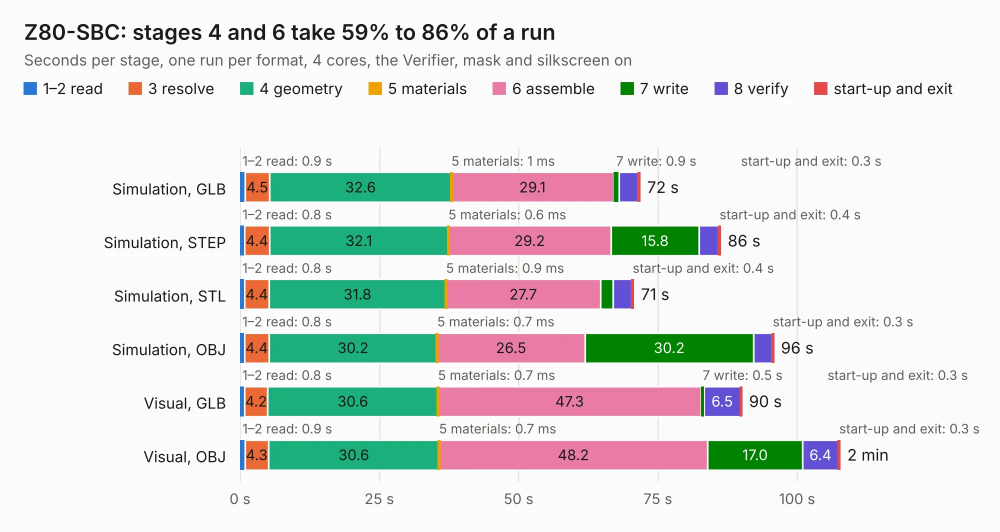

# 2549. Z80-SBC

Board 2,549 of the 3,118 of [Corpus Testing](../Corpus-Testing.md), on [Corpus Page 24](../CorpusTestingPages/Corpus-Testing-24.md#2549-z80-sbc).

| Mode and format | 1–2 read | 3 resolve | 4 geometry | 5 materials | 6 assemble | 7 write | 8 verify | start-up and exit | Total |
|---|---:|---:|---:|---:|---:|---:|---:|---:|---:|
| Simulation, GLB | 0.9 | 4.5 | 32.6 | 1&nbsp;ms | 29.1 | 0.9 | 3.5 | 0.3 | 71.8 |
| Simulation, STEP | 0.8 | 4.4 | 32.1 | 0.6&nbsp;ms | 29.2 | 15.8 | 3.5 | 0.4 | 86.3 |
| Simulation, STL | 0.8 | 4.4 | 31.8 | 0.9&nbsp;ms | 27.7 | 2.3 | 3.3 | 0.4 | 70.7 |
| Simulation, OBJ | 0.8 | 4.4 | 30.2 | 0.7&nbsp;ms | 26.5 | 30.2 | 3.3 | 0.3 | 95.8 |
| Visual, GLB | 0.8 | 4.2 | 30.6 | 0.7&nbsp;ms | 47.3 | 0.5 | 6.5 | 0.3 | 90.1 |
| Visual, OBJ | 0.9 | 4.3 | 30.6 | 0.7&nbsp;ms | 48.2 | 17.0 | 6.4 | 0.3 | 107.7 |

<table align="center"><tr><td valign="top">

| Board | Repo: [skiselev/zeta_sbc](https://github.com/skiselev/zeta_sbc) Board: `Z80-SBC.kicad_pcb` |
|---|---|
| Folder | KiCad |
| Complexity | 252&nbsp;/&nbsp;1000 (size&nbsp;197, features&nbsp;55) |
| KESE&nbsp;features | through vias, slotted holes, filled zones, curved board outline |
| Tested | 9th November 2026 |
| Copper&nbsp;layers | 2 |
| File&nbsp;format | KiCad 3 (3) |
| Parts,&nbsp;tracks,&nbsp;vias | 70, 2,861, 205 |
| Triangles,&nbsp;simulation | 4,972,440 in 155 parts |
| Verifier | PASS in all six runs |

</td><td valign="top">

<table>
<tr><th>File type</th><th>File size</th><th>Peak memory used</th></tr>
<tr><th colspan="3" align="left">Simulation</th></tr>
<tr><td>GLB</td><td align="right">171&nbsp;MB</td><td align="right">1.3&nbsp;GB</td></tr>
<tr><td>STEP</td><td align="right">865&nbsp;MB</td><td align="right">1.8&nbsp;GB</td></tr>
<tr><td>STL</td><td align="right">249&nbsp;MB</td><td align="right">1.3&nbsp;GB</td></tr>
<tr><td>OBJ</td><td align="right">539&nbsp;MB</td><td align="right">3.2&nbsp;GB</td></tr>
<tr><th colspan="3" align="left">Visual</th></tr>
<tr><td>GLB</td><td align="right">100&nbsp;MB</td><td align="right">1.7&nbsp;GB</td></tr>
<tr><td>OBJ</td><td align="right">318&nbsp;MB</td><td align="right">2.0&nbsp;GB</td></tr>
</table>

</td></tr></table>

| Previous | Next |
|:---|---:|
| [2548. Tiny_Z80](b2548b_tiny-z80_Tiny-Z80.md) | [2550. bitaxeUltra](b2550b_bitaxe_bitaxeUltra.md) |
