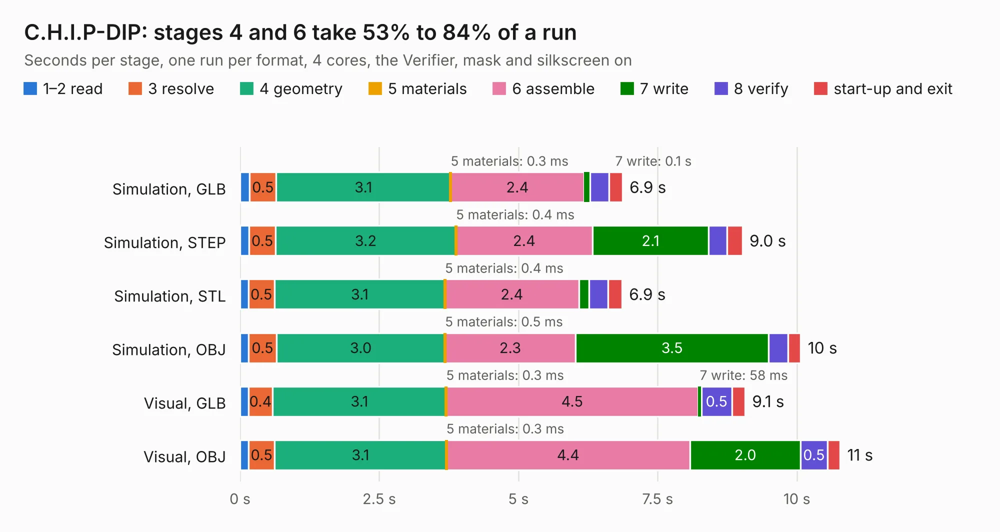

# 2551. C.H.I.P-DIP

Board 2,551 of the 3,116 of [Corpus Testing](../Corpus-Testing.md), on [Corpus Page 24](../CorpusTestingPages/Corpus-Testing-24.md#2551-chip-dip).

| Mode and format | 1–2 read | 3 resolve | 4 geometry | 5 materials | 6 assemble | 7 write | 8 verify | start-up and exit | Total |
|---|---:|---:|---:|---:|---:|---:|---:|---:|---:|
| Simulation, GLB | 0.2 | 0.5 | 3.1 | 0.3&nbsp;ms | 2.4 | 0.1 | 0.3 | 0.2 | 6.9 |
| Simulation, STEP | 0.2 | 0.5 | 3.2 | 0.4&nbsp;ms | 2.4 | 2.1 | 0.3 | 0.3 | 9.0 |
| Simulation, STL | 0.1 | 0.5 | 3.1 | 0.4&nbsp;ms | 2.4 | 0.2 | 0.3 | 0.2 | 6.9 |
| Simulation, OBJ | 0.2 | 0.5 | 3.0 | 0.5&nbsp;ms | 2.3 | 3.5 | 0.3 | 0.2 | 10.1 |
| Visual, GLB | 0.1 | 0.4 | 3.1 | 0.3&nbsp;ms | 4.5 | 58&nbsp;ms | 0.5 | 0.2 | 9.1 |
| Visual, OBJ | 0.2 | 0.5 | 3.1 | 0.3&nbsp;ms | 4.4 | 2.0 | 0.5 | 0.2 | 10.8 |

<table align="center"><tr><td valign="top">

| Board | Repo: [smoothieware/smoothieboard2](https://github.com/smoothieware/smoothieboard2) Board: `C.H.I.P-DIP.kicad_pcb` |
|---|---|
| Folder | extension-boards / chip-dip-computer-carrier |
| Complexity | 170&nbsp;/&nbsp;1000 (size&nbsp;135, features&nbsp;35) |
| KESE&nbsp;features | through vias, filled zones |
| Tested | 9th November 2026 |
| Copper&nbsp;layers | 2 |
| File&nbsp;format | KiCad 4 (4) |
| Parts,&nbsp;tracks,&nbsp;vias | 19, 160, 9 |
| Triangles,&nbsp;simulation | 633,472 in 96 parts |
| Verifier | PASS in all six runs |

</td><td valign="top">

<table>
<tr><th>File type</th><th>File size</th><th>Peak memory used</th></tr>
<tr><th colspan="3" align="left">Simulation</th></tr>
<tr><td>GLB</td><td align="right">21&nbsp;MB</td><td align="right">341&nbsp;MB</td></tr>
<tr><td>STEP</td><td align="right">108&nbsp;MB</td><td align="right">374&nbsp;MB</td></tr>
<tr><td>STL</td><td align="right">32&nbsp;MB</td><td align="right">322&nbsp;MB</td></tr>
<tr><td>OBJ</td><td align="right">64&nbsp;MB</td><td align="right">460&nbsp;MB</td></tr>
<tr><th colspan="3" align="left">Visual</th></tr>
<tr><td>GLB</td><td align="right">12&nbsp;MB</td><td align="right">358&nbsp;MB</td></tr>
<tr><td>OBJ</td><td align="right">36&nbsp;MB</td><td align="right">350&nbsp;MB</td></tr>
</table>

</td></tr></table>

| Previous | Next |
|:---|---:|
| [2550. StepperMotorBreakout](b2550b_smoothieboard2_StepperMotorBreakout.md) | [2552. Large MOSFET](b2552b_smoothieboard2_Large-MOSFET.md) |
