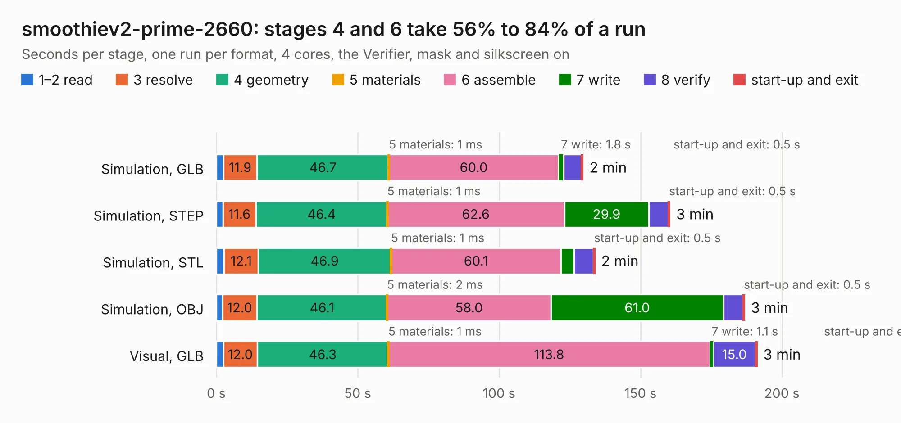

# 2551. smoothiev2-prime-2660

Board 2,551 of the 3,105 of [Corpus Testing](../Corpus-Testing.md), on [Corpus Page 24](../CorpusTestingPages/Corpus-Testing-24.md#2551-smoothiev2-prime-2660).

| Mode and format | 1–2 read | 3 resolve | 4 geometry | 5 materials | 6 assemble | 7 write | 8 verify | start-up and exit | Total |
|---|---:|---:|---:|---:|---:|---:|---:|---:|---:|
| Simulation, GLB | 2.5 | 11.9 | 46.7 | 1&nbsp;ms | 60.0 | 1.8 | 6.4 | 0.5 | 129.7 |
| Simulation, STEP | 2.4 | 11.6 | 46.4 | 1&nbsp;ms | 62.6 | 29.9 | 6.9 | 0.5 | 160.4 |
| Simulation, STL | 2.7 | 12.1 | 46.9 | 1&nbsp;ms | 60.1 | 4.6 | 6.9 | 0.5 | 133.8 |
| Simulation, OBJ | 2.3 | 12.0 | 46.1 | 2&nbsp;ms | 58.0 | 61.0 | 7.0 | 0.5 | 186.8 |
| Visual, GLB | 2.5 | 12.0 | 46.3 | 1&nbsp;ms | 113.8 | 1.1 | 15.0 | 0.4 | 191.1 |
| Visual, OBJ | 2.4 | 12.1 | 45.4 | 1&nbsp;ms | 116.7 | 39.1 | 14.2 | 0.4 | 230.3 |

<table align="center"><tr><td valign="top">

| Board | Repo: [smoothieware/smoothieboard2](https://github.com/smoothieware/smoothieboard2) Board: `smoothiev2-prime-2660.kicad_pcb` |
|---|---|
| Folder | smoothiev2-prime-Proto9and10_Kicad5 |
| Complexity | 412&nbsp;/&nbsp;1000 (size&nbsp;312, features&nbsp;100) |
| KESE&nbsp;features | through vias, custom pads, rounded, trapezoid or chamfered pads, drill offsets, filled zones, copper drawings, copper text, curved board outline |
| Tested | 9th November 2026 |
| Copper&nbsp;layers | 4 |
| File&nbsp;format | KiCad 5 (20171130) |
| Parts,&nbsp;tracks,&nbsp;vias | 411, 8,248, 1,353 |
| Triangles,&nbsp;simulation | 9,777,692 in 411 parts |
| Verifier | PASS in all six runs |

</td><td valign="top">

<table>
<tr><th>File type</th><th>File size</th><th>Peak memory used</th></tr>
<tr><th colspan="3" align="left">Simulation</th></tr>
<tr><td>GLB</td><td align="right">332&nbsp;MB</td><td align="right">2.6&nbsp;GB</td></tr>
<tr><td>STEP</td><td align="right">1.4&nbsp;GB</td><td align="right">3.7&nbsp;GB</td></tr>
<tr><td>STL</td><td align="right">489&nbsp;MB</td><td align="right">2.5&nbsp;GB</td></tr>
<tr><td>OBJ</td><td align="right">1.0&nbsp;GB</td><td align="right">6.0&nbsp;GB</td></tr>
<tr><th colspan="3" align="left">Visual</th></tr>
<tr><td>GLB</td><td align="right">224&nbsp;MB</td><td align="right">3.4&nbsp;GB</td></tr>
<tr><td>OBJ</td><td align="right">723&nbsp;MB</td><td align="right">4.7&nbsp;GB</td></tr>
</table>

</td></tr></table>

| Previous | Next |
|:---|---:|
| [2550. Thermocouple](b2550b_smoothieboard2_Thermocouple.md) | [2552. V2 Core](b2552b_smoothieboard2_V2-Core.md) |
