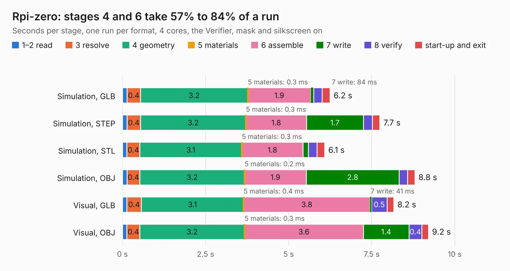

# 2552. Rpi-zero

Board 2,552 of the 3,112 of [Corpus Testing](../Corpus-Testing.md), on [Corpus Page 24](../CorpusTestingPages/Corpus-Testing-24.md#2552-rpi-zero).

| Mode and format | 1–2 read | 3 resolve | 4 geometry | 5 materials | 6 assemble | 7 write | 8 verify | start-up and exit | Total |
|---|---:|---:|---:|---:|---:|---:|---:|---:|---:|
| Simulation, GLB | 0.1 | 0.4 | 3.2 | 0.3&nbsp;ms | 1.9 | 84&nbsp;ms | 0.3 | 0.2 | 6.2 |
| Simulation, STEP | 0.1 | 0.4 | 3.2 | 0.3&nbsp;ms | 1.8 | 1.7 | 0.3 | 0.2 | 7.7 |
| Simulation, STL | 0.1 | 0.4 | 3.1 | 0.3&nbsp;ms | 1.8 | 0.2 | 0.3 | 0.2 | 6.1 |
| Simulation, OBJ | 0.1 | 0.4 | 3.2 | 0.2&nbsp;ms | 1.9 | 2.8 | 0.3 | 0.2 | 8.8 |
| Visual, GLB | 0.1 | 0.4 | 3.1 | 0.4&nbsp;ms | 3.8 | 41&nbsp;ms | 0.5 | 0.2 | 8.2 |
| Visual, OBJ | 0.1 | 0.4 | 3.2 | 0.3&nbsp;ms | 3.6 | 1.4 | 0.4 | 0.2 | 9.2 |

<table align="center"><tr><td valign="top">

| Board | Repo: [smoothieware/smoothieboard2](https://github.com/smoothieware/smoothieboard2) Board: `Rpi-zero.kicad_pcb` |
|---|---|
| Folder | extension-boards / raspberry-pi-zero-interface |
| Complexity | 167&nbsp;/&nbsp;1000 (size&nbsp;142, features&nbsp;25) |
| KESE&nbsp;features | through vias, curved board outline |
| Tested | 9th November 2026 |
| Copper&nbsp;layers | 2 |
| File&nbsp;format | KiCad 4 (4) |
| Parts,&nbsp;tracks,&nbsp;vias | 17, 289, 6 |
| Triangles,&nbsp;simulation | 512,212 in 55 parts |
| Verifier | PASS in all six runs |

</td><td valign="top">

<table>
<tr><th>File type</th><th>File size</th><th>Peak memory used</th></tr>
<tr><th colspan="3" align="left">Simulation</th></tr>
<tr><td>GLB</td><td align="right">17&nbsp;MB</td><td align="right">299&nbsp;MB</td></tr>
<tr><td>STEP</td><td align="right">84&nbsp;MB</td><td align="right">330&nbsp;MB</td></tr>
<tr><td>STL</td><td align="right">26&nbsp;MB</td><td align="right">307&nbsp;MB</td></tr>
<tr><td>OBJ</td><td align="right">52&nbsp;MB</td><td align="right">390&nbsp;MB</td></tr>
<tr><th colspan="3" align="left">Visual</th></tr>
<tr><td>GLB</td><td align="right">8.8&nbsp;MB</td><td align="right">295&nbsp;MB</td></tr>
<tr><td>OBJ</td><td align="right">26&nbsp;MB</td><td align="right">281&nbsp;MB</td></tr>
</table>

</td></tr></table>

| Previous | Next |
|:---|---:|
| [2551. RPi zero with ethernet](b2551b_smoothieboard2_RPi-zero-with-ethernet.md) | [2553. Small Mosfet](b2553b_smoothieboard2_Small-Mosfet.md) |
