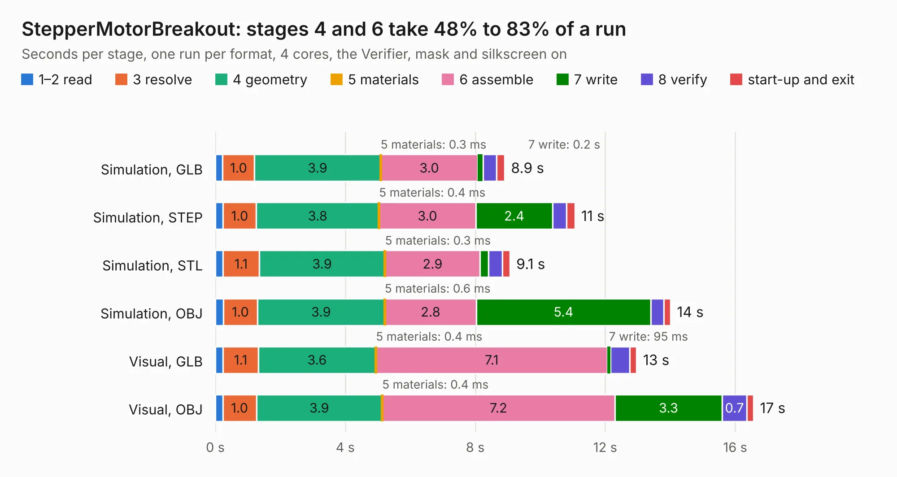

# 2552. StepperMotorBreakout

Board 2,552 of the 3,118 of [Corpus Testing](../Corpus-Testing.md), on [Corpus Page 24](../CorpusTestingPages/Corpus-Testing-24.md#2552-steppermotorbreakout).

| Mode and format | 1–2 read | 3 resolve | 4 geometry | 5 materials | 6 assemble | 7 write | 8 verify | start-up and exit | Total |
|---|---:|---:|---:|---:|---:|---:|---:|---:|---:|
| Simulation, GLB | 0.2 | 1.0 | 3.9 | 0.3&nbsp;ms | 3.0 | 0.2 | 0.4 | 0.2 | 8.9 |
| Simulation, STEP | 0.2 | 1.0 | 3.8 | 0.4&nbsp;ms | 3.0 | 2.4 | 0.4 | 0.3 | 11.1 |
| Simulation, STL | 0.2 | 1.1 | 3.9 | 0.3&nbsp;ms | 2.9 | 0.3 | 0.4 | 0.2 | 9.1 |
| Simulation, OBJ | 0.2 | 1.0 | 3.9 | 0.6&nbsp;ms | 2.8 | 5.4 | 0.4 | 0.2 | 14.0 |
| Visual, GLB | 0.2 | 1.1 | 3.6 | 0.4&nbsp;ms | 7.1 | 95&nbsp;ms | 0.6 | 0.2 | 13.0 |
| Visual, OBJ | 0.2 | 1.0 | 3.9 | 0.4&nbsp;ms | 7.2 | 3.3 | 0.7 | 0.2 | 16.6 |

<table align="center"><tr><td valign="top">

| Board | Repo: [smoothieware/smoothieboard2](https://github.com/smoothieware/smoothieboard2) Board: `StepperMotorBreakout.kicad_pcb` |
|---|---|
| Folder | extension-boards / a5984-stepper-driver |
| Complexity | 224&nbsp;/&nbsp;1000 (size&nbsp;189, features&nbsp;35) |
| KESE&nbsp;features | through vias, filled zones |
| Tested | 9th November 2026 |
| Copper&nbsp;layers | 4 |
| File&nbsp;format | KiCad 4 (4) |
| Parts,&nbsp;tracks,&nbsp;vias | 48, 553, 146 |
| Triangles,&nbsp;simulation | 1,027,218 in 74 parts |
| Verifier | PASS in all six runs |

</td><td valign="top">

<table>
<tr><th>File type</th><th>File size</th><th>Peak memory used</th></tr>
<tr><th colspan="3" align="left">Simulation</th></tr>
<tr><td>GLB</td><td align="right">36&nbsp;MB</td><td align="right">409&nbsp;MB</td></tr>
<tr><td>STEP</td><td align="right">137&nbsp;MB</td><td align="right">487&nbsp;MB</td></tr>
<tr><td>STL</td><td align="right">51&nbsp;MB</td><td align="right">415&nbsp;MB</td></tr>
<tr><td>OBJ</td><td align="right">106&nbsp;MB</td><td align="right">736&nbsp;MB</td></tr>
<tr><th colspan="3" align="left">Visual</th></tr>
<tr><td>GLB</td><td align="right">22&nbsp;MB</td><td align="right">542&nbsp;MB</td></tr>
<tr><td>OBJ</td><td align="right">67&nbsp;MB</td><td align="right">518&nbsp;MB</td></tr>
</table>

</td></tr></table>

| Previous | Next |
|:---|---:|
| [2551. a13board](b2551b_a13board_a13board.md) | [2553. C.H.I.P-DIP](b2553b_smoothieboard2_C-H-I-P-DIP.md) |
