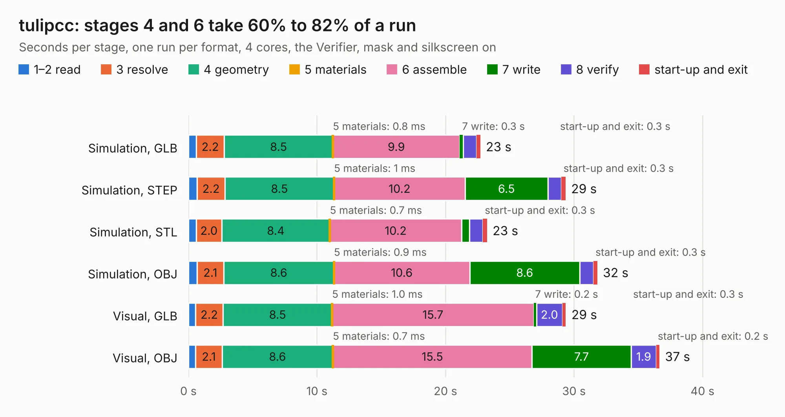

# 2552 tulipcc

Board 2,552 of the 3,138 of [Corpus Testing](../Corpus-Testing.md), on [Corpus Page 24](../CorpusTestingPages/Corpus-Testing-24.md#2552-tulipcc).

| Mode and format | 1–2 read | 3 resolve | 4 geometry | 5 materials | 6 assemble | 7 write | 8 verify | start-up and exit | Total |
|---|---:|---:|---:|---:|---:|---:|---:|---:|---:|
| Simulation, GLB | 0.6 | 2.2 | 8.5 | 0.8&nbsp;ms | 9.9 | 0.3 | 1.0 | 0.3 | 22.7 |
| Simulation, STEP | 0.7 | 2.2 | 8.5 | 1&nbsp;ms | 10.2 | 6.5 | 1.1 | 0.3 | 29.3 |
| Simulation, STL | 0.6 | 2.0 | 8.4 | 0.7&nbsp;ms | 10.2 | 0.6 | 1.0 | 0.3 | 23.2 |
| Simulation, OBJ | 0.7 | 2.1 | 8.6 | 0.9&nbsp;ms | 10.6 | 8.6 | 1.1 | 0.3 | 31.8 |
| Visual, GLB | 0.5 | 2.2 | 8.5 | 1.0&nbsp;ms | 15.7 | 0.2 | 2.0 | 0.3 | 29.4 |
| Visual, OBJ | 0.6 | 2.1 | 8.6 | 0.7&nbsp;ms | 15.5 | 7.7 | 1.9 | 0.2 | 36.6 |

<table align="center"><tr><td valign="top">

| Board | Repo: [shorepine/tulipcc](https://github.com/shorepine/tulipcc) Board: `tulipcc.kicad_pcb` |
|---|---|
| Folder | docs / pcbs / tulip4_board_v4r9 |
| Complexity | 303&nbsp;/&nbsp;1000 (size&nbsp;193, features&nbsp;110) |
| KESE&nbsp;features | through vias, slotted holes, rounded, trapezoid or chamfered pads, arc tracks, filled zones, curved board outline, stack-up, dielectric εr and tanδ |
| Tested | 10th November 2026 |
| Copper&nbsp;layers | 2 |
| File&nbsp;format | KiCad 7 (20221018) |
| Parts,&nbsp;tracks,&nbsp;vias | 96, 919, 474 |
| Triangles,&nbsp;simulation | 1,494,292 in 127 parts |
| Verifier | PASS in all six runs |

</td><td valign="top">

<table>
<tr><th>File type</th><th>File size</th><th>Peak memory used</th></tr>
<tr><th colspan="3" align="left">Simulation</th></tr>
<tr><td>GLB</td><td align="right">51&nbsp;MB</td><td align="right">688&nbsp;MB</td></tr>
<tr><td>STEP</td><td align="right">248&nbsp;MB</td><td align="right">825&nbsp;MB</td></tr>
<tr><td>STL</td><td align="right">75&nbsp;MB</td><td align="right">707&nbsp;MB</td></tr>
<tr><td>OBJ</td><td align="right">153&nbsp;MB</td><td align="right">1.0&nbsp;GB</td></tr>
<tr><th colspan="3" align="left">Visual</th></tr>
<tr><td>GLB</td><td align="right">45&nbsp;MB</td><td align="right">801&nbsp;MB</td></tr>
<tr><td>OBJ</td><td align="right">137&nbsp;MB</td><td align="right">976&nbsp;MB</td></tr>
</table>

</td></tr></table>

| Previous | Next |
|:---|---:|
| [2551 rpi-cm4-carrier-template](b2551b_rpi-cm4-carrier-template_rpi-cm4-carrier-template.md) | [2553 FlightPCB](b2553b_tsar_v1_FlightPCB.md) |
