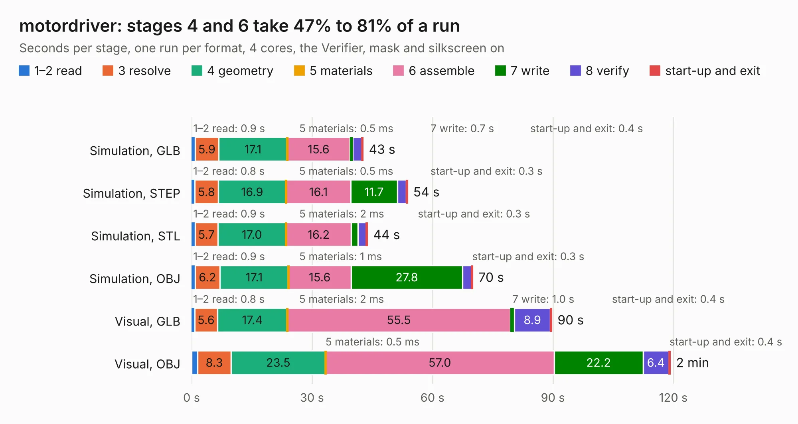

# 2553. motordriver

Board 2,553 of the 3,105 of [Corpus Testing](../Corpus-Testing.md), on [Corpus Page 24](../CorpusTestingPages/Corpus-Testing-24.md#2553-motordriver).

| Mode and format | 1–2 read | 3 resolve | 4 geometry | 5 materials | 6 assemble | 7 write | 8 verify | start-up and exit | Total |
|---|---:|---:|---:|---:|---:|---:|---:|---:|---:|
| Simulation, GLB | 0.9 | 5.9 | 17.1 | 0.5&nbsp;ms | 15.6 | 0.7 | 2.2 | 0.4 | 42.7 |
| Simulation, STEP | 0.8 | 5.8 | 16.9 | 0.5&nbsp;ms | 16.1 | 11.7 | 2.2 | 0.3 | 53.8 |
| Simulation, STL | 0.9 | 5.7 | 17.0 | 2&nbsp;ms | 16.2 | 1.7 | 2.1 | 0.3 | 43.8 |
| Simulation, OBJ | 0.9 | 6.2 | 17.1 | 1&nbsp;ms | 15.6 | 27.8 | 2.2 | 0.3 | 70.1 |
| Visual, GLB | 0.8 | 5.6 | 17.4 | 2&nbsp;ms | 55.5 | 1.0 | 8.9 | 0.4 | 89.7 |
| Visual, OBJ | 1.5 | 8.3 | 23.5 | 0.5&nbsp;ms | 57.0 | 22.2 | 6.4 | 0.4 | 119.3 |

<table align="center"><tr><td valign="top">

| Board | Repo: [smoothieware/smoothieboard2](https://github.com/smoothieware/smoothieboard2) Board: `motordriver.kicad_pcb` |
|---|---|
| Folder | V2_P11_Prime2660 / motordriver |
| Complexity | 300&nbsp;/&nbsp;1000 (size&nbsp;225, features&nbsp;75) |
| KESE&nbsp;features | through vias, rounded, trapezoid or chamfered pads, drill offsets, filled zones, copper text, curved board outline |
| Tested | 9th November 2026 |
| Copper&nbsp;layers | 4 |
| File&nbsp;format | KiCad 5 (20171130) |
| Parts,&nbsp;tracks,&nbsp;vias | 101, 2,575, 958 |
| Triangles,&nbsp;simulation | 4,673,744 in 127 parts |
| Verifier | PASS in all six runs |

</td><td valign="top">

<table>
<tr><th>File type</th><th>File size</th><th>Peak memory used</th></tr>
<tr><th colspan="3" align="left">Simulation</th></tr>
<tr><td>GLB</td><td align="right">156&nbsp;MB</td><td align="right">1.4&nbsp;GB</td></tr>
<tr><td>STEP</td><td align="right">523&nbsp;MB</td><td align="right">1.7&nbsp;GB</td></tr>
<tr><td>STL</td><td align="right">234&nbsp;MB</td><td align="right">1.4&nbsp;GB</td></tr>
<tr><td>OBJ</td><td align="right">490&nbsp;MB</td><td align="right">2.9&nbsp;GB</td></tr>
<tr><th colspan="3" align="left">Visual</th></tr>
<tr><td>GLB</td><td align="right">101&nbsp;MB</td><td align="right">1.6&nbsp;GB</td></tr>
<tr><td>OBJ</td><td align="right">326&nbsp;MB</td><td align="right">2.1&nbsp;GB</td></tr>
</table>

</td></tr></table>

| Previous | Next |
|:---|---:|
| [2552. V2 Core](b2552b_smoothieboard2_V2-Core.md) | [2554. smoothiev2-prime-2660](b2554b_smoothieboard2_V2-P11-Prime2660_smoothiev2-prime-2660.md) |
