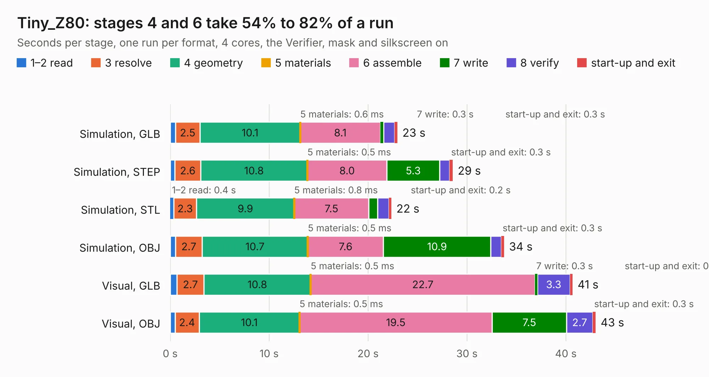

# 2553. Tiny_Z80

Board 2,553 of the 3,123 of [Corpus Testing](../Corpus-Testing.md), on [Corpus Page 24](../CorpusTestingPages/Corpus-Testing-24.md#2553-tiny_z80).

| Mode and format | 1–2 read | 3 resolve | 4 geometry | 5 materials | 6 assemble | 7 write | 8 verify | start-up and exit | Total |
|---|---:|---:|---:|---:|---:|---:|---:|---:|---:|
| Simulation, GLB | 0.5 | 2.5 | 10.1 | 0.6&nbsp;ms | 8.1 | 0.3 | 1.1 | 0.3 | 23.0 |
| Simulation, STEP | 0.5 | 2.6 | 10.8 | 0.5&nbsp;ms | 8.0 | 5.3 | 1.0 | 0.3 | 28.6 |
| Simulation, STL | 0.4 | 2.3 | 9.9 | 0.8&nbsp;ms | 7.5 | 0.9 | 1.2 | 0.2 | 22.4 |
| Simulation, OBJ | 0.5 | 2.7 | 10.7 | 0.5&nbsp;ms | 7.6 | 10.9 | 1.1 | 0.3 | 33.7 |
| Visual, GLB | 0.7 | 2.7 | 10.8 | 0.5&nbsp;ms | 22.7 | 0.3 | 3.3 | 0.3 | 40.7 |
| Visual, OBJ | 0.5 | 2.4 | 10.1 | 0.5&nbsp;ms | 19.5 | 7.5 | 2.7 | 0.3 | 43.0 |

<table align="center"><tr><td valign="top">

| Board | Repo: [skiselev/tiny_z80](https://github.com/skiselev/tiny_z80) Board: `Tiny_Z80.kicad_pcb` |
|---|---|
| Folder | KiCad |
| Complexity | 326&nbsp;/&nbsp;1000 (size&nbsp;246, features&nbsp;80) |
| KESE&nbsp;features | through vias, custom pads, rounded, trapezoid or chamfered pads, filled zones, copper drawings, curved board outline |
| Tested | 9th November 2026 |
| Copper&nbsp;layers | 2 |
| File&nbsp;format | KiCad 5 (20171130) |
| Parts,&nbsp;tracks,&nbsp;vias | 77, 1,976, 213 |
| Triangles,&nbsp;simulation | 1,992,830 in 158 parts |
| Verifier | PASS in all six runs |

</td><td valign="top">

<table>
<tr><th>File type</th><th>File size</th><th>Peak memory used</th></tr>
<tr><th colspan="3" align="left">Simulation</th></tr>
<tr><td>GLB</td><td align="right">70&nbsp;MB</td><td align="right">795&nbsp;MB</td></tr>
<tr><td>STEP</td><td align="right">382&nbsp;MB</td><td align="right">861&nbsp;MB</td></tr>
<tr><td>STL</td><td align="right">100&nbsp;MB</td><td align="right">860&nbsp;MB</td></tr>
<tr><td>OBJ</td><td align="right">213&nbsp;MB</td><td align="right">1.4&nbsp;GB</td></tr>
<tr><th colspan="3" align="left">Visual</th></tr>
<tr><td>GLB</td><td align="right">54&nbsp;MB</td><td align="right">890&nbsp;MB</td></tr>
<tr><td>OBJ</td><td align="right">166&nbsp;MB</td><td align="right">1.2&nbsp;GB</td></tr>
</table>

</td></tr></table>

| Previous | Next |
|:---|---:|
| [2552. Omega-Mainboard](b2552b_omega_Omega-Mainboard.md) | [2554. Z80-SBC](b2554b_zeta-sbc_Z80-SBC.md) |
