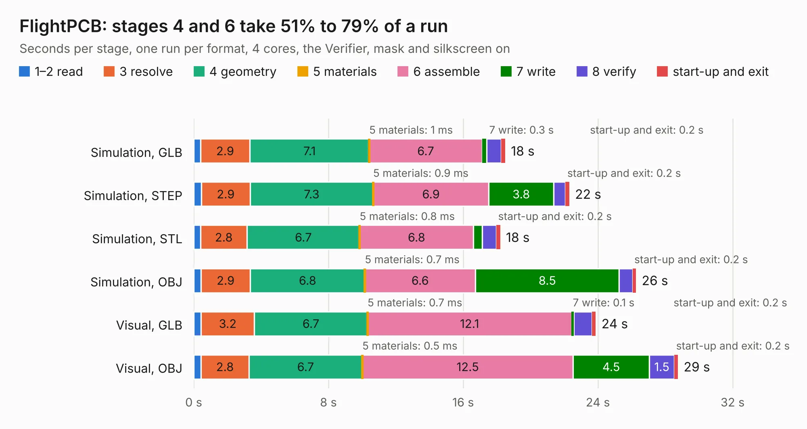

# 2555. FlightPCB

Board 2,555 of the 3,138 of [Corpus Testing](../Corpus-Testing.md), on [Corpus Page 24](../CorpusTestingPages/Corpus-Testing-24.md#2555-flightpcb).

| Mode and format | 1–2 read | 3 resolve | 4 geometry | 5 materials | 6 assemble | 7 write | 8 verify | start-up and exit | Total |
|---|---:|---:|---:|---:|---:|---:|---:|---:|---:|
| Simulation, GLB | 0.4 | 2.9 | 7.1 | 1&nbsp;ms | 6.7 | 0.3 | 0.9 | 0.2 | 18.5 |
| Simulation, STEP | 0.4 | 2.9 | 7.3 | 0.9&nbsp;ms | 6.9 | 3.8 | 0.7 | 0.2 | 22.3 |
| Simulation, STL | 0.4 | 2.8 | 6.7 | 0.8&nbsp;ms | 6.8 | 0.5 | 0.8 | 0.2 | 18.2 |
| Simulation, OBJ | 0.4 | 2.9 | 6.8 | 0.7&nbsp;ms | 6.6 | 8.5 | 0.8 | 0.2 | 26.3 |
| Visual, GLB | 0.4 | 3.2 | 6.7 | 0.7&nbsp;ms | 12.1 | 0.1 | 1.1 | 0.2 | 23.9 |
| Visual, OBJ | 0.4 | 2.8 | 6.7 | 0.5&nbsp;ms | 12.5 | 4.5 | 1.5 | 0.2 | 28.8 |

<table align="center"><tr><td valign="top">

| Board | Repo: [shubhamai/tsar](https://github.com/shubhamai/tsar) Board: `FlightPCB.kicad_pcb` |
|---|---|
| Folder | v3 |
| Complexity | 371&nbsp;/&nbsp;1000 (size&nbsp;246, features&nbsp;125) |
| KESE&nbsp;features | through vias, slotted holes, custom pads, rounded, trapezoid or chamfered pads, filled zones, copper drawings, TrueType text, stack-up, dielectric εr and tanδ |
| Tested | 9th November 2026 |
| Copper&nbsp;layers | 4 |
| File&nbsp;format | KiCad 8 (20240108) |
| Parts,&nbsp;tracks,&nbsp;vias | 93, 1,322, 184 |
| Triangles,&nbsp;simulation | 1,958,972 in 157 parts |
| Verifier | PASS in all six runs |

</td><td valign="top">

<table>
<tr><th>File type</th><th>File size</th><th>Peak memory used</th></tr>
<tr><th colspan="3" align="left">Simulation</th></tr>
<tr><td>GLB</td><td align="right">68&nbsp;MB</td><td align="right">690&nbsp;MB</td></tr>
<tr><td>STEP</td><td align="right">287&nbsp;MB</td><td align="right">780&nbsp;MB</td></tr>
<tr><td>STL</td><td align="right">98&nbsp;MB</td><td align="right">667&nbsp;MB</td></tr>
<tr><td>OBJ</td><td align="right">206&nbsp;MB</td><td align="right">1.4&nbsp;GB</td></tr>
<tr><th colspan="3" align="left">Visual</th></tr>
<tr><td>GLB</td><td align="right">36&nbsp;MB</td><td align="right">739&nbsp;MB</td></tr>
<tr><td>OBJ</td><td align="right">109&nbsp;MB</td><td align="right">831&nbsp;MB</td></tr>
</table>

</td></tr></table>

| Previous | Next |
|:---|---:|
| [2554. FlightPCB](b2554b_tsar_v2_FlightPCB.md) | [2556. rp-micro](b2556b_rp-micro_rp-micro.md) |
