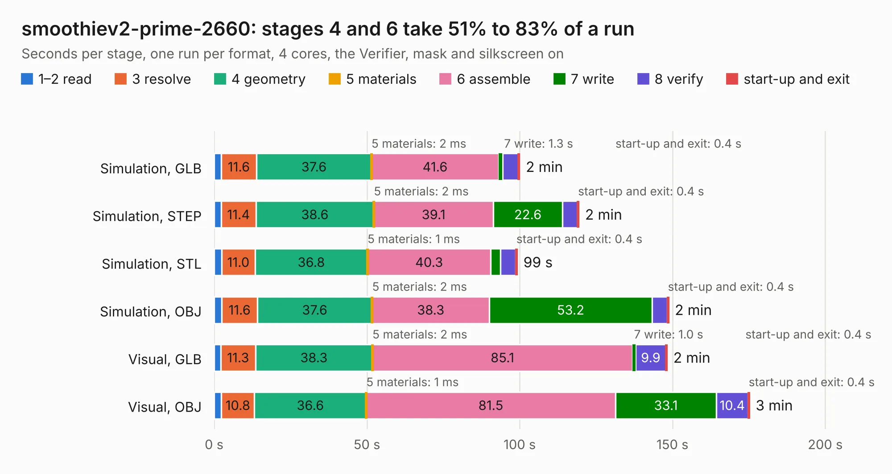

# 2556. smoothiev2-prime-2660

Board 2,556 of the 3,107 of [Corpus Testing](../Corpus-Testing.md), on [Corpus Page 24](../CorpusTestingPages/Corpus-Testing-24.md#2556-smoothiev2-prime-2660).

| Mode and format | 1–2 read | 3 resolve | 4 geometry | 5 materials | 6 assemble | 7 write | 8 verify | start-up and exit | Total |
|---|---:|---:|---:|---:|---:|---:|---:|---:|---:|
| Simulation, GLB | 2.3 | 11.6 | 37.6 | 2&nbsp;ms | 41.6 | 1.3 | 5.1 | 0.4 | 99.9 |
| Simulation, STEP | 2.3 | 11.4 | 38.6 | 2&nbsp;ms | 39.1 | 22.6 | 4.9 | 0.4 | 119.3 |
| Simulation, STL | 2.4 | 11.0 | 36.8 | 1&nbsp;ms | 40.3 | 3.2 | 5.0 | 0.4 | 99.1 |
| Simulation, OBJ | 2.5 | 11.6 | 37.6 | 2&nbsp;ms | 38.3 | 53.2 | 5.0 | 0.4 | 148.7 |
| Visual, GLB | 2.2 | 11.3 | 38.3 | 2&nbsp;ms | 85.1 | 1.0 | 9.9 | 0.4 | 148.2 |
| Visual, OBJ | 2.4 | 10.8 | 36.6 | 1&nbsp;ms | 81.5 | 33.1 | 10.4 | 0.4 | 175.1 |

<table align="center"><tr><td valign="top">

| Board | Repo: [smoothieware/smoothieboard2](https://github.com/smoothieware/smoothieboard2) Board: `smoothiev2-prime-2660.kicad_pcb` |
|---|---|
| Folder | V2_P11_Prime2660 |
| Complexity | 462&nbsp;/&nbsp;1000 (size&nbsp;312, features&nbsp;150) |
| KESE&nbsp;features | through vias, custom pads, rounded, trapezoid or chamfered pads, drill offsets, filled zones, copper drawings, copper text, curved board outline, TrueType text, stack-up, dielectric εr and tanδ, mask and silkscreen colours |
| Tested | 9th November 2026 |
| Copper&nbsp;layers | 4 |
| File&nbsp;format | KiCad 8 (20240108) |
| Parts,&nbsp;tracks,&nbsp;vias | 411, 8,241, 1,351 |
| Triangles,&nbsp;simulation | 8,598,648 in 411 parts |
| Verifier | PASS in all six runs |

</td><td valign="top">

<table>
<tr><th>File type</th><th>File size</th><th>Peak memory used</th></tr>
<tr><th colspan="3" align="left">Simulation</th></tr>
<tr><td>GLB</td><td align="right">289&nbsp;MB</td><td align="right">2.2&nbsp;GB</td></tr>
<tr><td>STEP</td><td align="right">1.3&nbsp;GB</td><td align="right">3.1&nbsp;GB</td></tr>
<tr><td>STL</td><td align="right">430&nbsp;MB</td><td align="right">2.2&nbsp;GB</td></tr>
<tr><td>OBJ</td><td align="right">919&nbsp;MB</td><td align="right">5.4&nbsp;GB</td></tr>
<tr><th colspan="3" align="left">Visual</th></tr>
<tr><td>GLB</td><td align="right">198&nbsp;MB</td><td align="right">3.2&nbsp;GB</td></tr>
<tr><td>OBJ</td><td align="right">641&nbsp;MB</td><td align="right">4.1&nbsp;GB</td></tr>
</table>

</td></tr></table>

| Previous | Next |
|:---|---:|
| [2555. motordriver](b2555b_smoothieboard2_motordriver.md) | [2557. smoothiev2-prime](b2557b_smoothieboard2_V2-P11-Prime2660_smoothiev2-prime.md) |
