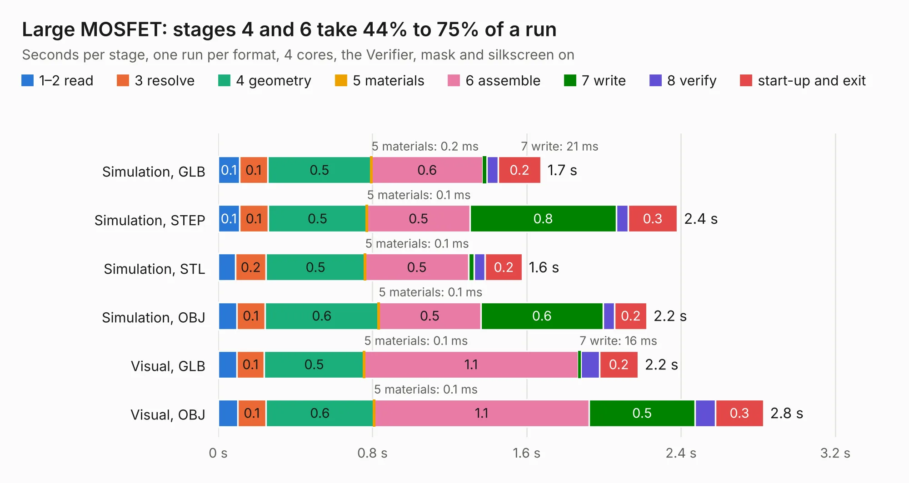

# 2557. Large MOSFET

Board 2,557 of the 3,121 of [Corpus Testing](../Corpus-Testing.md), on [Corpus Page 24](../CorpusTestingPages/Corpus-Testing-24.md#2557-large-mosfet).

| Mode and format | 1–2 read | 3 resolve | 4 geometry | 5 materials | 6 assemble | 7 write | 8 verify | start-up and exit | Total |
|---|---:|---:|---:|---:|---:|---:|---:|---:|---:|
| Simulation, GLB | 0.1 | 0.1 | 0.5 | 0.2&nbsp;ms | 0.6 | 21&nbsp;ms | 58&nbsp;ms | 0.2 | 1.7 |
| Simulation, STEP | 0.1 | 0.1 | 0.5 | 0.1&nbsp;ms | 0.5 | 0.8 | 61&nbsp;ms | 0.3 | 2.4 |
| Simulation, STL | 90&nbsp;ms | 0.2 | 0.5 | 0.1&nbsp;ms | 0.5 | 29&nbsp;ms | 58&nbsp;ms | 0.2 | 1.6 |
| Simulation, OBJ | 96&nbsp;ms | 0.1 | 0.6 | 0.1&nbsp;ms | 0.5 | 0.6 | 60&nbsp;ms | 0.2 | 2.2 |
| Visual, GLB | 96&nbsp;ms | 0.1 | 0.5 | 0.1&nbsp;ms | 1.1 | 16&nbsp;ms | 95&nbsp;ms | 0.2 | 2.2 |
| Visual, OBJ | 0.1 | 0.1 | 0.6 | 0.1&nbsp;ms | 1.1 | 0.5 | 0.1 | 0.3 | 2.8 |

<table align="center"><tr><td valign="top">

| Board | Repo: [smoothieware/smoothieboard2](https://github.com/smoothieware/smoothieboard2) Board: `Large MOSFET.kicad_pcb` |
|---|---|
| Folder | extension-boards / large-mosfet-kicad |
| Complexity | 120&nbsp;/&nbsp;1000 (size&nbsp;100, features&nbsp;20) |
| KESE&nbsp;features | filled zones |
| Tested | 9th November 2026 |
| Copper&nbsp;layers | 2 |
| File&nbsp;format | KiCad 4 (4) |
| Parts,&nbsp;tracks,&nbsp;vias | 9, 35, 0 |
| Triangles,&nbsp;simulation | 132,178 in 18 parts |
| Verifier | PASS in all six runs |

</td><td valign="top">

<table>
<tr><th>File type</th><th>File size</th><th>Peak memory used</th></tr>
<tr><th colspan="3" align="left">Simulation</th></tr>
<tr><td>GLB</td><td align="right">4.6&nbsp;MB</td><td align="right">193&nbsp;MB</td></tr>
<tr><td>STEP</td><td align="right">19&nbsp;MB</td><td align="right">194&nbsp;MB</td></tr>
<tr><td>STL</td><td align="right">6.6&nbsp;MB</td><td align="right">191&nbsp;MB</td></tr>
<tr><td>OBJ</td><td align="right">13&nbsp;MB</td><td align="right">188&nbsp;MB</td></tr>
<tr><th colspan="3" align="left">Visual</th></tr>
<tr><td>GLB</td><td align="right">3.3&nbsp;MB</td><td align="right">159&nbsp;MB</td></tr>
<tr><td>OBJ</td><td align="right">9.1&nbsp;MB</td><td align="right">158&nbsp;MB</td></tr>
</table>

</td></tr></table>

| Previous | Next |
|:---|---:|
| [2556. C.H.I.P-DIP](b2556b_smoothieboard2_C-H-I-P-DIP.md) | [2558. level-shifter](b2558b_smoothieboard2_level-shifter.md) |
