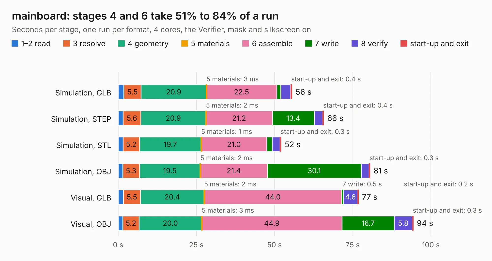

# 2558 mainboard

Board 2,558 of the 3,138 of [Corpus Testing](../Corpus-Testing.md), on [Corpus Page 24](../CorpusTestingPages/Corpus-Testing-24.md#2558-mainboard).

| Mode and format | 1–2 read | 3 resolve | 4 geometry | 5 materials | 6 assemble | 7 write | 8 verify | start-up and exit | Total |
|---|---:|---:|---:|---:|---:|---:|---:|---:|---:|
| Simulation, GLB | 1.8 | 5.5 | 20.9 | 3&nbsp;ms | 22.5 | 1.3 | 3.2 | 0.4 | 55.6 |
| Simulation, STEP | 1.6 | 5.6 | 20.9 | 2&nbsp;ms | 21.2 | 13.4 | 2.7 | 0.4 | 65.7 |
| Simulation, STL | 1.6 | 5.2 | 19.7 | 1&nbsp;ms | 21.0 | 1.7 | 2.5 | 0.3 | 52.1 |
| Simulation, OBJ | 1.5 | 5.3 | 19.5 | 2&nbsp;ms | 21.4 | 30.1 | 2.5 | 0.3 | 80.6 |
| Visual, GLB | 1.7 | 5.5 | 20.4 | 2&nbsp;ms | 44.0 | 0.5 | 4.6 | 0.2 | 76.8 |
| Visual, OBJ | 1.5 | 5.2 | 20.0 | 3&nbsp;ms | 44.9 | 16.7 | 5.8 | 0.3 | 94.4 |

<table align="center"><tr><td valign="top">

| Board | Repo: [sierra-lobo/mainboard-hardware](https://github.com/sierra-lobo/mainboard-hardware) Board: `mainboard.kicad_pcb` |
|---|---|
| Folder | revB-em |
| Complexity | 419&nbsp;/&nbsp;1000 (size&nbsp;289, features&nbsp;130) |
| KESE&nbsp;features | through vias, custom pads, rounded, trapezoid or chamfered pads, filled zones, copper drawings, curved board outline, stack-up, dielectric εr and tanδ, copper finish, mask and silkscreen colours |
| Tested | 9th November 2026 |
| Copper&nbsp;layers | 6 |
| File&nbsp;format | KiCad 7 (20221018) |
| Parts,&nbsp;tracks,&nbsp;vias | 380, 3,520, 732 |
| Triangles,&nbsp;simulation | 6,716,384 in 422 parts |
| Verifier | PASS in all six runs |

</td><td valign="top">

<table>
<tr><th>File type</th><th>File size</th><th>Peak memory used</th></tr>
<tr><th colspan="3" align="left">Simulation</th></tr>
<tr><td>GLB</td><td align="right">231&nbsp;MB</td><td align="right">1.7&nbsp;GB</td></tr>
<tr><td>STEP</td><td align="right">1.0&nbsp;GB</td><td align="right">2.2&nbsp;GB</td></tr>
<tr><td>STL</td><td align="right">336&nbsp;MB</td><td align="right">1.8&nbsp;GB</td></tr>
<tr><td>OBJ</td><td align="right">728&nbsp;MB</td><td align="right">4.4&nbsp;GB</td></tr>
<tr><th colspan="3" align="left">Visual</th></tr>
<tr><td>GLB</td><td align="right">127&nbsp;MB</td><td align="right">2.2&nbsp;GB</td></tr>
<tr><td>OBJ</td><td align="right">414&nbsp;MB</td><td align="right">2.8&nbsp;GB</td></tr>
</table>

</td></tr></table>

| Previous | Next |
|:---|---:|
| [2557 mainboard](b2557b_mainboard-hardware_revA-proto_mainboard.md) | [2559 mainboard_before_drastic](b2559b_mainboard-hardware_mainboard-before-drastic.md) |
