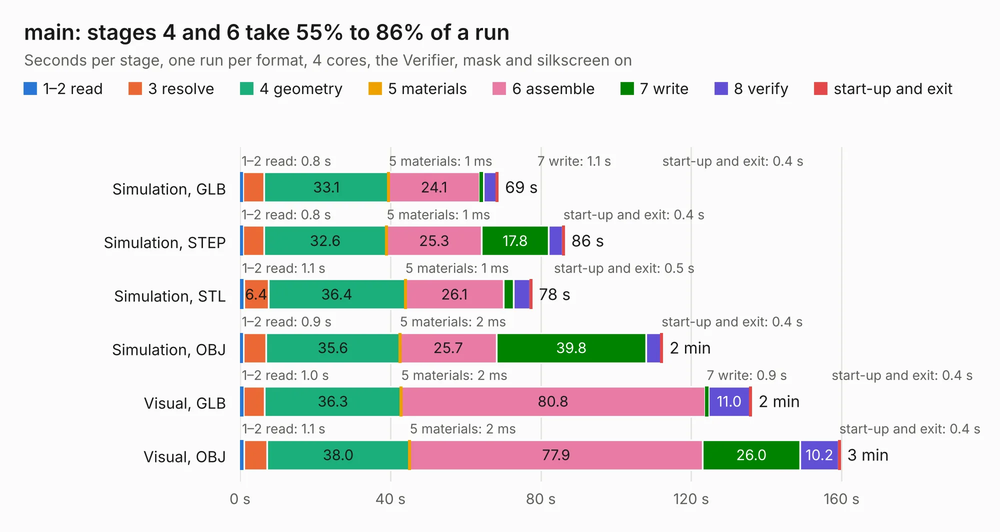

# 2561. main

Board 2,561 of the 3,107 of [Corpus Testing](../Corpus-Testing.md), on [Corpus Page 24](../CorpusTestingPages/Corpus-Testing-24.md#2561-main).

| Mode and format | 1–2 read | 3 resolve | 4 geometry | 5 materials | 6 assemble | 7 write | 8 verify | start-up and exit | Total |
|---|---:|---:|---:|---:|---:|---:|---:|---:|---:|
| Simulation, GLB | 0.8 | 5.6 | 33.1 | 1&nbsp;ms | 24.1 | 1.1 | 3.4 | 0.4 | 68.6 |
| Simulation, STEP | 0.8 | 5.6 | 32.6 | 1&nbsp;ms | 25.3 | 17.8 | 3.7 | 0.4 | 86.2 |
| Simulation, STL | 1.1 | 6.4 | 36.4 | 1&nbsp;ms | 26.1 | 2.7 | 4.4 | 0.5 | 77.6 |
| Simulation, OBJ | 0.9 | 6.0 | 35.6 | 2&nbsp;ms | 25.7 | 39.8 | 3.9 | 0.4 | 112.3 |
| Visual, GLB | 1.0 | 5.6 | 36.3 | 2&nbsp;ms | 80.8 | 0.9 | 11.0 | 0.4 | 136.0 |
| Visual, OBJ | 1.1 | 6.0 | 38.0 | 2&nbsp;ms | 77.9 | 26.0 | 10.2 | 0.4 | 159.6 |

<table align="center"><tr><td valign="top">

| Board | Repo: [snippyrow/-816-board](https://github.com/snippyrow/-816-board) Board: `main.kicad_pcb` |
|---|---|
| Complexity | 321&nbsp;/&nbsp;1000 (size&nbsp;221, features&nbsp;100) |
| KESE&nbsp;features | through vias, slotted holes, custom pads, rounded, trapezoid or chamfered pads, copper drawings, curved board outline, stack-up, dielectric εr and tanδ |
| Tested | 9th November 2026 |
| Copper&nbsp;layers | 2 |
| File&nbsp;format | KiCad 9 (20241229) |
| Parts,&nbsp;tracks,&nbsp;vias | 137, 7,943, 670 |
| Triangles,&nbsp;simulation | 7,106,946 in 256 parts |
| Verifier | PASS in all six runs |

</td><td valign="top">

<table>
<tr><th>File type</th><th>File size</th><th>Peak memory used</th></tr>
<tr><th colspan="3" align="left">Simulation</th></tr>
<tr><td>GLB</td><td align="right">239&nbsp;MB</td><td align="right">2.5&nbsp;GB</td></tr>
<tr><td>STEP</td><td align="right">1.1&nbsp;GB</td><td align="right">2.7&nbsp;GB</td></tr>
<tr><td>STL</td><td align="right">355&nbsp;MB</td><td align="right">2.6&nbsp;GB</td></tr>
<tr><td>OBJ</td><td align="right">749&nbsp;MB</td><td align="right">4.5&nbsp;GB</td></tr>
<tr><th colspan="3" align="left">Visual</th></tr>
<tr><td>GLB</td><td align="right">165&nbsp;MB</td><td align="right">2.6&nbsp;GB</td></tr>
<tr><td>OBJ</td><td align="right">530&nbsp;MB</td><td align="right">3.3&nbsp;GB</td></tr>
</table>

</td></tr></table>

| Previous | Next |
|:---|---:|
| [2560. main](b2560b_816-board_EXP-RAM-SCH_main.md) | [2562. db9](b2562b_Hermes-Lite2_db9.md) |
