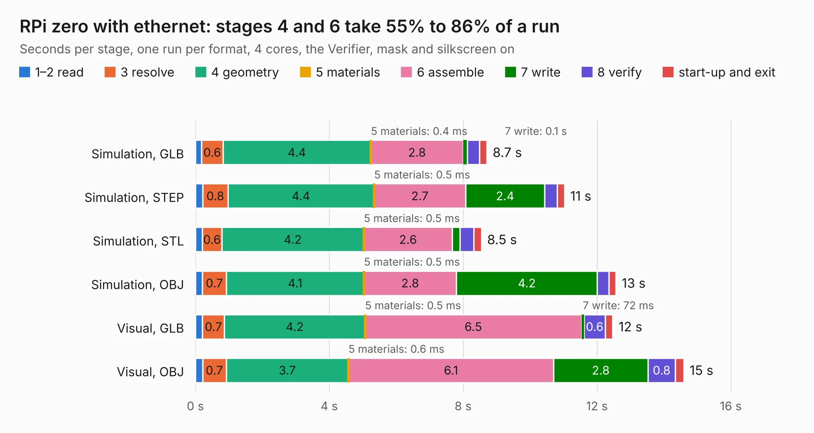

# 2561. RPi zero with ethernet

Board 2,561 of the 3,122 of [Corpus Testing](../Corpus-Testing.md), on [Corpus Page 24](../CorpusTestingPages/Corpus-Testing-24.md#2561-rpi-zero-with-ethernet).

| Mode and format | 1–2 read | 3 resolve | 4 geometry | 5 materials | 6 assemble | 7 write | 8 verify | start-up and exit | Total |
|---|---:|---:|---:|---:|---:|---:|---:|---:|---:|
| Simulation, GLB | 0.2 | 0.6 | 4.4 | 0.4&nbsp;ms | 2.8 | 0.1 | 0.4 | 0.2 | 8.7 |
| Simulation, STEP | 0.2 | 0.8 | 4.4 | 0.5&nbsp;ms | 2.7 | 2.4 | 0.4 | 0.2 | 11.0 |
| Simulation, STL | 0.2 | 0.6 | 4.2 | 0.5&nbsp;ms | 2.6 | 0.2 | 0.4 | 0.2 | 8.5 |
| Simulation, OBJ | 0.2 | 0.7 | 4.1 | 0.5&nbsp;ms | 2.8 | 4.2 | 0.3 | 0.2 | 12.6 |
| Visual, GLB | 0.2 | 0.7 | 4.2 | 0.5&nbsp;ms | 6.5 | 72&nbsp;ms | 0.6 | 0.2 | 12.5 |
| Visual, OBJ | 0.2 | 0.7 | 3.7 | 0.6&nbsp;ms | 6.1 | 2.8 | 0.8 | 0.3 | 14.6 |

<table align="center"><tr><td valign="top">

| Board | Repo: [smoothieware/smoothieboard2](https://github.com/smoothieware/smoothieboard2) Board: `RPi zero with ethernet.kicad_pcb` |
|---|---|
| Folder | extension-boards / raspberry-pi-zero-ethernet |
| Complexity | 251&nbsp;/&nbsp;1000 (size&nbsp;206, features&nbsp;45) |
| KESE&nbsp;features | through vias, filled zones, curved board outline |
| Tested | 9th November 2026 |
| Copper&nbsp;layers | 2 |
| File&nbsp;format | KiCad 4 (4) |
| Parts,&nbsp;tracks,&nbsp;vias | 38, 687, 35 |
| Triangles,&nbsp;simulation | 859,646 in 74 parts |
| Verifier | PASS in all six runs |

</td><td valign="top">

<table>
<tr><th>File type</th><th>File size</th><th>Peak memory used</th></tr>
<tr><th colspan="3" align="left">Simulation</th></tr>
<tr><td>GLB</td><td align="right">30&nbsp;MB</td><td align="right">375&nbsp;MB</td></tr>
<tr><td>STEP</td><td align="right">156&nbsp;MB</td><td align="right">448&nbsp;MB</td></tr>
<tr><td>STL</td><td align="right">43&nbsp;MB</td><td align="right">371&nbsp;MB</td></tr>
<tr><td>OBJ</td><td align="right">89&nbsp;MB</td><td align="right">611&nbsp;MB</td></tr>
<tr><th colspan="3" align="left">Visual</th></tr>
<tr><td>GLB</td><td align="right">19&nbsp;MB</td><td align="right">491&nbsp;MB</td></tr>
<tr><td>OBJ</td><td align="right">58&nbsp;MB</td><td align="right">473&nbsp;MB</td></tr>
</table>

</td></tr></table>

| Previous | Next |
|:---|---:|
| [2560. MechEndstop](b2560b_smoothieboard2_MechEndstop.md) | [2562. Rpi-zero](b2562b_smoothieboard2_Rpi-zero.md) |
