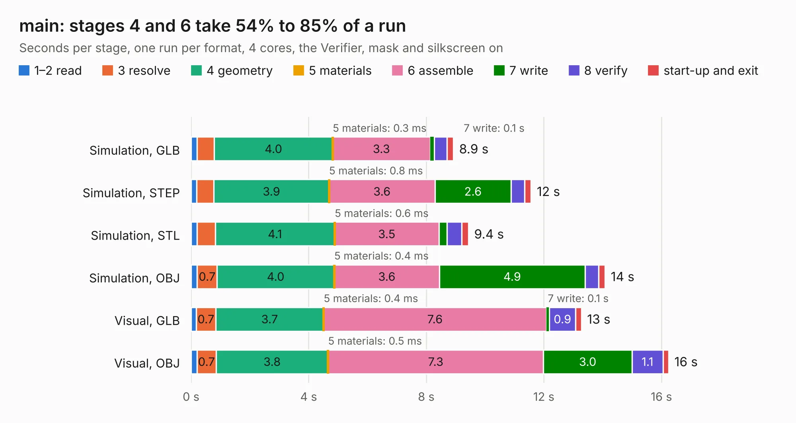

# 2563. main

Board 2,563 of the 3,110 of [Corpus Testing](../Corpus-Testing.md), on [Corpus Page 24](../CorpusTestingPages/Corpus-Testing-24.md#2563-main).

| Mode and format | 1–2 read | 3 resolve | 4 geometry | 5 materials | 6 assemble | 7 write | 8 verify | start-up and exit | Total |
|---|---:|---:|---:|---:|---:|---:|---:|---:|---:|
| Simulation, GLB | 0.2 | 0.6 | 4.0 | 0.3&nbsp;ms | 3.3 | 0.1 | 0.4 | 0.2 | 8.9 |
| Simulation, STEP | 0.2 | 0.6 | 3.9 | 0.8&nbsp;ms | 3.6 | 2.6 | 0.5 | 0.2 | 11.6 |
| Simulation, STL | 0.2 | 0.6 | 4.1 | 0.6&nbsp;ms | 3.5 | 0.3 | 0.5 | 0.2 | 9.4 |
| Simulation, OBJ | 0.2 | 0.7 | 4.0 | 0.4&nbsp;ms | 3.6 | 4.9 | 0.5 | 0.2 | 14.1 |
| Visual, GLB | 0.2 | 0.7 | 3.7 | 0.4&nbsp;ms | 7.6 | 0.1 | 0.9 | 0.2 | 13.3 |
| Visual, OBJ | 0.2 | 0.7 | 3.8 | 0.5&nbsp;ms | 7.3 | 3.0 | 1.1 | 0.2 | 16.2 |

<table align="center"><tr><td valign="top">

| Board | Repo: [snippyrow/-816-board](https://github.com/snippyrow/-816-board) Board: `main.kicad_pcb` |
|---|---|
| Folder | EXP / RAM_SCH |
| Complexity | 217&nbsp;/&nbsp;1000 (size&nbsp;162, features&nbsp;55) |
| KESE&nbsp;features | through vias, rounded, trapezoid or chamfered pads, filled zones, curved board outline |
| Tested | 9th November 2026 |
| Copper&nbsp;layers | 2 |
| File&nbsp;format | KiCad 9 (20241229) |
| Parts,&nbsp;tracks,&nbsp;vias | 17, 890, 43 |
| Triangles,&nbsp;simulation | 1,093,718 in 61 parts |
| Verifier | PASS in all six runs |

</td><td valign="top">

<table>
<tr><th>File type</th><th>File size</th><th>Peak memory used</th></tr>
<tr><th colspan="3" align="left">Simulation</th></tr>
<tr><td>GLB</td><td align="right">37&nbsp;MB</td><td align="right">455&nbsp;MB</td></tr>
<tr><td>STEP</td><td align="right">152&nbsp;MB</td><td align="right">573&nbsp;MB</td></tr>
<tr><td>STL</td><td align="right">55&nbsp;MB</td><td align="right">541&nbsp;MB</td></tr>
<tr><td>OBJ</td><td align="right">109&nbsp;MB</td><td align="right">763&nbsp;MB</td></tr>
<tr><th colspan="3" align="left">Visual</th></tr>
<tr><td>GLB</td><td align="right">23&nbsp;MB</td><td align="right">606&nbsp;MB</td></tr>
<tr><td>OBJ</td><td align="right">70&nbsp;MB</td><td align="right">666&nbsp;MB</td></tr>
</table>

</td></tr></table>

| Previous | Next |
|:---|---:|
| [2562. main](b2562b_816-board_EXP-GPU-SCH_main.md) | [2564. main](b2564b_816-board_main.md) |
