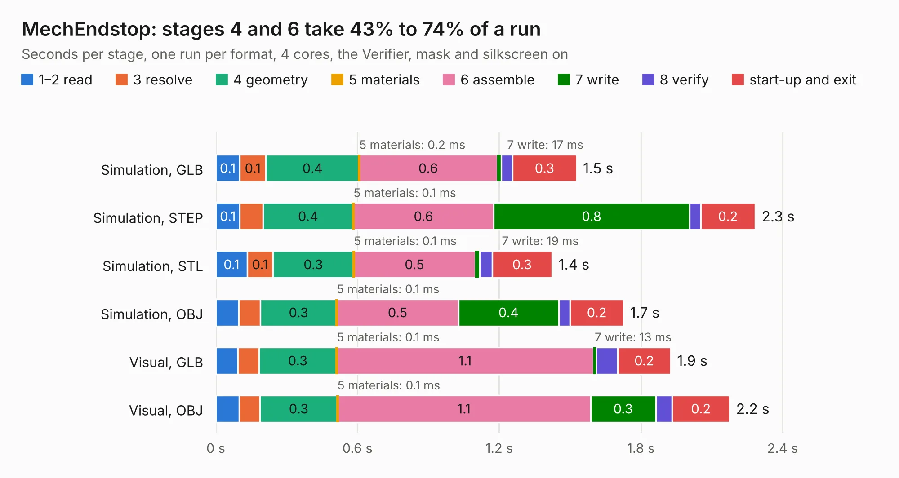

# 2564. MechEndstop

Board 2,564 of the 3,126 of [Corpus Testing](../Corpus-Testing.md), on [Corpus Page 24](../CorpusTestingPages/Corpus-Testing-24.md#2564-mechendstop).

| Mode and format | 1–2 read | 3 resolve | 4 geometry | 5 materials | 6 assemble | 7 write | 8 verify | start-up and exit | Total |
|---|---:|---:|---:|---:|---:|---:|---:|---:|---:|
| Simulation, GLB | 0.1 | 0.1 | 0.4 | 0.2&nbsp;ms | 0.6 | 17&nbsp;ms | 48&nbsp;ms | 0.3 | 1.5 |
| Simulation, STEP | 0.1 | 98&nbsp;ms | 0.4 | 0.1&nbsp;ms | 0.6 | 0.8 | 47&nbsp;ms | 0.2 | 2.3 |
| Simulation, STL | 0.1 | 0.1 | 0.3 | 0.1&nbsp;ms | 0.5 | 19&nbsp;ms | 53&nbsp;ms | 0.3 | 1.4 |
| Simulation, OBJ | 97&nbsp;ms | 92&nbsp;ms | 0.3 | 0.1&nbsp;ms | 0.5 | 0.4 | 48&nbsp;ms | 0.2 | 1.7 |
| Visual, GLB | 93&nbsp;ms | 90&nbsp;ms | 0.3 | 0.1&nbsp;ms | 1.1 | 13&nbsp;ms | 91&nbsp;ms | 0.2 | 1.9 |
| Visual, OBJ | 99&nbsp;ms | 88&nbsp;ms | 0.3 | 0.1&nbsp;ms | 1.1 | 0.3 | 70&nbsp;ms | 0.2 | 2.2 |

<table align="center"><tr><td valign="top">

| Board | Repo: [smoothieware/smoothieboard2](https://github.com/smoothieware/smoothieboard2) Board: `MechEndstop.kicad_pcb` |
|---|---|
| Folder | extension-boards / mechanical-endstop |
| Complexity | 115&nbsp;/&nbsp;1000 (size&nbsp;95, features&nbsp;20) |
| KESE&nbsp;features | filled zones |
| Tested | 9th November 2026 |
| Copper&nbsp;layers | 2 |
| File&nbsp;format | KiCad 4 (4) |
| Parts,&nbsp;tracks,&nbsp;vias | 6, 32, 0 |
| Triangles,&nbsp;simulation | 73,228 in 16 parts |
| Verifier | PASS in all six runs |

</td><td valign="top">

<table>
<tr><th>File type</th><th>File size</th><th>Peak memory used</th></tr>
<tr><th colspan="3" align="left">Simulation</th></tr>
<tr><td>GLB</td><td align="right">2.6&nbsp;MB</td><td align="right">171&nbsp;MB</td></tr>
<tr><td>STEP</td><td align="right">13&nbsp;MB</td><td align="right">180&nbsp;MB</td></tr>
<tr><td>STL</td><td align="right">3.7&nbsp;MB</td><td align="right">169&nbsp;MB</td></tr>
<tr><td>OBJ</td><td align="right">7.2&nbsp;MB</td><td align="right">167&nbsp;MB</td></tr>
<tr><th colspan="3" align="left">Visual</th></tr>
<tr><td>GLB</td><td align="right">1.7&nbsp;MB</td><td align="right">153&nbsp;MB</td></tr>
<tr><td>OBJ</td><td align="right">4.6&nbsp;MB</td><td align="right">153&nbsp;MB</td></tr>
</table>

</td></tr></table>

| Previous | Next |
|:---|---:|
| [2563. level-shifter](b2563b_smoothieboard2_level-shifter.md) | [2565. RPi zero with ethernet](b2565b_smoothieboard2_RPi-zero-with-ethernet.md) |
