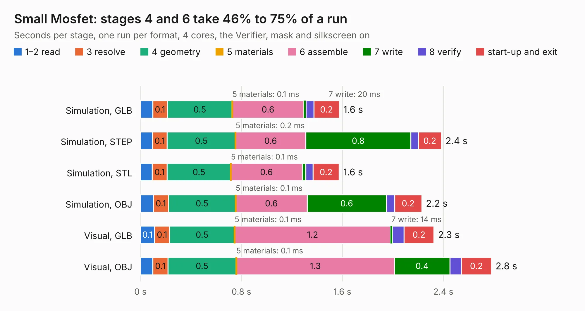

# 2564. Small Mosfet

Board 2,564 of the 3,123 of [Corpus Testing](../Corpus-Testing.md), on [Corpus Page 24](../CorpusTestingPages/Corpus-Testing-24.md#2564-small-mosfet).

| Mode and format | 1–2 read | 3 resolve | 4 geometry | 5 materials | 6 assemble | 7 write | 8 verify | start-up and exit | Total |
|---|---:|---:|---:|---:|---:|---:|---:|---:|---:|
| Simulation, GLB | 97&nbsp;ms | 0.1 | 0.5 | 0.1&nbsp;ms | 0.6 | 20&nbsp;ms | 61&nbsp;ms | 0.2 | 1.6 |
| Simulation, STEP | 95&nbsp;ms | 0.1 | 0.5 | 0.2&nbsp;ms | 0.6 | 0.8 | 60&nbsp;ms | 0.2 | 2.4 |
| Simulation, STL | 93&nbsp;ms | 0.1 | 0.5 | 0.1&nbsp;ms | 0.6 | 29&nbsp;ms | 59&nbsp;ms | 0.2 | 1.6 |
| Simulation, OBJ | 0.1 | 0.1 | 0.5 | 0.1&nbsp;ms | 0.6 | 0.6 | 65&nbsp;ms | 0.2 | 2.2 |
| Visual, GLB | 0.1 | 0.1 | 0.5 | 0.1&nbsp;ms | 1.2 | 14&nbsp;ms | 94&nbsp;ms | 0.2 | 2.3 |
| Visual, OBJ | 98&nbsp;ms | 0.1 | 0.5 | 0.1&nbsp;ms | 1.3 | 0.4 | 92&nbsp;ms | 0.2 | 2.8 |

<table align="center"><tr><td valign="top">

| Board | Repo: [smoothieware/smoothieboard2](https://github.com/smoothieware/smoothieboard2) Board: `Small Mosfet.kicad_pcb` |
|---|---|
| Folder | extension-boards / small-mosfet-kicad |
| Complexity | 122&nbsp;/&nbsp;1000 (size&nbsp;102, features&nbsp;20) |
| KESE&nbsp;features | filled zones |
| Tested | 9th November 2026 |
| Copper&nbsp;layers | 2 |
| File&nbsp;format | KiCad 4 (4) |
| Parts,&nbsp;tracks,&nbsp;vias | 9, 39, 0 |
| Triangles,&nbsp;simulation | 117,682 in 18 parts |
| Verifier | PASS in all six runs |

</td><td valign="top">

<table>
<tr><th>File type</th><th>File size</th><th>Peak memory used</th></tr>
<tr><th colspan="3" align="left">Simulation</th></tr>
<tr><td>GLB</td><td align="right">4.1&nbsp;MB</td><td align="right">183&nbsp;MB</td></tr>
<tr><td>STEP</td><td align="right">19&nbsp;MB</td><td align="right">195&nbsp;MB</td></tr>
<tr><td>STL</td><td align="right">5.9&nbsp;MB</td><td align="right">184&nbsp;MB</td></tr>
<tr><td>OBJ</td><td align="right">12&nbsp;MB</td><td align="right">181&nbsp;MB</td></tr>
<tr><th colspan="3" align="left">Visual</th></tr>
<tr><td>GLB</td><td align="right">2.9&nbsp;MB</td><td align="right">157&nbsp;MB</td></tr>
<tr><td>OBJ</td><td align="right">8.0&nbsp;MB</td><td align="right">156&nbsp;MB</td></tr>
</table>

</td></tr></table>

| Previous | Next |
|:---|---:|
| [2563. Rpi-zero](b2563b_smoothieboard2_Rpi-zero.md) | [2565. SPI Hub](b2565b_smoothieboard2_SPI-Hub.md) |
