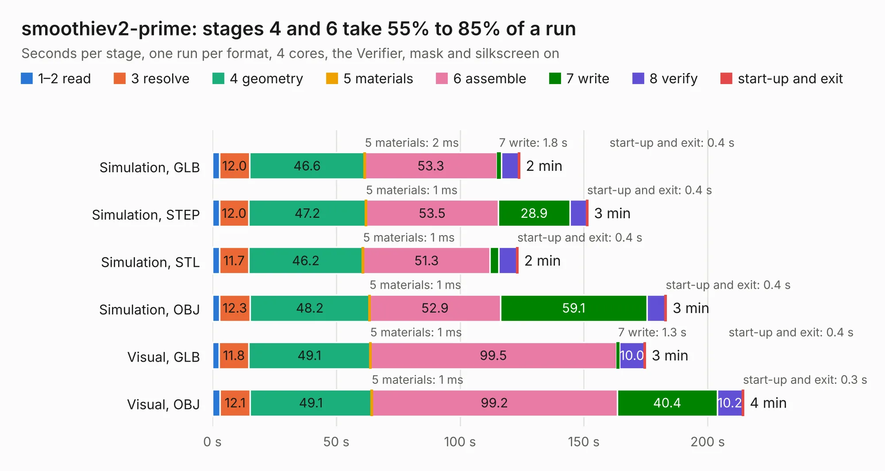

# 2568. smoothiev2-prime

Board 2,568 of the 3,118 of [Corpus Testing](../Corpus-Testing.md), on [Corpus Page 24](../CorpusTestingPages/Corpus-Testing-24.md#2568-smoothiev2-prime).

| Mode and format | 1–2 read | 3 resolve | 4 geometry | 5 materials | 6 assemble | 7 write | 8 verify | start-up and exit | Total |
|---|---:|---:|---:|---:|---:|---:|---:|---:|---:|
| Simulation, GLB | 2.9 | 12.0 | 46.6 | 2&nbsp;ms | 53.3 | 1.8 | 7.0 | 0.4 | 124.0 |
| Simulation, STEP | 2.8 | 12.0 | 47.2 | 1&nbsp;ms | 53.5 | 28.9 | 6.8 | 0.4 | 151.5 |
| Simulation, STL | 2.9 | 11.7 | 46.2 | 1&nbsp;ms | 51.3 | 3.6 | 7.3 | 0.4 | 123.3 |
| Simulation, OBJ | 2.9 | 12.3 | 48.2 | 1&nbsp;ms | 52.9 | 59.1 | 7.4 | 0.4 | 183.3 |
| Visual, GLB | 2.8 | 11.8 | 49.1 | 1&nbsp;ms | 99.5 | 1.3 | 10.0 | 0.4 | 174.8 |
| Visual, OBJ | 3.1 | 12.1 | 49.1 | 1&nbsp;ms | 99.2 | 40.4 | 10.2 | 0.3 | 214.4 |

<table align="center"><tr><td valign="top">

| Board | Repo: [smoothieware/smoothieboard2](https://github.com/smoothieware/smoothieboard2) Board: `smoothiev2-prime.kicad_pcb` |
|---|---|
| Folder | V2_P11_Prime2660 |
| Complexity | 408&nbsp;/&nbsp;1000 (size&nbsp;308, features&nbsp;100) |
| KESE&nbsp;features | through vias, custom pads, rounded, trapezoid or chamfered pads, drill offsets, filled zones, copper drawings, copper text, curved board outline |
| Tested | 9th November 2026 |
| Copper&nbsp;layers | 4 |
| File&nbsp;format | KiCad 5 (20171130) |
| Parts,&nbsp;tracks,&nbsp;vias | 437, 9,634, 1,439 |
| Triangles,&nbsp;simulation | 10,502,460 in 444 parts |
| Verifier | PASS in all six runs |

</td><td valign="top">

<table>
<tr><th>File type</th><th>File size</th><th>Peak memory used</th></tr>
<tr><th colspan="3" align="left">Simulation</th></tr>
<tr><td>GLB</td><td align="right">356&nbsp;MB</td><td align="right">2.7&nbsp;GB</td></tr>
<tr><td>STEP</td><td align="right">1.5&nbsp;GB</td><td align="right">3.8&nbsp;GB</td></tr>
<tr><td>STL</td><td align="right">525&nbsp;MB</td><td align="right">2.7&nbsp;GB</td></tr>
<tr><td>OBJ</td><td align="right">1.1&nbsp;GB</td><td align="right">6.6&nbsp;GB</td></tr>
<tr><th colspan="3" align="left">Visual</th></tr>
<tr><td>GLB</td><td align="right">244&nbsp;MB</td><td align="right">3.7&nbsp;GB</td></tr>
<tr><td>OBJ</td><td align="right">790&nbsp;MB</td><td align="right">4.9&nbsp;GB</td></tr>
</table>

</td></tr></table>

| Previous | Next |
|:---|---:|
| [2567. smoothiev2-prime-2660](b2567b_smoothieboard2_V2-P11-Prime2660_smoothiev2-prime-2660.md) | [2569. smoothiev2-prime](b2569b_smoothieboard2_V2-P12-Prime2590_smoothiev2-prime.md) |
