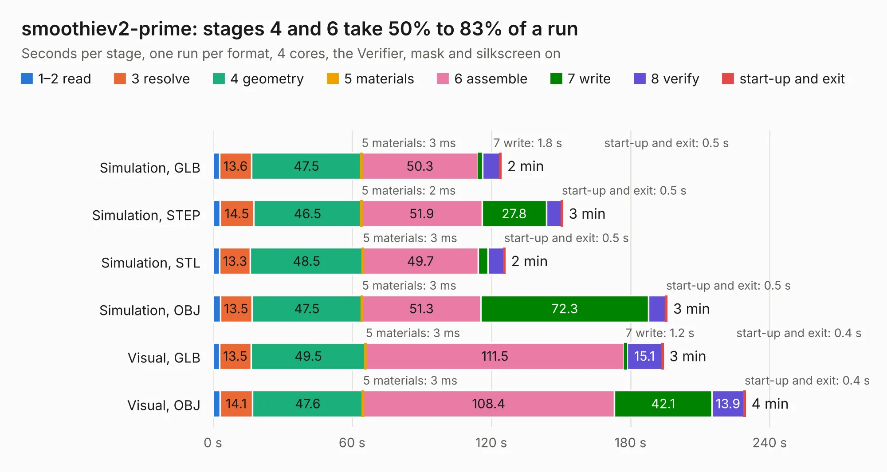

# 2568. smoothiev2-prime

Board 2,568 of the 3,117 of [Corpus Testing](../Corpus-Testing.md), on [Corpus Page 24](../CorpusTestingPages/Corpus-Testing-24.md#2568-smoothiev2-prime).

| Mode and format | 1–2 read | 3 resolve | 4 geometry | 5 materials | 6 assemble | 7 write | 8 verify | start-up and exit | Total |
|---|---:|---:|---:|---:|---:|---:|---:|---:|---:|
| Simulation, GLB | 2.9 | 13.6 | 47.5 | 3&nbsp;ms | 50.3 | 1.8 | 7.5 | 0.5 | 124.2 |
| Simulation, STEP | 3.0 | 14.5 | 46.5 | 2&nbsp;ms | 51.9 | 27.8 | 6.5 | 0.5 | 150.7 |
| Simulation, STL | 2.9 | 13.3 | 48.5 | 3&nbsp;ms | 49.7 | 4.1 | 6.8 | 0.5 | 125.8 |
| Simulation, OBJ | 3.2 | 13.5 | 47.5 | 3&nbsp;ms | 51.3 | 72.3 | 7.3 | 0.5 | 195.7 |
| Visual, GLB | 2.9 | 13.5 | 49.5 | 3&nbsp;ms | 111.5 | 1.2 | 15.1 | 0.4 | 194.1 |
| Visual, OBJ | 3.0 | 14.1 | 47.6 | 3&nbsp;ms | 108.4 | 42.1 | 13.9 | 0.4 | 229.4 |

<table align="center"><tr><td valign="top">

| Board | Repo: [smoothieware/smoothieboard2](https://github.com/smoothieware/smoothieboard2) Board: `smoothiev2-prime.kicad_pcb` |
|---|---|
| Folder | V2_P12_Prime2590 |
| Complexity | 458&nbsp;/&nbsp;1000 (size&nbsp;308, features&nbsp;150) |
| KESE&nbsp;features | through vias, custom pads, rounded, trapezoid or chamfered pads, drill offsets, filled zones, copper drawings, copper text, curved board outline, TrueType text, stack-up, dielectric εr and tanδ, mask and silkscreen colours |
| Tested | 9th November 2026 |
| Copper&nbsp;layers | 4 |
| File&nbsp;format | KiCad 8 (20240108) |
| Parts,&nbsp;tracks,&nbsp;vias | 437, 9,602, 1,439 |
| Triangles,&nbsp;simulation | 9,364,018 in 444 parts |
| Verifier | PASS in all six runs |

</td><td valign="top">

<table>
<tr><th>File type</th><th>File size</th><th>Peak memory used</th></tr>
<tr><th colspan="3" align="left">Simulation</th></tr>
<tr><td>GLB</td><td align="right">314&nbsp;MB</td><td align="right">2.4&nbsp;GB</td></tr>
<tr><td>STEP</td><td align="right">1.4&nbsp;GB</td><td align="right">3.4&nbsp;GB</td></tr>
<tr><td>STL</td><td align="right">468&nbsp;MB</td><td align="right">2.4&nbsp;GB</td></tr>
<tr><td>OBJ</td><td align="right">1.0&nbsp;GB</td><td align="right">5.9&nbsp;GB</td></tr>
<tr><th colspan="3" align="left">Visual</th></tr>
<tr><td>GLB</td><td align="right">216&nbsp;MB</td><td align="right">3.4&nbsp;GB</td></tr>
<tr><td>OBJ</td><td align="right">701&nbsp;MB</td><td align="right">4.3&nbsp;GB</td></tr>
</table>

</td></tr></table>

| Previous | Next |
|:---|---:|
| [2567. smoothiev2-prime](b2567b_smoothieboard2_V2-P11-Prime2660_smoothiev2-prime.md) | [2569. main](b2569b_816-board_EXP-GPU-SCH_main.md) |
