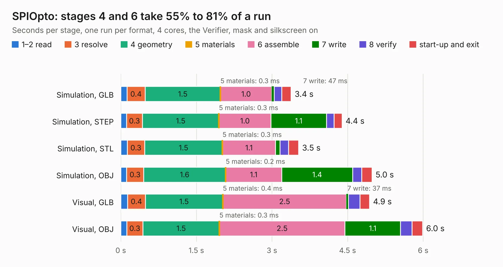

# 2569. SPIOpto

Board 2,569 of the 3,127 of [Corpus Testing](../Corpus-Testing.md), on [Corpus Page 24](../CorpusTestingPages/Corpus-Testing-24.md#2569-spiopto).

| Mode and format | 1–2 read | 3 resolve | 4 geometry | 5 materials | 6 assemble | 7 write | 8 verify | start-up and exit | Total |
|---|---:|---:|---:|---:|---:|---:|---:|---:|---:|
| Simulation, GLB | 0.1 | 0.4 | 1.5 | 0.3&nbsp;ms | 1.0 | 47&nbsp;ms | 0.1 | 0.2 | 3.4 |
| Simulation, STEP | 0.1 | 0.3 | 1.5 | 0.3&nbsp;ms | 1.0 | 1.1 | 0.2 | 0.2 | 4.4 |
| Simulation, STL | 0.1 | 0.3 | 1.5 | 0.3&nbsp;ms | 1.1 | 87&nbsp;ms | 0.2 | 0.2 | 3.5 |
| Simulation, OBJ | 0.1 | 0.3 | 1.6 | 0.2&nbsp;ms | 1.1 | 1.4 | 0.2 | 0.2 | 5.0 |
| Visual, GLB | 0.1 | 0.4 | 1.5 | 0.4&nbsp;ms | 2.5 | 37&nbsp;ms | 0.2 | 0.2 | 4.9 |
| Visual, OBJ | 0.1 | 0.3 | 1.5 | 0.3&nbsp;ms | 2.5 | 1.1 | 0.2 | 0.2 | 6.0 |

<table align="center"><tr><td valign="top">

| Board | Repo: [smoothieware/smoothieboard2](https://github.com/smoothieware/smoothieboard2) Board: `SPIOpto.kicad_pcb` |
|---|---|
| Folder | extension-boards / spi-opto-isolator |
| Complexity | 186&nbsp;/&nbsp;1000 (size&nbsp;151, features&nbsp;35) |
| KESE&nbsp;features | through vias, filled zones |
| Tested | 9th November 2026 |
| Copper&nbsp;layers | 2 |
| File&nbsp;format | KiCad 4 (4) |
| Parts,&nbsp;tracks,&nbsp;vias | 32, 248, 33 |
| Triangles,&nbsp;simulation | 359,254 in 53 parts |
| Verifier | PASS in all six runs |

</td><td valign="top">

<table>
<tr><th>File type</th><th>File size</th><th>Peak memory used</th></tr>
<tr><th colspan="3" align="left">Simulation</th></tr>
<tr><td>GLB</td><td align="right">13&nbsp;MB</td><td align="right">263&nbsp;MB</td></tr>
<tr><td>STEP</td><td align="right">59&nbsp;MB</td><td align="right">281&nbsp;MB</td></tr>
<tr><td>STL</td><td align="right">18&nbsp;MB</td><td align="right">253&nbsp;MB</td></tr>
<tr><td>OBJ</td><td align="right">37&nbsp;MB</td><td align="right">265&nbsp;MB</td></tr>
<tr><th colspan="3" align="left">Visual</th></tr>
<tr><td>GLB</td><td align="right">9.5&nbsp;MB</td><td align="right">263&nbsp;MB</td></tr>
<tr><td>OBJ</td><td align="right">27&nbsp;MB</td><td align="right">280&nbsp;MB</td></tr>
</table>

</td></tr></table>

| Previous | Next |
|:---|---:|
| [2568. SPI Hub](b2568b_smoothieboard2_SPI-Hub.md) | [2570. SPI PT100](b2570b_smoothieboard2_SPI-PT100.md) |
