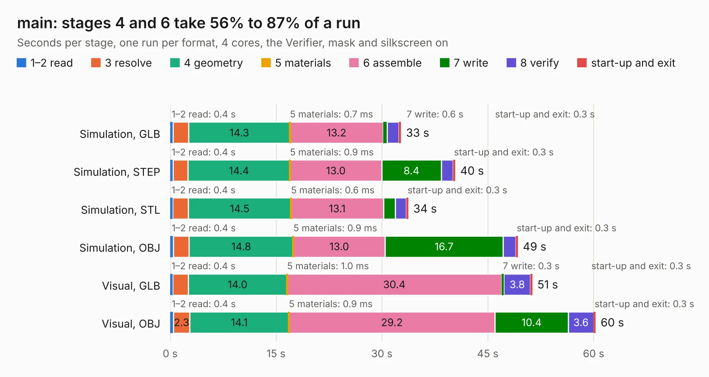

# 2570. main

Board 2,570 of the 3,118 of [Corpus Testing](../Corpus-Testing.md), on [Corpus Page 24](../CorpusTestingPages/Corpus-Testing-24.md#2570-main).

| Mode and format | 1–2 read | 3 resolve | 4 geometry | 5 materials | 6 assemble | 7 write | 8 verify | start-up and exit | Total |
|---|---:|---:|---:|---:|---:|---:|---:|---:|---:|
| Simulation, GLB | 0.4 | 2.2 | 14.3 | 0.7&nbsp;ms | 13.2 | 0.6 | 1.6 | 0.3 | 32.7 |
| Simulation, STEP | 0.4 | 2.1 | 14.4 | 0.9&nbsp;ms | 13.0 | 8.4 | 1.7 | 0.3 | 40.4 |
| Simulation, STL | 0.4 | 2.2 | 14.5 | 0.6&nbsp;ms | 13.1 | 1.7 | 1.6 | 0.3 | 33.7 |
| Simulation, OBJ | 0.4 | 2.3 | 14.8 | 0.9&nbsp;ms | 13.0 | 16.7 | 1.8 | 0.3 | 49.3 |
| Visual, GLB | 0.4 | 2.2 | 14.0 | 1.0&nbsp;ms | 30.4 | 0.3 | 3.8 | 0.3 | 51.3 |
| Visual, OBJ | 0.4 | 2.3 | 14.1 | 0.9&nbsp;ms | 29.2 | 10.4 | 3.6 | 0.3 | 60.3 |

<table align="center"><tr><td valign="top">

| Board | Repo: [snippyrow/-816-board](https://github.com/snippyrow/-816-board) Board: `main.kicad_pcb` |
|---|---|
| Folder | EXP / GPU_SCH |
| Complexity | 231&nbsp;/&nbsp;1000 (size&nbsp;196, features&nbsp;35) |
| KESE&nbsp;features | through vias, rounded, trapezoid or chamfered pads, curved board outline |
| Tested | 9th November 2026 |
| Copper&nbsp;layers | 2 |
| File&nbsp;format | KiCad 9 (20241229) |
| Parts,&nbsp;tracks,&nbsp;vias | 66, 2,767, 253 |
| Triangles,&nbsp;simulation | 3,510,342 in 160 parts |
| Verifier | PASS in all six runs |

</td><td valign="top">

<table>
<tr><th>File type</th><th>File size</th><th>Peak memory used</th></tr>
<tr><th colspan="3" align="left">Simulation</th></tr>
<tr><td>GLB</td><td align="right">121&nbsp;MB</td><td align="right">1.2&nbsp;GB</td></tr>
<tr><td>STEP</td><td align="right">600&nbsp;MB</td><td align="right">1.4&nbsp;GB</td></tr>
<tr><td>STL</td><td align="right">176&nbsp;MB</td><td align="right">1.3&nbsp;GB</td></tr>
<tr><td>OBJ</td><td align="right">374&nbsp;MB</td><td align="right">2.2&nbsp;GB</td></tr>
<tr><th colspan="3" align="left">Visual</th></tr>
<tr><td>GLB</td><td align="right">76&nbsp;MB</td><td align="right">1.4&nbsp;GB</td></tr>
<tr><td>OBJ</td><td align="right">240&nbsp;MB</td><td align="right">1.6&nbsp;GB</td></tr>
</table>

</td></tr></table>

| Previous | Next |
|:---|---:|
| [2569. smoothiev2-prime](b2569b_smoothieboard2_V2-P12-Prime2590_smoothiev2-prime.md) | [2571. main](b2571b_816-board_EXP-RAM-SCH_main.md) |
