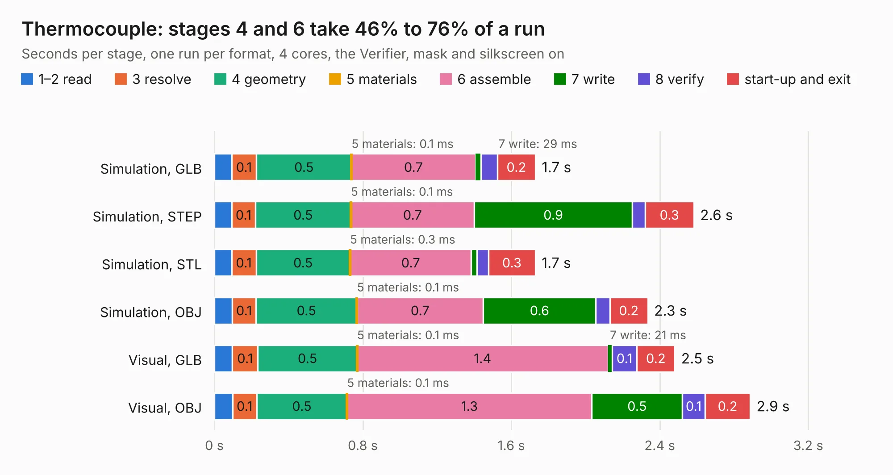

# 2571. Thermocouple

Board 2,571 of the 3,126 of [Corpus Testing](../Corpus-Testing.md), on [Corpus Page 24](../CorpusTestingPages/Corpus-Testing-24.md#2571-thermocouple).

| Mode and format | 1–2 read | 3 resolve | 4 geometry | 5 materials | 6 assemble | 7 write | 8 verify | start-up and exit | Total |
|---|---:|---:|---:|---:|---:|---:|---:|---:|---:|
| Simulation, GLB | 93&nbsp;ms | 0.1 | 0.5 | 0.1&nbsp;ms | 0.7 | 29&nbsp;ms | 89&nbsp;ms | 0.2 | 1.7 |
| Simulation, STEP | 94&nbsp;ms | 0.1 | 0.5 | 0.1&nbsp;ms | 0.7 | 0.9 | 68&nbsp;ms | 0.3 | 2.6 |
| Simulation, STL | 93&nbsp;ms | 0.1 | 0.5 | 0.3&nbsp;ms | 0.7 | 31&nbsp;ms | 62&nbsp;ms | 0.3 | 1.7 |
| Simulation, OBJ | 97&nbsp;ms | 0.1 | 0.5 | 0.1&nbsp;ms | 0.7 | 0.6 | 75&nbsp;ms | 0.2 | 2.3 |
| Visual, GLB | 97&nbsp;ms | 0.1 | 0.5 | 0.1&nbsp;ms | 1.4 | 21&nbsp;ms | 0.1 | 0.2 | 2.5 |
| Visual, OBJ | 98&nbsp;ms | 0.1 | 0.5 | 0.1&nbsp;ms | 1.3 | 0.5 | 0.1 | 0.2 | 2.9 |

<table align="center"><tr><td valign="top">

| Board | Repo: [smoothieware/smoothieboard2](https://github.com/smoothieware/smoothieboard2) Board: `Thermocouple.kicad_pcb` |
|---|---|
| Folder | extension-boards / thermocouple-interface |
| Complexity | 156&nbsp;/&nbsp;1000 (size&nbsp;111, features&nbsp;45) |
| KESE&nbsp;features | through vias, filled zones, curved board outline |
| Tested | 9th November 2026 |
| Copper&nbsp;layers | 2 |
| File&nbsp;format | KiCad 4 (4) |
| Parts,&nbsp;tracks,&nbsp;vias | 9, 54, 5 |
| Triangles,&nbsp;simulation | 116,554 in 20 parts |
| Verifier | PASS in all six runs |

</td><td valign="top">

<table>
<tr><th>File type</th><th>File size</th><th>Peak memory used</th></tr>
<tr><th colspan="3" align="left">Simulation</th></tr>
<tr><td>GLB</td><td align="right">4.2&nbsp;MB</td><td align="right">194&nbsp;MB</td></tr>
<tr><td>STEP</td><td align="right">22&nbsp;MB</td><td align="right">206&nbsp;MB</td></tr>
<tr><td>STL</td><td align="right">5.8&nbsp;MB</td><td align="right">186&nbsp;MB</td></tr>
<tr><td>OBJ</td><td align="right">12&nbsp;MB</td><td align="right">196&nbsp;MB</td></tr>
<tr><th colspan="3" align="left">Visual</th></tr>
<tr><td>GLB</td><td align="right">3.1&nbsp;MB</td><td align="right">158&nbsp;MB</td></tr>
<tr><td>OBJ</td><td align="right">8.5&nbsp;MB</td><td align="right">157&nbsp;MB</td></tr>
</table>

</td></tr></table>

| Previous | Next |
|:---|---:|
| [2570. SPI PT100](b2570b_smoothieboard2_SPI-PT100.md) | [2572. smoothiev2-prime-2660](b2572b_smoothieboard2_smoothiev2-prime-Proto9and10-Kicad5_smoothiev2-prime-2660.md) |
