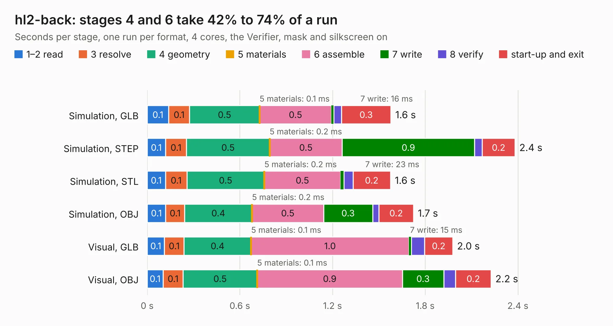

# 2572. hl2-back

Board 2,572 of the 3,109 of [Corpus Testing](../Corpus-Testing.md), on [Corpus Page 24](../CorpusTestingPages/Corpus-Testing-24.md#2572-hl2-back).

| Mode and format | 1–2 read | 3 resolve | 4 geometry | 5 materials | 6 assemble | 7 write | 8 verify | start-up and exit | Total |
|---|---:|---:|---:|---:|---:|---:|---:|---:|---:|
| Simulation, GLB | 0.1 | 0.1 | 0.5 | 0.1&nbsp;ms | 0.5 | 16&nbsp;ms | 49&nbsp;ms | 0.3 | 1.6 |
| Simulation, STEP | 0.1 | 0.1 | 0.5 | 0.2&nbsp;ms | 0.5 | 0.9 | 50&nbsp;ms | 0.2 | 2.4 |
| Simulation, STL | 0.1 | 0.1 | 0.5 | 0.2&nbsp;ms | 0.5 | 23&nbsp;ms | 58&nbsp;ms | 0.2 | 1.6 |
| Simulation, OBJ | 0.1 | 0.1 | 0.4 | 0.2&nbsp;ms | 0.5 | 0.3 | 41&nbsp;ms | 0.2 | 1.7 |
| Visual, GLB | 0.1 | 0.1 | 0.4 | 0.1&nbsp;ms | 1.0 | 15&nbsp;ms | 87&nbsp;ms | 0.2 | 2.0 |
| Visual, OBJ | 0.1 | 0.1 | 0.5 | 0.1&nbsp;ms | 0.9 | 0.3 | 76&nbsp;ms | 0.2 | 2.2 |

<table align="center"><tr><td valign="top">

| Board | Repo: [softerhardware/Hermes-Lite2](https://github.com/softerhardware/Hermes-Lite2) Board: `hl2-back.kicad_pcb` |
|---|---|
| Folder | hardware / enclosure / endcaps / ad5dz / hl2-back |
| Complexity | 47&nbsp;/&nbsp;1000 (size&nbsp;17, features&nbsp;30) |
| KESE&nbsp;features | slotted holes, filled zones |
| Tested | 9th November 2026 |
| Copper&nbsp;layers | 2 |
| File&nbsp;format | KiCad 5 (20171130) |
| Parts,&nbsp;tracks,&nbsp;vias | 0, 0, 0 |
| Triangles,&nbsp;simulation | 66,376 in 12 parts |
| Note | no components |
| Verifier | PASS in all six runs |

</td><td valign="top">

<table>
<tr><th>File type</th><th>File size</th><th>Peak memory used</th></tr>
<tr><th colspan="3" align="left">Simulation</th></tr>
<tr><td>GLB</td><td align="right">2.5&nbsp;MB</td><td align="right">180&nbsp;MB</td></tr>
<tr><td>STEP</td><td align="right">13&nbsp;MB</td><td align="right">183&nbsp;MB</td></tr>
<tr><td>STL</td><td align="right">3.3&nbsp;MB</td><td align="right">179&nbsp;MB</td></tr>
<tr><td>OBJ</td><td align="right">6.8&nbsp;MB</td><td align="right">179&nbsp;MB</td></tr>
<tr><th colspan="3" align="left">Visual</th></tr>
<tr><td>GLB</td><td align="right">2.0&nbsp;MB</td><td align="right">156&nbsp;MB</td></tr>
<tr><td>OBJ</td><td align="right">5.5&nbsp;MB</td><td align="right">155&nbsp;MB</td></tr>
</table>

</td></tr></table>

| Previous | Next |
|:---|---:|
| [2571. hl2-back-vert](b2571b_Hermes-Lite2_hl2-back-vert.md) | [2573. hl2-front-horiz](b2573b_Hermes-Lite2_hl2-front-horiz.md) |
