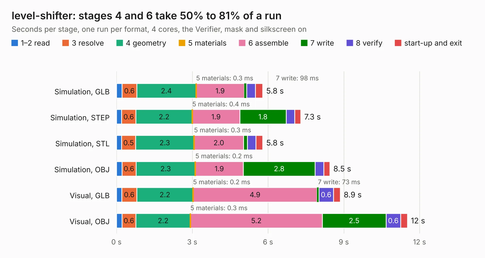

# 2573 level-shifter

Board 2,573 of the 3,138 of [Corpus Testing](../Corpus-Testing.md), on [Corpus Page 24](../CorpusTestingPages/Corpus-Testing-24.md#2573-level-shifter).

| Mode and format | 1–2 read | 3 resolve | 4 geometry | 5 materials | 6 assemble | 7 write | 8 verify | start-up and exit | Total |
|---|---:|---:|---:|---:|---:|---:|---:|---:|---:|
| Simulation, GLB | 0.2 | 0.6 | 2.4 | 0.3&nbsp;ms | 1.9 | 98&nbsp;ms | 0.4 | 0.3 | 5.8 |
| Simulation, STEP | 0.2 | 0.6 | 2.2 | 0.4&nbsp;ms | 1.9 | 1.8 | 0.3 | 0.2 | 7.3 |
| Simulation, STL | 0.2 | 0.5 | 2.3 | 0.3&nbsp;ms | 2.0 | 0.1 | 0.3 | 0.3 | 5.8 |
| Simulation, OBJ | 0.2 | 0.6 | 2.3 | 0.2&nbsp;ms | 1.9 | 2.8 | 0.3 | 0.2 | 8.5 |
| Visual, GLB | 0.2 | 0.6 | 2.2 | 0.2&nbsp;ms | 4.9 | 73&nbsp;ms | 0.6 | 0.3 | 8.9 |
| Visual, OBJ | 0.2 | 0.6 | 2.2 | 0.3&nbsp;ms | 5.2 | 2.5 | 0.6 | 0.3 | 11.5 |

<table align="center"><tr><td valign="top">

| Board | Repo: [smoothieware/smoothieboard2](https://github.com/smoothieware/smoothieboard2) Board: `level-shifter.kicad_pcb` |
|---|---|
| Folder | extension-boards / legacy-level-shifter-high-current |
| Complexity | 204&nbsp;/&nbsp;1000 (size&nbsp;169, features&nbsp;35) |
| KESE&nbsp;features | through vias, filled zones |
| Tested | 10th November 2026 |
| Copper&nbsp;layers | 2 |
| File&nbsp;format | KiCad 4 (4) |
| Parts,&nbsp;tracks,&nbsp;vias | 60, 520, 70 |
| Triangles,&nbsp;simulation | 499,498 in 45 parts |
| Verifier | PASS in all six runs |

</td><td valign="top">

<table>
<tr><th>File type</th><th>File size</th><th>Peak memory used</th></tr>
<tr><th colspan="3" align="left">Simulation</th></tr>
<tr><td>GLB</td><td align="right">17&nbsp;MB</td><td align="right">315&nbsp;MB</td></tr>
<tr><td>STEP</td><td align="right">91&nbsp;MB</td><td align="right">341&nbsp;MB</td></tr>
<tr><td>STL</td><td align="right">25&nbsp;MB</td><td align="right">304&nbsp;MB</td></tr>
<tr><td>OBJ</td><td align="right">51&nbsp;MB</td><td align="right">385&nbsp;MB</td></tr>
<tr><th colspan="3" align="left">Visual</th></tr>
<tr><td>GLB</td><td align="right">15&nbsp;MB</td><td align="right">381&nbsp;MB</td></tr>
<tr><td>OBJ</td><td align="right">44&nbsp;MB</td><td align="right">380&nbsp;MB</td></tr>
</table>

</td></tr></table>

| Previous | Next |
|:---|---:|
| [2572 Large MOSFET](b2572b_smoothieboard2_Large-MOSFET.md) | [2574 MechEndstop](b2574b_smoothieboard2_MechEndstop.md) |
