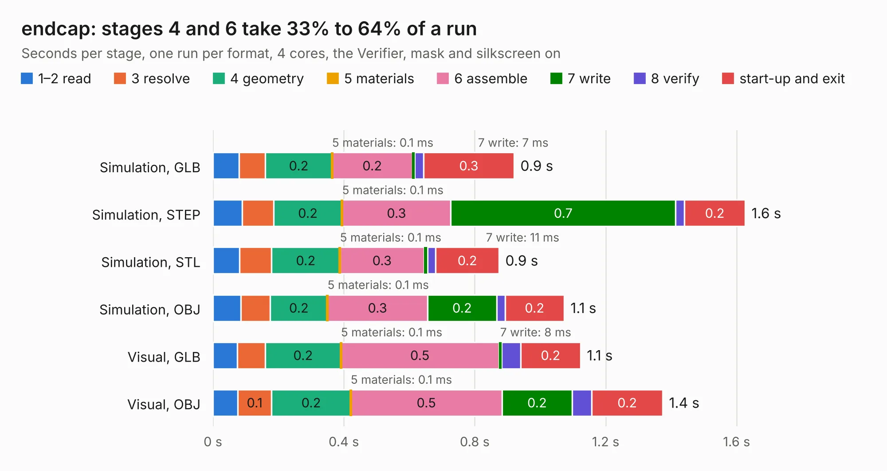

# 2574. endcap

Board 2,574 of the 3,100 of [Corpus Testing](../Corpus-Testing.md), on [Corpus Page 24](../CorpusTestingPages/Corpus-Testing-24.md#2574-endcap).

| Mode and format | 1–2 read | 3 resolve | 4 geometry | 5 materials | 6 assemble | 7 write | 8 verify | start-up and exit | Total |
|---|---:|---:|---:|---:|---:|---:|---:|---:|---:|
| Simulation, GLB | 80&nbsp;ms | 81&nbsp;ms | 0.2 | 0.1&nbsp;ms | 0.2 | 7&nbsp;ms | 27&nbsp;ms | 0.3 | 0.9 |
| Simulation, STEP | 90&nbsp;ms | 95&nbsp;ms | 0.2 | 0.1&nbsp;ms | 0.3 | 0.7 | 27&nbsp;ms | 0.2 | 1.6 |
| Simulation, STL | 81&nbsp;ms | 98&nbsp;ms | 0.2 | 0.1&nbsp;ms | 0.3 | 11&nbsp;ms | 25&nbsp;ms | 0.2 | 0.9 |
| Simulation, OBJ | 86&nbsp;ms | 89&nbsp;ms | 0.2 | 0.1&nbsp;ms | 0.3 | 0.2 | 25&nbsp;ms | 0.2 | 1.1 |
| Visual, GLB | 75&nbsp;ms | 85&nbsp;ms | 0.2 | 0.1&nbsp;ms | 0.5 | 8&nbsp;ms | 58&nbsp;ms | 0.2 | 1.1 |
| Visual, OBJ | 76&nbsp;ms | 0.1 | 0.2 | 0.1&nbsp;ms | 0.5 | 0.2 | 60&nbsp;ms | 0.2 | 1.4 |

<table align="center"><tr><td valign="top">

| Board | Repo: [softerhardware/Hermes-Lite2](https://github.com/softerhardware/Hermes-Lite2) Board: `endcap.kicad_pcb` |
|---|---|
| Folder | hardware / enclosure / endcaps / kf7o / hl2_55fb |
| Complexity | 69&nbsp;/&nbsp;1000 (size&nbsp;29, features&nbsp;40) |
| KESE&nbsp;features | slotted holes, filled zones, curved board outline |
| Tested | 9th November 2026 |
| Copper&nbsp;layers | 2 |
| File&nbsp;format | KiCad 5 (20171130) |
| Parts,&nbsp;tracks,&nbsp;vias | 2, 0, 0 |
| Triangles,&nbsp;simulation | 52,740 in 11 parts |
| Verifier | PASS in all six runs |

</td><td valign="top">

<table>
<tr><th>File type</th><th>File size</th><th>Peak memory used</th></tr>
<tr><th colspan="3" align="left">Simulation</th></tr>
<tr><td>GLB</td><td align="right">1.7&nbsp;MB</td><td align="right">71&nbsp;MB</td></tr>
<tr><td>STEP</td><td align="right">10&nbsp;MB</td><td align="right">177&nbsp;MB</td></tr>
<tr><td>STL</td><td align="right">2.6&nbsp;MB</td><td align="right">71&nbsp;MB</td></tr>
<tr><td>OBJ</td><td align="right">5.1&nbsp;MB</td><td align="right">83&nbsp;MB</td></tr>
<tr><th colspan="3" align="left">Visual</th></tr>
<tr><td>GLB</td><td align="right">1.4&nbsp;MB</td><td align="right">106&nbsp;MB</td></tr>
<tr><td>OBJ</td><td align="right">3.9&nbsp;MB</td><td align="right">107&nbsp;MB</td></tr>
</table>

</td></tr></table>

| Previous | Next |
|:---|---:|
| [2573. endcap](b2573b_Hermes-Lite2_hardware-enclosure-endcaps-kf7o-hl2-55f_endcap.md) | [2575. hermeslite](b2575b_Hermes-Lite2_hermeslite.md) |
