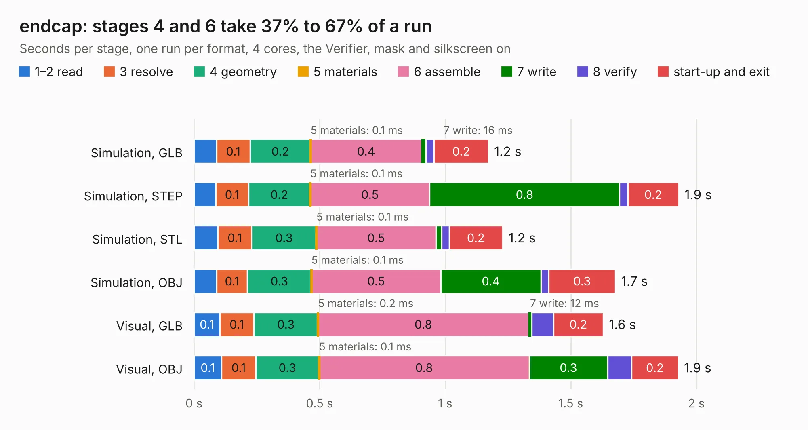

# 2577. endcap

Board 2,577 of the 3,106 of [Corpus Testing](../Corpus-Testing.md), on [Corpus Page 24](../CorpusTestingPages/Corpus-Testing-24.md#2577-endcap).

| Mode and format | 1–2 read | 3 resolve | 4 geometry | 5 materials | 6 assemble | 7 write | 8 verify | start-up and exit | Total |
|---|---:|---:|---:|---:|---:|---:|---:|---:|---:|
| Simulation, GLB | 89&nbsp;ms | 0.1 | 0.2 | 0.1&nbsp;ms | 0.4 | 16&nbsp;ms | 34&nbsp;ms | 0.2 | 1.2 |
| Simulation, STEP | 87&nbsp;ms | 0.1 | 0.2 | 0.1&nbsp;ms | 0.5 | 0.8 | 33&nbsp;ms | 0.2 | 1.9 |
| Simulation, STL | 94&nbsp;ms | 0.1 | 0.3 | 0.1&nbsp;ms | 0.5 | 23&nbsp;ms | 29&nbsp;ms | 0.2 | 1.2 |
| Simulation, OBJ | 90&nbsp;ms | 0.1 | 0.3 | 0.1&nbsp;ms | 0.5 | 0.4 | 32&nbsp;ms | 0.3 | 1.7 |
| Visual, GLB | 0.1 | 0.1 | 0.3 | 0.2&nbsp;ms | 0.8 | 12&nbsp;ms | 87&nbsp;ms | 0.2 | 1.6 |
| Visual, OBJ | 0.1 | 0.1 | 0.3 | 0.1&nbsp;ms | 0.8 | 0.3 | 95&nbsp;ms | 0.2 | 1.9 |

<table align="center"><tr><td valign="top">

| Board | Repo: [softerhardware/Hermes-Lite2](https://github.com/softerhardware/Hermes-Lite2) Board: `endcap.kicad_pcb` |
|---|---|
| Folder | hardware / enclosure / endcaps / kf7o / hl2_40f |
| Complexity | 62&nbsp;/&nbsp;1000 (size&nbsp;32, features&nbsp;30) |
| KESE&nbsp;features | filled zones, curved board outline |
| Tested | 9th November 2026 |
| Copper&nbsp;layers | 2 |
| File&nbsp;format | KiCad 5 (20171130) |
| Parts,&nbsp;tracks,&nbsp;vias | 3, 0, 0 |
| Triangles,&nbsp;simulation | 86,444 in 11 parts |
| Verifier | PASS in all six runs |

</td><td valign="top">

<table>
<tr><th>File type</th><th>File size</th><th>Peak memory used</th></tr>
<tr><th colspan="3" align="left">Simulation</th></tr>
<tr><td>GLB</td><td align="right">2.9&nbsp;MB</td><td align="right">187&nbsp;MB</td></tr>
<tr><td>STEP</td><td align="right">12&nbsp;MB</td><td align="right">186&nbsp;MB</td></tr>
<tr><td>STL</td><td align="right">4.3&nbsp;MB</td><td align="right">183&nbsp;MB</td></tr>
<tr><td>OBJ</td><td align="right">8.3&nbsp;MB</td><td align="right">183&nbsp;MB</td></tr>
<tr><th colspan="3" align="left">Visual</th></tr>
<tr><td>GLB</td><td align="right">2.2&nbsp;MB</td><td align="right">153&nbsp;MB</td></tr>
<tr><td>OBJ</td><td align="right">6.1&nbsp;MB</td><td align="right">152&nbsp;MB</td></tr>
</table>

</td></tr></table>

| Previous | Next |
|:---|---:|
| [2576. endcap](b2576b_Hermes-Lite2_hardware-enclosure-endcaps-kf7o-hl2-40b_endcap.md) | [2578. endcap](b2578b_Hermes-Lite2_hardware-enclosure-endcaps-kf7o-hl2-55b_endcap.md) |
