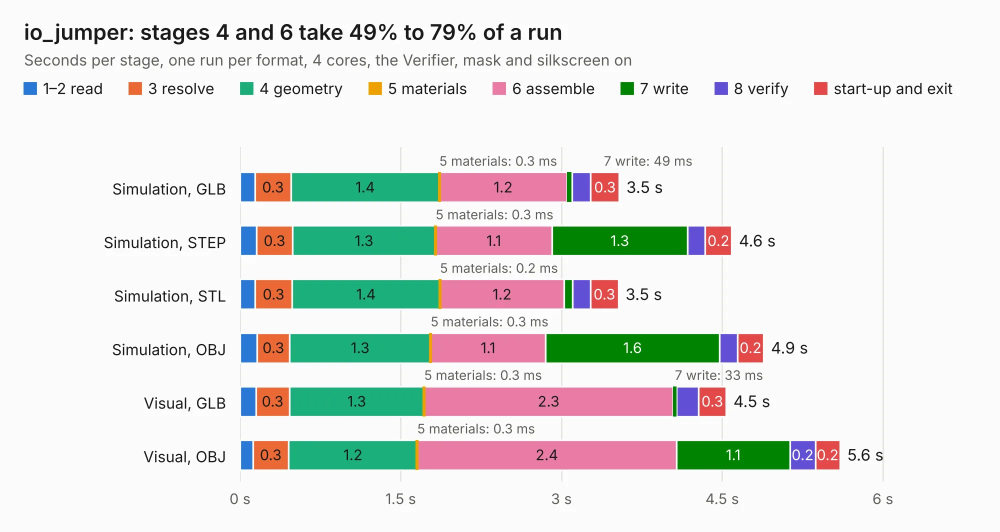

# 2577. io_jumper

Board 2,577 of the 3,121 of [Corpus Testing](../Corpus-Testing.md), on [Corpus Page 24](../CorpusTestingPages/Corpus-Testing-24.md#2577-io_jumper).

| Mode and format | 1–2 read | 3 resolve | 4 geometry | 5 materials | 6 assemble | 7 write | 8 verify | start-up and exit | Total |
|---|---:|---:|---:|---:|---:|---:|---:|---:|---:|
| Simulation, GLB | 0.1 | 0.3 | 1.4 | 0.3&nbsp;ms | 1.2 | 49&nbsp;ms | 0.2 | 0.3 | 3.5 |
| Simulation, STEP | 0.2 | 0.3 | 1.3 | 0.3&nbsp;ms | 1.1 | 1.3 | 0.2 | 0.2 | 4.6 |
| Simulation, STL | 0.1 | 0.3 | 1.4 | 0.2&nbsp;ms | 1.2 | 77&nbsp;ms | 0.2 | 0.3 | 3.5 |
| Simulation, OBJ | 0.2 | 0.3 | 1.3 | 0.3&nbsp;ms | 1.1 | 1.6 | 0.2 | 0.2 | 4.9 |
| Visual, GLB | 0.1 | 0.3 | 1.3 | 0.3&nbsp;ms | 2.3 | 33&nbsp;ms | 0.2 | 0.3 | 4.5 |
| Visual, OBJ | 0.1 | 0.3 | 1.2 | 0.3&nbsp;ms | 2.4 | 1.1 | 0.2 | 0.2 | 5.6 |

<table align="center"><tr><td valign="top">

| Board | Repo: [softerhardware/Hermes-Lite2](https://github.com/softerhardware/Hermes-Lite2) Board: `io_jumper.kicad_pcb` |
|---|---|
| Folder | hardware / companions / io_jumper |
| Complexity | 165&nbsp;/&nbsp;1000 (size&nbsp;130, features&nbsp;35) |
| KESE&nbsp;features | through vias, filled zones |
| Tested | 9th November 2026 |
| Copper&nbsp;layers | 2 |
| File&nbsp;format | KiCad 5 (20171130) |
| Parts,&nbsp;tracks,&nbsp;vias | 12, 162, 9 |
| Triangles,&nbsp;simulation | 273,400 in 39 parts |
| Verifier | PASS in all six runs |

</td><td valign="top">

<table>
<tr><th>File type</th><th>File size</th><th>Peak memory used</th></tr>
<tr><th colspan="3" align="left">Simulation</th></tr>
<tr><td>GLB</td><td align="right">9.4&nbsp;MB</td><td align="right">238&nbsp;MB</td></tr>
<tr><td>STEP</td><td align="right">40&nbsp;MB</td><td align="right">244&nbsp;MB</td></tr>
<tr><td>STL</td><td align="right">14&nbsp;MB</td><td align="right">225&nbsp;MB</td></tr>
<tr><td>OBJ</td><td align="right">27&nbsp;MB</td><td align="right">234&nbsp;MB</td></tr>
<tr><th colspan="3" align="left">Visual</th></tr>
<tr><td>GLB</td><td align="right">6.0&nbsp;MB</td><td align="right">237&nbsp;MB</td></tr>
<tr><td>OBJ</td><td align="right">17&nbsp;MB</td><td align="right">239&nbsp;MB</td></tr>
</table>

</td></tr></table>

| Previous | Next |
|:---|---:|
| [2576. db9](b2576b_Hermes-Lite2_db9.md) | [2578. n2adr](b2578b_Hermes-Lite2_n2adr.md) |
